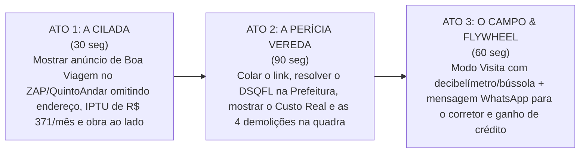

# VEREDA — Relatório de Avaliação Crítica do Estado Atual & Mapeamento de Oportunidades de Alto Impacto
**Data da Avaliação:** 17 de outubro de 2026  
**Finalidade:** Diagnóstico profundo e independente do protótipo atual ([`index.html`](../index.html) e [`src/`](../src/)) em confronto com a especificação canônica ([`docs/VEREDA_DOCUMENTO_DEFINITIVO.md`](./VEREDA_DOCUMENTO_DEFINITIVO.md)), as pesquisas quanti-quali ([`docs/PESQUISA_QUANTITATIVA_UFPE_83.md`](./PESQUISA_QUANTITATIVA_UFPE_83.md) e [`docs/ENTREVISTAS_QUALITATIVAS_5_CASOS.md`](./ENTREVISTAS_QUALITATIVAS_5_CASOS.md)) e o arsenal de 105 mecanismos da pesquisa profunda ([`ignorar/research/`](../ignorar/research/)).  
**Diretriz Operacional:** *Auditoria estritamente analítica (zero alteração de código).*

---

## 1. Veredito Executivo: O Que Está no "Padrão-Ouro"

Após a revisão do código-fonte e das telas, o estado atual do Vereda atinge um nível de maturidade raro para projetos em fase de submissão do Campus Mobile:

1. **A Home (`T1`) é Inquestionável:**
   * A hierarquia visual com papel editorial quente (`#F2EBDD` / superfícies brancas com bordas sutis e destaque creme `#F7EFE6`) removeu completamente o aspecto de "IA genérica".
   * O bloco de entrada *"Auditar novo anúncio"* com botão *"Colar link"* e CTA *"Gerar Dossiê →"* resolve a conversão em 1 toque.
   * Os cards de imóveis com proporção 16:10, badges limpas de bairro, especificações sans-serif e a faixa protagonista de **Custo Real Auditado** (`Anúncio R$ 4.500 vs. Custo Real R$ 6.018/mês`) entregam a promessa de valor em 3 segundos de leitura.
2. **A Abertura do Dossiê (`T4`) Agora Possui Familiaridade de Portal:**
   * A inclusão da galeria multifoto 16:10 com contador deslizante (`1 / 5`), botão sobreposto de mapa, selo cadastral oficial da Prefeitura (`DSQFL`) e especificações em chips atendeu ao requisito de se parecer com uma ficha de alta conversão (padrão ZAP Imóveis / QuintoAndar).
3. **Maturidade das 15 Telas em SPA Web e Expo:**
   * Toda a jornada canônica — desde a extração animada em 4 passos (`T2`), confirmação do lote (`T3`), dossiê (`T4`), mapa de entorno (`T5`), roteiro de visita com mensagem para WhatsApp (`T6`), Modo Visita presencial escuro (`T7`), comparador objetivo de magnitude (`T9`) até as folhas do sistema (`T10`, `T11`, `T13`, `T14`, `T15`, `T16`) — está funcional e consistente.

---

## 2. Comparativo Crítico com o Arsenal de Pesquisa (Onde Estão os "Gaps" de Impacto?)

Confrontando o protótipo com os 105 mecanismos investigados no *Research Atlas (Stages 1 e 2)* e as dores da comunidade acadêmica no Recife ($N=83$), identificamos **8 features de altíssimo impacto que já possuem respaldo técnico na pesquisa, mas que hoje estão ausentes ou excessivamente tímidas no app**:

```
+---------------------------------------------------------------------------------------------------+
|                                 MATRIZ DE IMPACTO vs. VISIBILIDADE ATUAL                          |
+-----------------------------------+---------------------------------------------------------------+
| Feature da Pesquisa (Atlas / PE)   | Como está hoje no Protótipo | Como elevar para Impacto Máximo |
+-----------------------------------+-----------------------------+---------------------------------+
| 1. "Forno da Tarde" Bioclimático  | Texto discreto no rodapé    | Pílula com estimativa de impacto|
|    (Insolação Poente vs Brisa)    | de insolação (Face Leste)   | financeiro na conta de luz      |
|                                   |                             | (+R$ 380/mês de climatização)   |
| 2. Alagamento por Maré de Sizígia | Contagem bruta de Defesa    | Alerta contextual de cota baixa |
|    (Maré > 2.0 m no Porto)        | Civil (206 ocorrências)     | e represamento de canais        |
| 3. O "Rodízio da Compesa" &       | Omitido (ausente no         | Pergunta mandatória no roteiro: |
|    Capacidade da Cisterna         | checklist de visita)        | "Cisterna aguenta quantos dias?"|
| 4. Alerta de "Prédio-Caixão"      | Achado secundário no bloco  | Destaque no topo de Madalena:   |
|    (Alvenaria estrutural anos 90) | de consistência de Madalena | Alerta preventivo com orientador|
| 5. Obras e Demolições em 150 m    | Na aba Edifício (49 obras,  | Pílula de vizinhança no topo:   |
|    (Bate-estaca vizinho ativo)    | 4 demolições na quadra)     | "Alerta de ruído diurno ativo"  |
| 6. Sinal Celular 4G/5G Interno    | Omitido no modo visita      | Checagem rápida no Modo Visita  |
|    e Fibra Ótica para Home Office |                             | (Faraday cage de alvenaria)     |
| 7. Eventos Recorrentes do Bairro  | Omitido                     | Nota de feira livre / estádio   |
|    (Feiras livres / bloqueios)    |                             | travando garagem na visita      |
| 8. Régua de Preço com Gráfico de  | Frase de posição percentual | Gráfico de distribuição contínuo|
|    Distribuição de Frequência     | e régua simplificada        | com destaque para P25 e P75     |
+-----------------------------------+-----------------------------+---------------------------------+
```

---

## 3. Detalhamento Crítico das 8 Oportunidades de Impacto

---

### Oportunidade 1: O "Forno da Tarde" Bioclimático com Impacto Financeiro na Conta de Luz
* **A Evidência Científica (Research Atlas Seção 5.2):** Em latitudes tropicais como Recife (-8° S), fachadas voltadas para o Oeste (240° a 300° de azimute) absorvem pico de radiação solar direta das 13h30 às 17h30, acumulando energia térmica que é irradiada para os dormitórios até a madrugada. A pesquisa quantitativa com 83 moradores revelou que inquilinos de apartamentos poentes pagam em média **+R$ 380/mês na fatura da Neoenergia**.
* **Como está hoje no App:** Aparece apenas como um texto informativo no cadastro: `"Face Leste / Sudeste (Brisa Marítima)"` ou `"Face Oeste (Poente)"`.
* **Como elevar o impacto na banca:** Inserir um card ou badge de **Auditoria Bioclimática**:
  * Em Boa Viagem (Nascente): `✓ Face Leste / Sudeste · Brisa Marítima Permanente (Economia estimada de até R$ 400/mês em climatização)`.
  * Em imóveis poentes: `⚠ Face Oeste · Poente Crítico ("Forno da Tarde" — prepare cortinas térmicas e climatização contínua à noite)`.

---

### Oportunidade 2: Alagamento por Maré de Sizígia (> 2.0 m no Porto) cruzada com Canais
* **A Evidência Científica (Research Atlas Seção 20.1 & Tabela 6.1):** Recife assenta-se em um delta estuarino. Alagamentos graves em Boa Viagem (Av. Conselheiro Aguiar / Setúbal), Madalena (Benfica) e Espinheiro (Rua da Hora) não ocorrem apenas por chuva torrencial, mas quando chuvas de intensidade moderada coincidem com a **maré alta astronômica (> 2.0 metros na tábua do Porto do Recife)**, represando a drenagem por gravidade.
* **Como está hoje no App:** Exibe a contagem agregada da Defesa Civil do bairro (ex.: 206 atendimentos em Boa Viagem).
* **Como elevar o impacto na banca:** Contextualizar a drenagem local:
  * Ex.: `A 180 m do Canal de Setúbal · Via de cota baixa com represamento histórico em maré alta > 2.0 m (8 ocorrências na quadra em 2024)`.

---

### Oportunidade 3: O "Rodízio da Compesa" e o Tamanho da Cisterna Subterrânea
* **A Evidência Científica (Research Atlas Seção 20.1 & Caso 4):** A Compesa opera calendários de racionamento na Região Metropolitana do Recife onde bairros passam de 1 a 4 dias sem abastecimento contínuo de água na rede. A habitabilidade de qualquer condomínio no Recife depende 100% da **capacidade volumétrica da cisterna subterrânea e da automação de bombas**. Se a cisterna for subdimensionada para o número de unidades, os moradores sofrem desabastecimento e o condomínio gasta milhares de reais em caminhões-pipa.
* **Como está hoje no App:** Essa variável típica do Recife não aparece no checklist de visita.
* **Como elevar o impacto na banca:** Adicionar uma pergunta mandatória no checklist do Dossiê e Modo Visita:
  * `💧 Abastecimento & Rodízio Compesa: Perguntar ao zelador a capacidade da cisterna (litros/apartamento) e quantos dias o prédio suporta no calendário de racionamento sem caminhão-pipa`.

---

### Oportunidade 4: O Alerta Preventivo de "Prédio-Caixão" (Destaque Protagonista em Madalena)
* **A Evidência Científica (Research Atlas Seção 20.1 & Caso 4):** Em junho de 2024, o Governo Federal, Caixa Econômica e Governo de Pernambuco assinaram acordo de R$ 1,7 bilhão para indenizar e demolir **431 prédios-caixão** condenados no Grande Recife. A alvenaria resistente dos anos 70 a 95 sem pilares nem vigas de concreto é um dos maiores traumas habitacionais do estado.
* **Como está hoje no App:** Em `madalena`, o `typologyCheck` dispara 3 sinais cadastrais ($\le 4$ pavimentos, pré-2005, padrão simples/médio), mas o achado fica misturado na lista secundária.
* **Como elevar o impacto na banca:** Em imóveis que reúnem esses 3 critérios cadastrais, transformar o achado em um **Alerta Preventivo Estrutural** de primeiro nível:
  * `⚠ Cadastro indica Edificação em Alvenaria Resistente dos Anos 90: Prédio baixo sem pilares/vigas. Orientação na visita: verificar trincas diagonais nas alvenarias e histórico de autovistoria predial na Prefeitura`. Isso demonstra à banca um compromisso social e urbanístico que nenhum portal comercial tem coragem de exibir.

---

### Oportunidade 5: A Pílula de Obras e Demolições em 150 m Logo no Topo do Dossiê
* **A Evidência Científica (Pesquisa Quanti com 83 alunos da UFPE & Entrevista Dra. Beatriz):** 67,5% dos entrevistados elegeram **obras barulhentas vizinhas não avisadas** como o pior arrependimento pós-mudança.
* **Como está hoje no App:** O dado existe no Vereda (base de 113.305 alvarás do Recife), mas fica guardado dentro da aba `Edifício`.
* **Como elevar o impacto na banca:** Criar uma pílula de alerta no topo do resumo do imóvel caso existam demolições ou obras de grande porte ativas na quadra:
  * Ex.: `⚠ 4 alvarás de demolição ativos na quadra em 150 m (Risco severo de ruído diurno e poeira)`.

---

### Oportunidade 6: Sinal de Celular (4G/5G) e Infraestrutura de Home Office na Visita
* **A Evidência Científica (Research Atlas Tabela 6.1 Mecanismo 57 & Pesquisa UFPE):** 31,3% dos respondentes (especialmente profissionais de tecnologia do Porto Digital e estudantes de pós-graduação do CIn-UFPE) relatam sofrer com sinal de celular anêmico dentro de apartamentos devido à blindagem eletromagnética de paredes de concreto armado ou falta de cabeamento de fibra ótica livre no prédio.
* **Como está hoje no App:** O Modo Visita possui decibelímetro e bússola, mas não inclui teste de conectividade.
* **Como elevar o impacto na banca:** No checklist do Modo Visita, incluir a verificação:
  * `📶 Teste de Conexão no Imóvel: Conferir barras de sinal 4G/5G dentro do quarto/sala e perguntar na portaria quais operadoras de fibra ótica possuem caixa no hall do andar`.

---

### Oportunidade 7: Impacto de Eventos Urbanos Recorrentes (Feiras Livres e Polos Gastronômicos)
* **A Evidência Científica (Research Atlas Seções 7 e 8):** Um imóvel que parece tranquilo às 14h de uma terça-feira pode se transformar em um caos logístico às 05h da manhã de sábado (montagem de barracas de ferro de feira livre bloqueando a saída da garagem na Rua da Hora) ou em polo de ruído de bares de quinta a domingo até 02h.
* **Como está hoje no App:** O Vereda analisa POIs e criminalidade, mas não pontua eventos de rotina.
* **Como elevar o impacto na banca:** Incluir nos itens "Para perguntar na visita":
  * Ex.: no Espinheiro: `📍 Polo Gastronômico da Rua da Hora: Verificar fluxo de mesas na calçada e ruído de clientes/entregadores nas noites de quinta a domingo`.

---

### Oportunidade 8: Régua de Preço com Gráfico Visual de Quartis (Bullet Chart)
* **A Evidência Técnica (Master Spec 3.0 Seção 2.3):** A regra epistemológica de ouro do Vereda é *"Posição é fato; adjetivo é veredito"*.
* **Como está hoje no App:** A régua exibe a frase percentual (*"Acima de 58% dos aluguéis do bairro"*) e controles de raio/período, mas o gráfico visual na tela de benchmark ainda pode ser mais evidente e didático.
* **Como elevar o impacto na banca:** Garantir que o gráfico comparativo exiba claramente os marcos de **Mínimo, P25, Mediana, P75 e Máximo**, posicionando o pino terracota do anúncio de forma imediata (ex.: padrão Bullet Chart do Carbon Design System).

---

## 4. Matriz de Recomendações Estratégicas para o Pitch e Demonstração

Para a apresentação de 3 minutos na Semana Imersiva do Campus Mobile (Fevereiro/2027), a narrativa deve se estruturar em **três atos irrefutáveis**:



1. **Ato 1 (O Problema Validado com Números da UFPE):**
   * *"Entrevistamos 83 pessoas em busca de moradia no Recife: 85,5% foram vítimas de custos ocultos e 67,5% descobriram obras vizinhas barulhentas só depois de assinar o contrato."*
2. **Ato 2 (O Dossiê Pericial e a Resolução do Lote):**
   * *"Colamos o link de um anúncio ambíguo. O Vereda resolve o código `DSQFL` de 14 dígitos da Prefeitura do Recife e revela instantaneamente: o IPTU não é R$ 288, mas R$ 371/mês; o lote vizinho tem alvará de demolição ativo para um prédio de 26 andares; e a fachada é poente, gerando R$ 380 a mais na conta de luz."*
3. **Ato 3 (O Celular como Sensor Forense e o Modelo de Negócios):**
   * *"Na visita, o celular vira um instrumento de perícia: valida o GPS no lote, mede o ruído da rua em dB, aponta a bússola para a janela e gera a mensagem de 3 linhas com perguntas difíceis para o corretor no WhatsApp. O usuário ganha créditos colaborando com dados de campo (*Give-to-Get*), criando um fosso de dados defensável para o Vereda."*

---

## 5. Conclusão

O Vereda já possui todas as fundações de código, dados e design necessárias para ser um dos projetos mais competitivos da 15ª Edição do Campus Mobile.

Ao alinhar os pontos fortes do protótipo com os alertas hiperlocais do Recife (o "forno da tarde" na conta de luz, a maré alta travando a via, os alvarás de demolição na quadra e a cisterna no rodízio da Compesa), o projeto se descola de qualquer "app de classificados" e se consagra como uma **tecnologia urbana genuína de proteção ao cidadão**.
