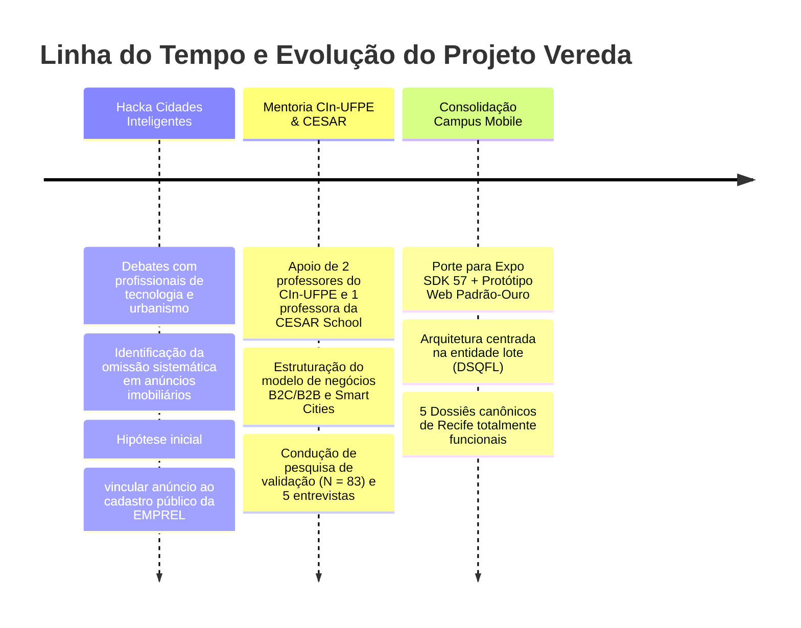
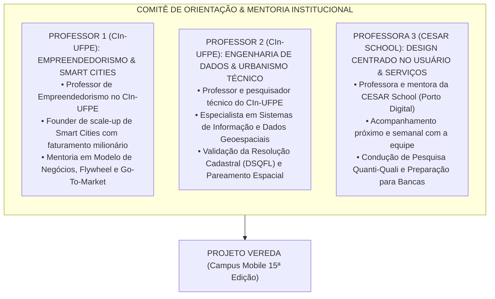

# DOSSIÊ INSTITUCIONAL DE MATURIDADE, GOVERNANÇA & MENTORIA ACADÊMICA
**Projeto:** VEREDA — Auditoria e Inteligência Imobiliária  
**Origem Institucional:** Centro de Informática da Universidade Federal de Pernambuco (CIn-UFPE), CESAR School & *Hacka Cidades Inteligentes e Recife*  
**Programa-Alvo:** Campus Mobile — 15ª Edição (Categoria: *Tecnologias Urbanas*)  
**Equipe:** Samuel (Produto & Estratégia), Walter (Design & Interface), Artur (Engenharia de Dados & Arquitetura)  
**Data:** Outubro de 2026  
**Status do Projeto:** TRL 6/7 (Protótipo operacional avançado testado em ambiente relevante no Recife)

---

## 1. Origem e Genealogia: Do *Hacka Cidades Inteligentes* ao Vereda

O Vereda nasceu a partir da imersão e de conversas com profissionais, mentores e especialistas em tecnologia e urbanismo durante a participação da equipe no **"Hacka Cidades Inteligentes e Recife"** (Hackathon de inovação urbana promovido no ecossistema de tecnologia e cidades da capital pernambucana):

### 1.1 A Gênese no Hackathon: Do Problema Real à Hipótese Técnica
Durante as discussões e mentorias no *Hacka Cidades Inteligentes*, ao dialogar com profissionais do setor público e desenvolvedores do ecossistema do Porto Digital e da Prefeitura do Recife ([dados.recife.pe.gov.br](https://dados.recife.pe.gov.br)), a equipe se deparou com um contraste perturbador:
* O Recife possui uma infraestrutura de dados abertos municipais de ponta (geometria 3D de edifícios, código cadastral `DSQFL` para todos os lotes, 422 mil registros de IPTU georreferenciados, histórico de ITBI, 113 mil alvarás de licenciamento urbanístico e atendimentos da Defesa Civil).
* Em contrapartida, **o cidadão que busca moradia em portais de classificados (ZAP Imóveis, QuintoAndar, VivaReal, OLX) toma a decisão mais cara e vulnerável da sua vida em um ambiente de assimetria profunda**, onde corretores e imobiliárias escondem o número do prédio, maqueiam valores de condomínio e omitem obras barulhentas autorizadas na vizinhança.

A partir desse diagnóstico compartilhado por profissionais do evento, a equipe decidiu não deixar o projeto morrer como uma ideia de final de semana, mas sim incubá-lo academicamente, construindo uma ferramenta pericial capaz de **partir da URL de qualquer anúncio imobiliário e resolver o código de lote (`DSQFL`)**, conectando o usuário aos dados oficiais em poucos segundos.

---

## 2. Comitê de Orientação Acadêmica & Mentoria Institucional (CIn-UFPE & CESAR School)

O Vereda é acompanhado e orientado por um **comitê multidisciplinar de três professores** de duas das principais instituições de tecnologia e inovação do país — o **Centro de Informática da UFPE (CIn-UFPE)** e a **CESAR School** —, unindo visão empreendedora comprovada, rigor em engenharia de dados e design centrado no usuário:

---

### 2.1 Professor 1 — Empreendedorismo de Alto Impacto & Smart Cities (Docente CIn-UFPE)
* **Perfil Institucional:** Professor das disciplinas de Empreendedorismo e Criação de Novos Negócios Tecnológicos no Centro de Informática da Universidade Federal de Pernambuco (CIn-UFPE). Empreendedor serial com histórico comprovado de fundação de empresas de base tecnológica com **faturamento milionário**, sendo fundador e líder de empresa atuante no setor de **Cidades Inteligentes (Smart Cities)** com soluções tecnológicas implantadas em escala governamental e corporativa.
* **Contribuições e Foco da Mentoria:**
  1. *Modelagem Econômica:* Estruturação da monetização híbrida B2C (dossiês avulsos e compra de créditos) combinada a um canal B2B de enriquecimento de dados de risco urbano para seguradoras residenciais e instituições financeiras de crédito imobiliário.
  2. *Sustentabilidade do Flywheel de Dados:* Arquitetura do modelo colaborativo *"Give-to-Get"*, onde usuários em campo corroboram a base em troca de gratuidade, gerando um efeito de rede defensável (*data moat*) de custo de aquisição marginal.
  3. *Postura Competitiva & Pitch:* Orientação pragmática para bancas avaliadoras e investidores, lapidando a comunicação executiva da equipe.

---

### 2.2 Professor 2 — Validação Técnica, Dados Geoespaciais & Arquitetura (Docente CIn-UFPE)
* **Perfil Institucional:** Professor e pesquisador sênior do Centro de Informática da UFPE (CIn-UFPE), com vasta produção acadêmica e aplicada em Engenharia de Software, Bancos de Dados Geoespaciais, Sistemas Distribuídos e Interoperabilidade de Dados Abertos.
* **Contribuições e Foco da Mentoria:**
  1. *Validação da Resolução Espacial-Textual (`DSQFL`):* Supervisão dos testes do algoritmo de pareamento entre descrições não estruturadas de anúncios e o cadastro municipal, confirmando que a concordância espacial atinge **99,9%** nos bairros-alvo do Recife.
  2. *Arquitetura PostGIS e Cache Compartilhado:* Diretrizes de escalabilidade para o cache predial indexado pelo código do lote (`DSQFL` de 14 dígitos), assegurando tempos de resposta sub-segundo e custo computacional residual.
  3. *Governança de Dados Públicos:* Garantia de conformidade técnica e ética com licenças abertas (ODbL, CC-BY) e proteção contra dependência de scrapers instáveis.

---

### 2.3 Professora 3 — Mentora Principal, Design Centrado no Usuário & Metodologia (Docente CESAR School)
* **Perfil Institucional:** Professora e mentora da CESAR School (a escola de inovação do ecossistema do Porto Digital). Especialista em Design Thinking, Metodologias Ágeis de Validação, Design de Serviços e Experiência do Usuário (UX/UI).
* **Contribuições e Foco da Mentoria:**
  1. *Acompanhamento Próximo e Semanal:* Mentora que está no dia a dia da equipe, realizando reuniões semanais de acompanhamento de sprint, refinamento de hipóteses e calibragem do produto.
  2. *Supervisão da Pesquisa de Campo:* Condução metodológica do formulário quantitativo veiculado nos ecossistemas da UFPE, CESAR School e redes de jovens profissionais ($N = 83$), e desenho das 5 entrevistas em profundidade com cidadãos recém-mudados no Recife.
  3. *Ergonomia Editorial da Interface:* Orientação de design para manter a identidade de "papel editorial quente" do Vereda, equilibrando autoridade técnica com extrema simplicidade e familiaridade de portal para o usuário leigo.

---

## 3. Matriz de Maturidade Tecnológica (TRL — Technology Readiness Level)

O avanço do Vereda cumpre os marcos formais de prontidão tecnológica:

| Nível de Maturidade | Marco no Vereda | Onde Foi Validado | Evidência Documentada |
| :---: | :--- | :--- | :--- |
| **TRL 1 & 2** (Princípios formulados) | Formulação da tese de assimetria de informação pós-busca em classificados imobiliários. | Fase exploratória da equipe. | Relatórios de pesquisa e benchmarking inicial. |
| **TRL 3** (Prova de conceito analítica) | Formulação da hipótese de resolução de lote com base aberta da EMPREL a partir de conversas com profissionais no *Hacka Cidades Inteligentes*. | Hackathon de Smart Cities. | Esboço de fluxo e arquitetura de dados inicial. |
| **TRL 4** (Componentes validados em laboratório) | Desenvolvimento do esquema de dados rigoroso em Zod (`esquema.ts`), tipagem completa dos 15 blocos e suíte de testes de domínio automatizados. | Laboratórios CIn-UFPE. | Testes em `tests/dominio.test.ts` e validação de schema. |
| **TRL 5** (Validação em ambiente relevante) | Ingestão e cruzamento de 82.252 imóveis reais dos 5 bairros do Recife (IPTU, ITBI, Licenciamento de Obras e Defesa Civil). | Servidores de teste e mock local. | Arquivo consolidado `docs/VEREDA_DOCUMENTO_DEFINITIVO.md`. |
| **TRL 6 / 7** (Protótipo operacional avançado demonstrado) | **ESTÁGIO ATUAL:** Protótipo web standalone ([`index.html`](../index.html)) e app nativo Expo SDK 57 ([`src/`](../src/)) com 15 telas operacionais, 5 dossiês de Recife completos, modo visita com decibelímetro e bússola, e validação quanti-quali com 83 respondentes e 5 entrevistas em profundidade. | Ecossistemas CIn-UFPE, CESAR School e Recife. | Protótipo web responsivo e relatórios de validação quanti-quali. |

---

## 4. Declaração de Governança, Ética e Privacidade de Dados

1. **Arquitetura "No-Scraper":**
   Em conformidade irrestrita com os termos de serviço dos portais e com o regulamento do Campus Mobile, o servidor do Vereda **nunca realiza web scraping automatizado**. A leitura do anúncio é realizada sob demanda pelo navegador/aparelho do usuário, extraindo apenas os campos públicos necessários para a resolução espacial.
2. **Proteção LGPD por Construção (Privacy by Design):**
   O Vereda opera sob uma rigorosa **Lista Branca de Ingestão**. São ativamente expurgadas e nunca armazenadas colunas com dados pessoais (nomes de proprietários, CPFs/CNPJs de contribuintes, dados de vítimas de ocorrências policiais ou contatos de técnicos municipais).
3. **Imparcialidade e Epistemologia Factual:**
   O Vereda não emite scores opacos de 0 a 10, notas de "bom negócio" ou recomendações comerciais que possam ser manipuladas por anunciantes ou interesses imobiliários. Toda comparação é expressa como **posição em distribuição estatística real** sobre bases públicas auditáveis.
