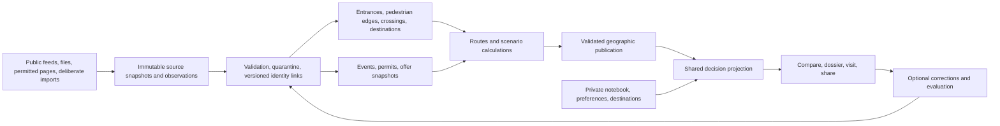

# VEREDA — Official Application and Evaluation Plan

Version 1.0 · 14 November 2026 · Implementation has not started under this plan.

**Build a decision product: help someone choose which home to visit, what to verify, what to negotiate, and where else to search.** The defensible asset is the maintained relationship between a home, its entrances, usable routes, daily destinations, dated events, changing offers, and the decisions these facts support.

This is the execution authority for the research-driven application programme requested on 14 November 2026. It covers the five pilot neighbourhoods—Boa Viagem, Casa Forte, Graças, Espinheiro, and Madalena—before expansion. It specifies the application of the collected research, the data acquisition work, the experiments, and the evaluation necessary to earn each capability. It is a plan, not a claim that those capabilities already work.

## 1. Authority, scope, and navigation

The current user's instructions take precedence. Within project documentation, this plan supersedes conflicting **sequence, feature priority, and research-application guidance** in the [earlier research plan](../dados/literatura/urbanismo-nova-leva/plano-desenvolvimento.md), the [integrated assessment's provisional schedule](../dados/literatura/parecer-tecnico-integrado.md), and the [October execution plan](../plano-recife/README.md). The [project specification](../VEREDA_DOCUMENTO_DEFINITIVO.md) remains background for the product and business; its blanket precedence statement does not override this newer programme. Existing persistence, platform, accessibility, brand, and working feature contracts continue unless an epoch deliberately changes them with regression evidence.

Epoch identifiers are **VE00–VE17**. They are distinct from the historical `EP00–EP14`; historical completion never automatically completes a VE epoch. Preserve earlier reports, research, and the existing user's work. Do not restart the application or replace its architecture wholesale.

All new planning documents, execution records, and AI reports in this programme are in English. This does **not** request translation of the Portuguese application interface. Examples below are English specifications for the existing product language.

| Document | Purpose |
|---|---|
| This plan | Product decisions, application catalogue, architecture, data acquisition, detailed epochs, and acceptance |
| [Research traceability](RESEARCH-TRACEABILITY.md) | All 217 PDFs individually mapped to an application or evaluation; metadata-only discoveries kept separate |
| [Experiment cards](EXPERIMENT-CARDS.md) | Twenty product hypotheses and eighteen advanced test options, with baselines, required labels, and stop rules |
| [Repository baseline](REPOSITORY-BASELINE.md) | Verified code/test entry points, inherited weaknesses, and preservation mapping for the legacy F01–F80 catalogue |
| [Epoch tracker](EPOCH-TRACKER.md) | Current execution states, dependencies, outcomes, and evidence links |
| [Reusable execution prompt](EXECUTION-PROMPT.md) | Instructions for an implementation AI to execute and evaluate one epoch at a time |
| [Integrated technical assessment](../dados/literatura/parecer-tecnico-integrado.md) | Source reasoning, measured data limitations, and product thesis |
| [Audit measurements](../dados/literatura/evidencias-do-parecer.json) | Machine-readable snapshot supporting the inherited baseline |
| [Original individual assessment](../dados/literatura/avaliacao-do-acervo.md) | Original Apply / Experiment / Reference decisions and discovery records |

**Programme boundaries.** The core works from listings already imported through the WebView or manual entry. No new mandatory account, document upload, sensor session, or long preference form. Reuse saved destinations and optional household preferences. Private documents and advanced sensors are extension experiments. Existing functionality remains available where compatible; this plan does not require deleting it.

The prototype can be inventive and use explicit scenario parameters. Customer screens should express the useful conclusion clearly, with one compact date/source cue when it matters and expandable evidence. Do not cover every card with “inference,” “prediction,” or “approximation” badges. Keep the distinctions in the data contracts and evaluation. Synthetic scenarios belong in development fixtures or a clearly separate demonstration context; they must not silently enter a person's saved real-property record.

## 2. What the programme starts with

These are findings from the 14 November review and static inspection. VE00 must verify them against the checkout actually being used. Changing counts are expected; unexplained changes are not.

| Existing asset or defect | Consequence for implementation | Repository evidence |
|---|---|---|
| Expo / React Native app with listing import, saved notebook, dossier, comparison, costs, visits, and solar analysis | Extend the actual decision flow. Do not build a new dashboard beside it. | [App scripts and dependencies](../../package.json), [comparison](../../src/app/%28abas%29/comparar.tsx), [dossier](../../src/app/%28abas%29/dossie.tsx) |
| Published municipal index covers 7,206 buildings in 72 neighbourhoods; 2,688 are in the five-area pilot | Scope a reliable pilot without discarding broader municipal identifiers. | [Publication entry point](../../src/dados/recife/publicacaoGerada.ts), [measurements](../dados/literatura/evidencias-do-parecer.json) |
| All 2,688 pilot street codes matched the downloaded official street network; 2,622 centroids lay within 50 m of their own street geometry | Strong starting point for joins; street proximity is not a confirmed entrance or a routable sidewalk. | [Integrated assessment](../dados/literatura/parecer-tecnico-integrado.md) |
| Experimental `raw` and `processado` files are separate from data distributed under `src/dados/recife` and `src/dados/sol` | A collector's `ok` flag is not proof of publication or useful coverage. Establish one promotion path. | [Exploratory processor](../dados/infra/scripts/09-processar.mjs), [index builder](../../scripts/dados/construir-indice-recife.mjs) |
| `rotina.ts` returns straight-line distance. The ×1.32 distance approximation is in `estimarDeslocamentoMensal` | Preserve the distinction between distance, scenario cost, scheduled travel time, and measured travel time. | [Routine](../../src/dados/rotina.ts), [cost breakdown](../../src/dados/custoPorPartes.ts) |
| GTFS exploratory ZIP and published corridor generator use different feed versions; the corridor count ignores active service dates | Correct calendars and directions before presenting daily or time-window transit supply. Never apply the inherited −0.75° shift without independent coordinate evidence. | [GTFS generator](../../scripts/dados/camadas-inteligentes-recife.mjs), [prior validation](../dados/validacao-defesa-civil-gtfs.md) |
| Google Maps research stored 100 searches with no extracted entities. The recorded Overpass attempt failed across 18 categories. | Acquisition must be judged by valid entities and coverage, not attempts or HTTP status. | [Research data directory](../dados/raw/), [OSM collector](../dados/infra/scripts/10-osm-pois.mjs) |
| OSM collector has Recife boxes near latitude −8.8; the later amenities collector builds malformed selectors and references `todosPois` outside its block | Save regression fixtures for coordinate, query, and collector-output defects; prefer one dated regional extract over repeated per-category requests. | [OSM collector](../dados/infra/scripts/10-osm-pois.mjs), [amenities collector](../dados/infra/scripts/12-amenidades.mjs) |
| Published CNEFE subset has 5,661 education, health, and religious-service points; 96.5% of pilot buildings are within 300 m of at least one | Generic proximity scarcely differentiates choices. Obtain groceries/pharmacies, verify entrances, and compute usable alternatives. | [CNEFE layer](../../src/dados/recife/servicos-cnefe.json), [assessment](../dados/literatura/parecer-tecnico-integrado.md) |
| Flood category reaches seven streets in the published aggregate. Twenty recoverable 2020–2024 rows include fourteen records on one administrative date. | Build an episode ledger; fourteen administrative records are not fourteen independent floods. | [Street parser](../../scripts/dados/rua/nucleo.mjs), [measurements](../dados/literatura/evidencias-do-parecer.json) |
| Drainage calls are near 2,515 pilot buildings; traffic-injury calls near 2,588; pedestrian-collision calls near 772, with overlapping catchments | A binary nearby-record flag is weak. Link episodes and crossings to the route actually used. | [Assessment](../dados/literatura/parecer-tecnico-integrado.md) |
| GLO-30 is a surface model resampled to roughly 155 m; thermal analysis uses four Landsat dates; ERA5 series is shared across the five areas | None supplies apartment temperature, curb elevation, or individual flood probability. Test broader context or acquire appropriate measurements. | [Environmental layer](../../src/dados/recife/camadasAmbientais.ts), [assessment](../dados/literatura/parecer-tecnico-integrado.md) |
| Solar engine and four geometry partitions already exist; Madalena is missing from the distributed solar coverage | Extend the existing physical model; measure missing geometry, trees, and route shade separately. | [Solar implementation](../produto/sol-nas-janelas-2026-10-27/IMPLEMENTACAO-E-REVISAO.md), [solar source](../../src/dados/sol/) |
| 139 ZAP card summaries are a selected first-page sample, not 139 verified unique homes; Oleo has errors, no listings | Build snapshots and deduplication before an external market distribution. | [ZAP sample](../dados/raw/precos/zap-bairros-recife.json), [assessment](../dados/literatura/parecer-tecnico-integrado.md) |
| ITBI fiscal quartiles exist for 1,319 pilot buildings; 630 pass current homogeneous-typology gating | Preserve price nature and area definitions. Fiscal assessment is not an observed closing price. | [Assessment](../dados/literatura/parecer-tecnico-integrado.md), [personal comparables](../../src/dados/comparaveisPessoais.ts) |

Legacy claims in old reports must be reconciled with source records and code. In particular, do not reuse the old crime classification that includes theft in a violent-crime grouping, the old shifted GTFS counts, or the empty airport-noise result as verified product facts.

## 3. Product thesis and complete application catalogue

The first screen of comparison should answer: **“Which of these fits my life better, what is the trade-off, and what could change the answer?”** Every new dataset must improve a decision, route, action, or question. Merely adding a map layer is insufficient.

The catalogue below includes the actionable applications identified in the collected research and related repository studies. It is the finite backlog for this programme, not a promise to implement every conceivable future idea. Research-only items have an explicit experiment and a stopping rule. Every item must receive a recorded disposition by VE17.

| ID | Application and customer outcome | First implementation or test | Owning epoch |
|---|---|---|---|
| A01 | Decision brief: why visit A before B | Two or three comparable differences; user-controlled priority; no universal property score | VE01 |
| A02 | Monthly cost and time trade-off | Known cost, missing-fee break-even, hours per month, same scenario assumptions | VE01, VE10 |
| A03 | The one question worth asking next | Perturb missing fields and select the question most likely to change the choice | VE01, VE11 |
| A04 | Structured evidence compiler | Same derived result and source lineage in dossier, comparison, visit, and share output | VE01, VE02 |
| A05 | Historical place identity | Building → parcel → entrance → street segment; versioned aliases and corrections | VE03 |
| A06 | Essentials within a real walk | Grocery, pharmacy, park, transit access via network and public entrances | VE04 |
| A07 | A genuinely independent plan B | Second service or route that avoids the same bridge, crossing, or gate | VE04, VE06 |
| A08 | Errands in one trip | Home → grocery → pharmacy → home; compare against separate trips with opening windows | VE04 |
| A09 | Less difficult walking | Fewer major crossings, steps avoided where verified, slower walking scenarios | VE03, VE08 |
| A10 | Weekday, weekend, and late return | Scheduled journeys by date, direction, departure window, and last useful connection | VE05 |
| A11 | Rain-aware access history | A dated closure on a useful access route, plus an alternative and time difference | VE06 |
| A12 | Drainage recurrence and intervention history | Distinct episodes, reopenings, repairs, and recurring locations; triage inspection | VE06, VE09 |
| A13 | Service access under disruption | Which essential services remain reachable if one documented link is unavailable | VE06 |
| A14 | Facade and room solar comparison | Existing solar engine; building faces first, room/window only when orientation is known | VE07 |
| A15 | Shade for an actual walk | Minutes of direct sun and extra walking for a less exposed route | VE07 |
| A16 | Evening route context | Relevant crossings, lighting evidence, scheduled transport, verified activity by hour | VE08 |
| A17 | Quiet-side visit planning | Road/event/airport context, facade orientation, and best time to check on site | VE08 |
| A18 | Changes since saving | Offer, POI, permit, event, and data changes with clear before/after meaning | VE09 |
| A19 | Construction and view-change watch | Permit state and geometry; later, observed construction and dated obstruction scenarios | VE09, VE13 |
| A20 | Effective offer history | Same unit across listings, reductions, fees, republication, and disappearance | VE10 |
| A21 | Comparable offer ranges | Unique units, same tenure/area basis, local support, robust intervals | VE10 |
| A22 | Evidence-based negotiation preparation | Editable question or offer rationale from costs and matched listings | VE10 |
| A23 | Where else to search | Segments satisfying retained routine and cost constraints; useful even without live inventory | VE11 |
| A24 | Household compromise | Explicit preferences and non-dominated options for two routines; no mandatory profiling | VE11 |
| A25 | Decision stability | Show which scenario or missing fact would change the preference | VE11 |
| A26 | Visit that answers the decision | Carry a small number of high-value questions into existing visit and notebook flows | VE11, VE15 |
| A27 | Audited street-image extraction | Find ramps, crossings, barriers, shade, canopies, and visible construction for review | VE13 |
| A28 | Listing-text and image enrichment | Extract observable attributes with source spans; optional duplicate-image evidence | VE13 |
| A29 | Active review allocation | Inspect the uncertain entrance/crossing/event that affects the most material decisions | VE13, VE17 |
| A30 | Flood susceptibility research | Topography, drainage, rainfall, tide, and event labels; compare against simple baselines | VE14 |
| A31 | Local valuation research | Tabular/hedonic first; quantiles, spatial models, GNNs, and multimodal ablations only with labels | VE14 |
| A32 | Heat, wind, and ventilation research | Surface context, street morphology, weather, facade scenarios, then local observations | VE14 |
| A33 | Air and acoustic exposure research | Co-located monitoring and temporally matched predictors; no invented facade concentrations | VE14 |
| A34 | Optional building/document intelligence | Extract costs, maintenance, minutes, legal identifiers, and public process history | VE15 |
| A35 | Optional field instruments | Compass, photographs, repeat visits, calibrated sound, and geometry capture | VE15 |
| A36 | Opt-in shared corrections | Private observation first; reviewed, minimal derived public corrections where authorized | VE15 |
| A37 | Resilient scraping and ingestion | Reproducible observations, parser fallback, source health, replay, quarantine, rollback | VE02, VE16 |
| A38 | Neighbourhood expansion | Coverage-qualified geographic partitions with routine paths crossing municipal boundaries | VE16 |
| A39 | Longitudinal product learning | Track useful decisions, corrections, update costs, and sustained information advantage | VE12, VE17 |
| A40 | Optional local context queue | Connectivity, utilities, public-health/environmental context, coastal/land records, professional workflows | VE15; investigate only a decision-relevant subset |

**What creates the moat.** Each verified entrance improves many routes. Each resolved event improves all affected homes. Each deduplicated offer strengthens future comparisons. Each correction is retained with its evidence and previous version. Each evaluation shows which information actually changed a search decision. Public inputs remain public/licensed inputs; defensibility comes from maintained joins, history, validation, delivery, and consented outcomes—not from claiming exclusive ownership of public records.

## 4. Architecture and contracts to implement incrementally

Keep Expo, TypeScript, current Zod validation, local notebook storage, and the existing publication approach. Do acquisition, spatial joins, extraction, and expensive routing outside the phone. Start with Node/Python batch tools, ordinary tables and spatial files, and compact versioned app payloads. Use a spatial database only when measured query or concurrent-edit needs warrant it. A graph data model does not require a graph database, and a graph database does not require a GNN.

The following are **proposed logical contracts**, not claims that these types or files already exist. Map them onto [existing contracts](../../src/dados/contratos.ts), [schemas](../../src/dados/esquema.ts), [fact states](../../src/dados/estadoDoFato.ts), and the publication builder before adding types.

| Contract | Minimum fields and invariant |
|---|---|
| `SourceSnapshot` | `sourceId`, canonical URL, retrieval time, reference period, media type, hash, schema/parser version, access/retention terms, extraction status, row counts. HTTP 200 is never sufficient success. |
| `Observation` | Stable ID, source snapshot + original record ID, entity candidates, property/value/unit, geometry + CRS + precision class, event/observed/published/retrieved times, time precision, source excerpt or row locator, method, state. Unknown and zero remain distinct. |
| `EntityLink` | Source and target IDs, relation, evidence IDs, method/version, validity interval, review state, rejected alternatives. Distinguish same street, building, tower, entrance, unit, and listing. |
| `NetworkEdge` | Stable/versioned edge ID, node IDs, geometry, modal permissions, sidewalk side if known, crossing, bridge/tunnel/layer, stairs/access constraints, evidence and observation date. Geometric intersection alone does not create connectivity. |
| `Destination` | Canonical POI ID, category, public entrance, aliases, operation evidence, opening-hours source and date, availability state. One venue with several category tags is not several independent alternatives. |
| `UrbanEvent` | Event ID, phenomenon, location candidates, time interval and precision, affected modes, state transitions, related observations, episode cluster/version. Administrative service date is not automatically occurrence time. |
| `OfferSnapshot` | Portal/listing ID, retrieval time, unit candidates, tenure, asking price, charges and periodicity, area kind, physical attributes, status, per-field evidence. Disappearance is not proof of a completed transaction. |
| `RouteScenario` | Origin entrance, destination entrance, graph/feed versions, mode, departure window, constraints, ordered edges, distance/time components, impacted events, alternative, derivation IDs. |
| `DerivedMetric` | Method/version, input observation IDs, scenario, value/unit/range, spatial and temporal scope, applicable population, coverage state. A route estimate and an air-distance estimate cannot share an unlabeled internal type. |
| `DecisionProjection` | Compared property IDs, shared scenario, comparable quantities, hard constraints, material differences, decisive unknown, next action, evidence IDs, coverage. One producer serves all screens. |
| `PublicationManifest` | Publication/schema versions, source hashes, partitions, derivation versions, coverage denominators, checksums, validation report, creation time, previous usable version. Activation is atomic. |

**Identity and time rules.** Retain stable cadastral IDs where available; normalised names are aliases, not primary identity. Separate valid time in the world from time learned by Vereda. Corrections append a revision; they do not silently rewrite history. Split road features into useful connected segments and preserve the original official street code. Give geometry and identity changes explicit versions so saved reports can be reproduced.

**Decision mechanics.** Start with hard constraints and a Pareto comparison of a few explicit dimensions. Compute monetary and time differences using the same tenure, frequency, date window, fee basis, and transport scenario. For missing fees, solve a break-even equation. Do not assign a private monetary value to the user's time; show the implied trade-off. To select a question, vary a missing input through a defensible scenario range and measure whether it changes the shortlist. Probabilistic expected information gain is a later experiment requiring calibrated distributions.

**Narrative mechanics.** Facts and calculations are structured before text. Use deterministic templates for the first decision brief. An optional language model may compress or rephrase validated facts, but cannot invent routes, prices, events, sources, or preference weights. Validate numeric consistency and source links against the structured projection; fall back to templates on failure. Retrieved pages and documents are untrusted data, not agent instructions.

**Privacy and continuity.** Keep destinations, household preferences, documents, and decision notes local by default. Test backup and migrations before changing schemas. Shared outputs use deliberate selection, not automatic disclosure of home/work destinations. Maintain useful saved results without network access. Source outages degrade the affected layer, not the whole comparison.

## 5. Data acquisition and operational experiments

The acquisition priority is **marginal decision value per maintained observation**. Prefer a source that resolves a bridge, active grocery entrance, or documented closure over thousands of generic nearby points.

| Data family | Acquisition and normalization work | Exact labels or cross-references to build | First owner |
|---|---|---|---|
| Cadastre, parcels, official roads | Version municipal extracts; join street code and DSQFL; preserve original attributes | Correct building, tower, frontage, public entrance, wrong-street negative examples | VE00–VE03 |
| Walk network | Dated OSM PBF with a routing margin; retain foot/access/crossing/bridge/layer semantics | Passable connection, legal/public entrance, barrier, crossing, side, stairs, route failure | VE03 |
| Useful POIs | OSM + municipal businesses + CNEFE + directed verification | Canonical venue, useful category, open/closed evidence, entrance, hours and holiday exceptions | VE04 |
| GTFS | Archive one identified feed per run; original coordinates; service dates and exceptions | Known stops and directions, manually calculated scheduled journeys, service-day edge cases | VE05 |
| Rain and drainage | Municipal bulletins, CTTU, Defesa Civil, 156, station rain and tide if available | Same episode vs duplicate report; location; closure/reopening; mode; date precision | VE06 |
| Shade and facade geometry | Existing solar volumes, cadastral heights, targeted canopy/marquee observations | Timestamped direct-sun/shade observations, correct facade, missing obstruction, alternate-route ordering | VE07 |
| Crossings, lighting, traffic | Municipal collision and maintenance records, network, dated observation | Actual crossing used, correct incident category/location, lighting presence vs operation | VE08 |
| Noise/activity/airport | LUSE, operation hours, road geometry, verified official airport contours | Source identity, time window, contour alignment, observations where acoustic claims are tested | VE08 |
| Permits and change | Successive official snapshots and independent activity evidence | Filed/approved/expired/active/completed states; address match; real change vs parser change | VE09 |
| Offers and fees | Deliberate WebView imports, permitted public pages/feeds, possible partner feed | Same unit vs same building; asking/fiscal/closing nature; charges; area type; update/republication | VE10 |
| Images and text | Accessible dated imagery and source excerpts with usable retention terms | Per-object/field labels, ambiguous/absent examples, reviewer corrections, held-out locations | VE13 |
| High-resolution terrain and monitoring | Seek municipal terrain/drainage, dated event footprints, local air/acoustic/weather campaigns | Independent event outcomes, dry controls with observation effort, calibration against instruments | VE14 |
| Documents and building history | Optional user-provided documents and relevant public records | Correct legal entity, document period, explicit statement/page, charge or maintenance finding | VE15 |

The [official Recife street dataset](https://dados.recife.pe.gov.br/dataset/area-urbana/resource/6be90377-7b6d-483c-9b58-f7f34401ee6a) provides the cadastral street join. [Geofabrik's Nordeste extract](https://download.geofabrik.de/south-america/brazil/nordeste.html) is a candidate reproducible network source; archive the dated file and hash rather than depending on a moving `latest` URL. [OpenSidewalks](https://github.com/OpenSidewalks/OpenSidewalks-Schema) informs explicit sidewalk/crossing representation. Verify coverage locally.

### Collection ladder and failure handling

1. Prefer downloadable data, documented APIs, feeds, or publisher-provided structured state. Then use static HTML/DOM extraction. Use a browser for genuinely rendered content. Use VLM extraction only for fields that require visual reading and only after a small accuracy/cost comparison.
2. Save permitted raw snapshots and field locators. Make extraction replayable without another network request. Detect content type, schema drift, unexpected zero rows, duplicate pagination, stale timestamps, and geographic displacement before normalization.
3. Use per-host concurrency and request budgets, cache/conditional requests, bounded retries with jitter, resumable cursors, and a circuit breaker. Honour explicit throttling and `Retry-After`. An access-denied or login/challenge response is a failed source acquisition, not an empty dataset; switch to an available source or record the dependency instead of building evasion into the collector.
4. Review applicable access and reuse terms per source, including image storage and redistribution; preserve necessary attribution in the data/source view. This is a source-specific acquisition task, not a demand for a generic legal disclaimer on every screen. Never assume that a public page grants unlimited collection or republication.
5. Quarantine invalid records with a reason and original reference. A partial run can retain valid data, but cannot publish an apparently complete layer. Preserve the last good publication. Compare parser changes with a frozen snapshot before changing live collection.
6. Prioritize refreshes by change frequency and impact: offers and opening hours first where used, municipal updates on source cadence, large static geometry only when changed. Measure actual cost and staleness before choosing a fixed schedule.

For every collector record: attempted pages/requests; valid unique records; usable geolocations; coverage by area/category; duplicate rate; freshness; extraction/review minutes; bytes; runtime; API/model spend; and cost per usable record. For derived features record cost per **decision supported**, including human review. A pipeline with zero usable records never passes on the strength of successful requests.

## 6. Evaluation system used by every epoch

### 6.1 Separate four kinds of success

| Evaluation | Required evidence | Failure response |
|---|---|---|
| Engineering correctness | Executed tests, reproducible inputs, state migration, negative cases, publication recovery | Fix the defect; do not lower a semantic invariant |
| Data validity | Coverage denominators, reviewed labels, false links, source/version/time alignment | Quarantine or narrow the enabled coverage |
| Customer utility | Observed task performance and explanation, decision-changing evidence, useful next action | Simplify, merge, redesign, or stop the feature |
| Operational viability | Refresh effort, latency, payload size, cost, source fragility, reviewer load | Use simpler methods, precompute, narrow scope, or defer scaling |

Passing unit tests does not establish field accuracy or customer value. Passing a small product study does not establish citywide model accuracy. Record each result separately. Missing field observations or participants keep those evaluations pending; they need not prevent unrelated local engineering.

### 6.2 Initial evaluation sets

Create these gradually, under a stable fixture/label registry with source, reviewer, date, and split assignment. Numerical sizes below are **initial experimental budgets**, not achieved counts or guarantees of statistical power.

| Set | Initial budget and selection | Use |
|---|---|---|
| `G-BUILDING` | 50 buildings, ten per pilot area; corners, multiple fronts, far centroids, sparse records | Entity links and entrance candidates |
| `G-COMPARE` | 20 property pairs across all five areas, rent and purchase, complete and incomplete costs | Arithmetic, preference reversals, shared projection, evidence parity |
| `G-ROUTE` | 30 routes, six per area, including a difficult crossing/bridge/gate in each | Pedestrian connectivity, entrance match, infeasible paths |
| `G-POI` | At least 40 selected venues across the four initial categories and five areas; include closures/duplicates where found | Category, operation, entrance, alternative independence |
| `G-TRANSIT` | 20 manually checked itineraries across weekday/weekend/holiday, direction, and after-midnight cases | Service calendars and journey components |
| `G-RAIN` | Seek 20–40 located records across at least three episodes; reserve two additional episodes if obtainable | Extraction, episode identity, localization, modal closure and detour |
| `G-SHADE` | At least ten route-pair/time observations across available areas, morning and afternoon; retain dates | Shade classification and alternate-route ordering |
| `G-OFFER` | At least 50 reviewed pairs containing duplicate, distinct-unit, republication, and missing-field cases | Deduplication and value/area semantics |
| `G-EXTRACT` | Initial 100 labeled fields/objects across permitted text/image sources, including absences and ambiguous cases | DOM versus model extraction and review cost |
| `G-USER` | First moderated round with 8–12 people actively searching, mixed rent/purchase | Actionable choice, comprehension, time to useful answer, added burden |

Hold out buildings/streets for spatial tasks, portals/templates for extraction, and later periods or whole episodes for temporal claims. Keep train/development/test entity groups disjoint. Deduplicate before splitting. Do not train on alternative photos of the same unit and call the other photo a generalization test. Unreported flooding is an unlabeled case, not a reliable dry negative.

### 6.3 Targets and decision rules

These are starting acceptance proposals. VE00 records a baseline, device, and evaluation budget; any revision needs a reason **before** examining the final held-out results. Always publish numerator, denominator, and failure cases. Small samples earn narrow capability claims.

- **Invariants:** no invented zero for a missing fee; no published route through a known impassable or prohibited edge; no administrative date silently used as an event time; no fiscal-to-asking-price relabeling; no private notebook loss; no activation of corrupt data. Any observed violation is a release blocker for the affected capability.
- **High-impact links:** target at least 98% precision for automatic building/event/duplicate-unit links on the relevant reviewed set, and inspect every observed false positive. Below target, require review or show candidates. Sample counts must accompany the percentage; 49/50 is a pilot result, not proof of population accuracy.
- **Routes and services:** zero known impossible paths in the acceptance set; target at least 90% correct destination/entrance/category records in the initial POI review. A route network needs explicit known/unknown accessibility attributes before describing a path as step-free.
- **Decision utility:** an initial product target is at least 8 of 10 comparable tasks ending with a justified next action and one correct supporting difference. Record the actual denominator if the study has 8–12 participants. Compare task time and explanation quality with the current app; fewer clicks alone are not success.
- **Performance:** provisional pilot budgets are cached comparison usable within 1 second at p95 and local scenario change within 200 ms at p95 on the documented target device. Measure at least 30 runs, report cold/warm conditions, and establish a payload/memory budget from the actual low-end device. No invented “measured” speed or fixed cloud-cost promise.
- **Model value:** a complex method must improve a predeclared task metric over a cheap baseline on held-out groups, while meeting review cost and latency budgets. For the first model comparison, seek a material improvement such as 10% relative error reduction; adapt to the task before testing. Better benchmark scores without a better decision or review workload do not justify adoption.

### 6.4 Commands, evidence, and review

Available package commands are `npm run typecheck`, `npm run lint`, `npm test -- --runInBand`, `npm run verificar`, and `npm run test:v1`. Inspect scripts before running them; browser/native smoke checks may require a running app or device. Use targeted domain tests while iterating, then required project checks before declaring a functional epoch verified. Do not repeatedly rerun the full suite for unchanged documentation or already-tested code.

Save human-readable results plus small machine-readable measurements under `docs/aplicacao/execucoes/VE##/`. Large source datasets stay in the established data/cache locations with manifests and hashes; do not duplicate PDFs or commit private records. Every report names the exact checkout state, data versions, commands, actual outputs, failures, and unexecuted checks. Visual work requires inspection of real rendered states, including 360–390 px widths, loading/partial/offline states, keyboard and larger text; use the repository's applicable UI workflow. Native sensor or WebView claims need native evidence, not only a web screenshot.

Each epoch performs two distinct reviews: (1) correctness/data/failure modes; (2) whether a customer gets a clearer decision with acceptable effort. Fix the material findings, then rerun only affected checks. Record unresolved issues with capability scope and owner. Do not invent a human reviewer or describe automated inspection as field observation.

## 7. Execution map and milestones

An epoch is an evaluated increment, not a fixed number of days. The work packages below are sequential within an epoch unless their inputs are independent. Estimate effort after inspecting the first package and measuring acquisition/review cost. Do not promise a calendar from unmeasured integration work.

| Epoch | Outcome | Required predecessor capability |
|---|---|---|
| VE00 | Reconciled baseline and reproducible evaluation set | None |
| VE01 | Useful comparison from existing facts | VE00 |
| VE02 | Reliable acquisition, contracts, and publication | VE00; consume VE01's projection needs |
| VE03 | Buildings connected to usable pedestrian networks | VE02 |
| VE04 | Essential services and an independent alternative | VE01, VE03 |
| VE05 | Routine and transit by service date and hour | VE02, VE03; VE04 for destination catalogue |
| VE06 | Historical rain events and access disruption | VE02, VE03; VE04 for service resilience |
| VE07 | Facade contrast and shaded walking | VE03; existing solar baseline; VE04 for destinations |
| VE08 | Evening walking and source-based noise context | VE03, VE04; VE05 for late transit |
| VE09 | Meaningful changes since saving | VE02; consume whichever VE04–VE08 layers passed |
| VE10 | Offer identity, comparable costs, and negotiation | VE01, VE02; VE03 identities |
| VE11 | Decision-sensitive questions and reverse search | VE01, VE03, VE04; use VE05–VE10 only where verified |
| VE12 | Integrated five-area pilot and customer evaluation | Review every VE00–VE11 outcome; required core as defined below |
| VE13 | Multimodal extraction and targeted human review | VE02, VE03 and a demonstrated review bottleneck |
| VE14 | Advanced models with local evidence and ablations | Relevant passed domain epoch + required labels; optional experiments |
| VE15 | Optional building, visit, document, and collaboration extensions | VE01, VE02 and selected existing flow; optional experiments |
| VE16 | Repeatable operation and controlled expansion | VE12 engineering acceptance; actual coverage and cost evidence |
| VE17 | Portfolio decisions and compounding-data review | Disposition/evidence for all prior epochs and A01–A40 |

Default execution follows VE00 → VE17, **one epoch per invocation**. An explicit multi-epoch request may continue after each evaluation. If a dependency is missing, finish independent work, record the bounded gap, and select another eligible epoch only within the user's authorized scope. Research branches VE13–VE15 must be evaluated but need not all be deployed. A defensible decision to reject an expensive model is a valid experiment result; missing data alone is not a successful experiment.

**Milestone M1 — immediate decision value:** VE01 provides consistent comparison and an actionable question using existing facts. **M2 — local differentiation:** VE03–VE08 add usable routes, rain-access history, and solar/shade contrasts where tested. **M3 — coherent pilot:** VE12 proves the essential saved-listing → comparison → visit/negotiation journey across the five areas. **M4 — compounding advantage:** VE13–VE17 establish affordable correction, history, and update loops and select any advanced models worth operating.

### VE00 — Reconcile the real application and preserve the baseline

**Outcome:** the next AI knows exactly what works, which published data a screen consumes, and what is inherited versus newly broken. Applications: A04, A37, A39.

**VE00.01 — Checkout and journey inventory.** Read scoped instructions and `git status`; record existing changes without reverting them. Run the app using available tooling. Follow import/manual entry → save → dossier → compare → visit → reopen, including one real supported building per pilot area. Record native/web capabilities separately. Reuse the [existing feature catalogue](../plano-recife/01-CATALOGO-E-RASTREABILIDADE.md) as a preservation checklist, not a mandate to rebuild eighty functions.

**VE00.02 — Published-data reconciliation.** Trace each relevant visible metric to its actual file, generator, source period, and unit. Recalculate the baseline counts in section 2 with reproducible scripts where needed. Resolve the GTFS-version and geography contradiction, drainage date/schema shifts, and source success flags. Record both the current and expected behavior for each defect.

**VE00.03 — Evaluation setup.** Establish `G-BUILDING` and `G-COMPARE` selections, label statuses, and held-out groups. Define device and performance measurement procedure. Record the baseline test outputs; inherited failures need exact reproduction and impact. Save source hashes rather than relying on `/tmp` audit files.

**VE00.04 — Baseline report.** Produce `baseline.md`, `coverage.json`, `checks.json`, and a prioritized issue list inside the epoch evidence directory. Review current tests that forbid evaluative comparison wording: this newer programme permits user-relevant, evidence-backed trade-offs. Preserve arithmetic/provenance protections while recording which wording assertions will need deliberate revision.

**Acceptance:** every pilot area appears in the inventory; each displayed metric inspected has a real producer and time/scale definition; baseline commands and unexecuted device checks are recorded; no user data or unrelated work was changed. A broken inherited test is documented, not retrospectively called passing. Research references: R029–R031, R049, R058, R064, R097 in the [appendix](RESEARCH-TRACEABILITY.md).

### VE01 — Make comparison the first useful product increment

**Outcome:** a person can choose a first visit and explain the main trade-off without entering extra information. Applications: A01–A04.

**Reuse:** [comparison domain](../../src/componentes/comparar/comparar.ts), [comparison panels](../../src/componentes/comparar/Paineis.tsx), [cost breakdown](../../src/dados/custoPorPartes.ts), [household profile](../../src/estado/PerfilDomicilio.tsx), and [routine](../../src/dados/rotina.ts).

**VE01.01 — One comparison projection.** Audit existing derived objects and extract the smallest shared projection needed for known costs, location context, saved destinations, and source identifiers. Keep purchase and rent comparisons internally coherent. Retain missing charges and precision instead of silently zero-filling or creating artificial certainty.

**VE01.02 — Decision brief.** Add a compact opening brief to the current Compare screen, followed by at most three material differences and a next action. Start with deterministic templates and optional priority controls using existing information. With no destination or preferences, compare known monthly burden and available verified differences; do not fabricate a commute.

**VE01.03 — Break-even and question.** Reuse existing cost calculations to show how an unknown fee or changed travel frequency can reverse the comparison. Example arithmetic fixture: 20 minutes/day × 16 days = 5h20/month; R$180 divided by that time is R$33.75/hour. Display the trade-off without assuming the user values time at that amount. Create an editable visit/negotiation question from the decisive unknown.

**VE01.04 — Evidence consistency.** Feed the same quantities to dossier and comparison. Preserve the notebook and existing exports; share output cannot expose private destinations by default. Add loading, one-property, incompatible-tenure, partial-cost, and offline behavior.

**Acceptance and tests:** run `G-COMPARE`; verify annual/monthly charges, equal totals, missing/zero, unit conversion, reversals, and purchase horizon. Add meaningful tests alongside [comparison tests](../../tests/comparar.test.ts), [cost tests](../../tests/custos.test.ts), and [profile/cost tests](../../tests/perfil-domicilio-custo.test.ts). Inspect real rendered screens. Record initial comprehension findings if participants are available; otherwise keep customer validation pending. No route-time claim is introduced from air distance. References: R020, R055, R074, R086–R088.

### VE02 — Establish a reliable observation-to-publication pipeline

**Outcome:** new data can be acquired, inspected, joined, and published without silently corrupting the experience. Applications: A04, A37.

**Reuse:** [HTTP helper](../dados/infra/scripts/http.mjs), [pagination](../../scripts/dados/paginacao.mjs), [index builder](../../scripts/dados/construir-indice-recife.mjs), [activation](../../scripts/dados/ativar-indice-municipal.mjs), and existing contracts.

**VE02.01 — Contract implementation.** Introduce only the required `SourceSnapshot`, `Observation`, and manifest fields; map current facts into them. Define valid/empty/partial/failed separately. Add explicit source scale, date precision, units, and derivation version. Preserve old saved-data reading through a tested migration when necessary.

**VE02.02 — Repair and consolidate collectors.** Address inherited OSM bounding-box/query/scope defects with offline fixtures. Select a reproducible dated network extract. Demonstrate one municipal file/API, one HTML or structured-page source, and the existing deliberate listing import through the same observation contract. Do not build a generic autonomous browser crawler before these adapters work.

**VE02.03 — Replay and promotion.** Archive permissible raw inputs, normalize deterministically, quarantine suspect records, compare coverage with the previous version, and activate only a complete compatible manifest. Same input and parser version must produce equivalent normalized facts. Interrupted writes and bad checksums preserve the prior publication.

**VE02.04 — Economics and operational evidence.** Instrument requests, valid records, review time, source age, runtime, payload, and actual spend. Record source-specific access and retention assumptions. Create a small health report distinguishing discovered/captured/parsed/linked/eligible/published.

**Acceptance and tests:** fixtures include 200-with-HTML-error, 403/429, repeated page, missing next page, shifted columns, wrong coordinate system, all categories failed, legitimate empty results, absent fees, and an interrupted activation. No zero-record success is mislabeled full coverage. Reuse [pagination tests](../../tests/paginacao.test.ts) and [municipal staging tests](../../tests/municipal-staging.test.ts). References: R005, R026, R040, R046, R049, R097; browser-agent references guide failures, not the architecture.

### VE03 — Link homes to entrances, crossings, and paths

**Outcome:** address-level insights become path-level insights without re-solving listing import. Applications: A05, A09.

**VE03.01 — Identity backbone.** Join published buildings to the official street network using cadastral street code, parcel context, and geometry. Preserve all candidate fronts for corner/multi-entry buildings; record corrections separately from raw centroids. Review far-from-street matches first. Never snap across a canal merely because it is the nearest line.

**VE03.02 — Connected network.** Build a pedestrian graph from a dated extract with a margin beyond the five areas. Preserve bridges, tunnels, layers, access permissions, steps, crossings, and distinct sidewalk sides where supported. Split edges at valid connections, not every apparent geometric crossing. Store official street-code lineage alongside OSM identity.

**VE03.03 — Routing baseline.** Implement or adopt Dijkstra/A* in the offline pipeline, with distance and stated walking-speed scenarios. Keep uncertain entrances reviewable. Export selected path geometries and summary matrices; do not ship a regional routing engine inside the phone without a measured need.

**VE03.04 — Review queue and publication.** Rank uncertain links by the number of useful routes they affect. Publish only supported path claims, retaining destination location when the path is unresolved. Persist reviewer corrections for future runs.

**Acceptance and tests:** review `G-BUILDING` and `G-ROUTE`; report precision and coverage separately by area. Exercise corners, dual carriageways, overpasses, stairs, gates, closed/private ways, disconnected components, and graph version changes. Require no known impossible path in enabled examples. A centroid-within-50m statistic does not pass the entrance test. References: R015, R016, R039, R047, R050, R051, R169, R206; [OpenSidewalks](https://github.com/OpenSidewalks/OpenSidewalks-Schema).

### VE04 — Deliver essentials on foot, with a real plan B

**Outcome:** a user sees which daily tasks fit around each home, what crossing matters, and whether the backup depends on the same bottleneck. Applications: A06–A08.

**VE04.01 — Destination catalogue.** Start with grocery, pharmacy, park, and public-transport access. Merge OSM, municipal, and CNEFE candidates by venue identity; add public entrance and activity evidence. Verify the initial gold set rather than inferring grocery coverage from education/religious records.

**VE04.02 — Reachability.** Compute paths from supported building entrances to useful destinations. Use network time/distance, not neighbourhood centroids. Keep a useful nearby destination when the graph is incomplete, but do not express the result as a verified walk.

**VE04.03 — Independent alternatives.** Select a second destination and test shared critical edges/crossings. Two shops behind the same blocked bridge are not an independent plan B. For a small candidate set, enumerate simple two-errand chains and compare with separate trips; include hours only where supported.

**VE04.04 — Product integration.** Add concise daily-life contrasts to Compare and the existing surroundings panel. Each card exposes a route or specific destination and a useful alternative. Allow a generic first-use routine without new onboarding.

**Acceptance and tests:** evaluate `G-POI` and `G-ROUTE`; cover duplicates, closed venue, missing hours, unsuitable public entrance, same-chain-but-distinct venue, and shared bottleneck. Show coverage by building/category, not only POI totals. The errands feature must reduce actual path distance/time under identical assumptions. References: R055, R074, R169, R178, R183, R206.

### VE05 — Make routine depend on date, direction, and hour

**Outcome:** the user can compare a weekday morning, Saturday, and late return without mistaking stop counts for useful transit. Applications: A10, A16.

**VE05.01 — One feed and service-day model.** Identify the authoritative feed for the run and verify original stop coordinates against known stops and municipal geometry. Resolve active service with calendars and exceptions; handle agency timezone and after-midnight service times. Preserve the distinction between scheduled and observed service. Use the [GTFS reference](https://gtfs.org/documentation/schedule/reference/) for these semantics.

**VE05.02 — Journey calculations.** Compute access walk, waiting, boarding direction, ride, transfer, and final walk for departure windows. Compare a simple scheduled-routing baseline with [r5py](https://r5py.readthedocs.io/latest/) only if it reduces implementation burden and supports the needed inputs. Pin the actual tool/feed versions in the run manifest.

**VE05.03 — Scenario comparison.** Replace unsupported “daily stops” claims with useful scheduled departures or journey summaries. Reuse saved destinations. Show monthly time differences using an explicit frequency and optional later-return scenario; an empty service window is different from an unavailable feed.

**VE05.04 — Reliability research stub.** Record whether authorized vehicle observations exist. If absent, keep real-world reliability modeling as a VE14 experiment; do not fabricate delay statistics.

**Acceptance and tests:** `G-TRANSIT` includes added/removed service exceptions, Saturday/Sunday, 24:xx times, opposite directions, terminal versus boarding point, transfers, no-service days, and walking access. Manually reproduce a sample of itineraries. Compare calendar-aware results with the old count to explain the correction. References: R172, R183 and the mobility studies mapped in the appendix.

### VE06 — Explain what happens to access when a documented link is lost

**Outcome:** a historical rain record becomes an understandable access consequence and a plan B. Applications: A07, A11–A13.

**VE06.01 — Event ledger.** Recover Defesa Civil/156 records through [the street parser](../../scripts/dados/rua/nucleo.mjs); add located municipal/CTTU bulletins, closure and reopening records. Record source excerpts, location precision, event time versus administrative date, affected mode, and independent origin. Begin with a 24-hour episode-grouping hypothesis, then revise using actual rain/event continuity.

**VE06.02 — Adjudication.** Seek `G-RAIN` and retain ambiguous location/date examples. Preserve multiple observations of one episode without counting them as independent floods. Tie station rainfall and tide only at a defensible time and spatial scale. Absence of a record is unknown, not proof of dry conditions.

**VE06.03 — Historical route replay.** Remove the documented affected link for its relevant mode, recalculate access to a useful destination, and show added time, lost access, or an alternative. Use dated history or an explicit “if this segment is closed” scenario. A vehicle restriction does not automatically close a pedestrian route. This is not a real-time emergency navigation feature.

**VE06.04 — Data-value experiment.** Compare a review-priority method combining located closures, recurring drainage evidence, and coarse terrain against complaint count, canal distance, and terrain alone. Measure useful independently verified event links per reviewer hour; retain the cheap winner.

**Acceptance and tests:** hold out whole episodes; test duplicated bulletins, shifted administrative columns, same-name streets, long roads, reopenings, mode mismatch, uncertain dates, and two paths sharing a bottleneck. Validate the detour calculation on reviewed edges. If not enough held-out episodes exist, ship only evaluated historical facts/scenarios and mark predictive research pending. References: R178, R184–R186, R208, R216, plus [China flood fusion](../dados/literatura/urbanismo-nova-leva/china-flood-social-satellite.pdf) and [Recife tide study](../dados/literatura/urbanismo-nova-leva/recife-mare.pdf).

### VE07 — Turn solar geometry into facade and walking choices

**Outcome:** show the side and visit hour worth checking, and a less exposed walk when the benefit survives uncertainty. Applications: A14, A15.

**VE07.01 — Reuse and complete solar coverage.** Inspect [existing solar code](../../src/dados/sol/) and [solar preparation](../../scripts/dados/preparar-sol-recife.py). Bring Madalena through the same publication process. Preserve height intervals, coordinate/time conventions, and building-versus-unit orientation.

**VE07.02 — Facade contrast.** Compare building faces at useful hours and seasons. Use optional known window/room orientation to refine the result. Carry the strongest visit-time question into the existing visit flow. Do not derive interior air temperature from sun exposure or street thermal imagery.

**VE07.03 — Route shade.** Compute direct-sun duration along walking paths with travel-time progression, side of street, and available building/tree/marquee geometry. Compare the shortest path with a shade-favouring alternative under an initial 10–15% detour limit. Test the sensitivity to missing canopies and height ranges. [CoolWalks](https://github.com/henrik-wolf/CoolWalks) is a reproducible method candidate, not a drop-in Recife validation.

**VE07.04 — Observations.** Collect or schedule dated route/facade observations with known position and time. Separate tests of solar calculation from tests of geometry completeness. Record a route pair as inconclusive when the preferred route flips across plausible geometry assumptions.

**Acceptance and tests:** reuse [solar fixtures/tests](../../tests/sol-janelas.test.ts) and [shade/structure tests](../../tests/sol-sombra-estrutura.test.ts); test opposite facades, missing buildings, nighttime, seasons, timezone, canopy omission, and extra-distance constraints. Evaluate `G-SHADE` with observed shade and route ordering. Never report field agreement when only a simulation ran. References: R166, R174, R181, R193, R194, R210 and [Hong Kong shade](../dados/literatura/urbanismo-nova-leva/hong-kong-sombra.pdf).

### VE08 — Explain evening walking and relevant noise sources

**Outcome:** useful, time-specific context for the route home and the next visit. Applications: A09, A16, A17.

**VE08.01 — Crossing and lighting evidence.** Link collision records to reviewed crossings where possible, preserving event category and period. Separate installed lighting, maintenance requests, and observed working condition. Distinguish a street-wide observation from evidence on the actual path.

**VE08.02 — Evening scenario.** Combine relevant crossings, late scheduled transport, and verified opening hours. Offer a route with fewer major crossings when feasible. Do not label an area safe or unsafe using appearance, income, demographics, or neighbourhood crime totals.

**VE08.03 — Source and facade context.** Locate road, venue, construction, and airport context. Verify LUSE status and independent activity evidence. If using airport contours, verify document version, georeferencing control points, and overlap; the old empty cone calculation is not usable evidence. Compare source-facing and other facades as visit hypotheses.

**VE08.04 — Small observation campaign.** Select at least ten route/source-time cases spanning the five areas where inputs exist; include inactive/expired sources. Record what was actually observed at the relevant time. Prepare, but do not pretend to run, calibrated acoustic experiments for VE14 if equipment is unavailable.

**Acceptance and tests:** category classification, wrong-intersection matches, lamp installed versus working, venue licensed versus active, midnight hours, airport alignment, and expired data. Output practical source/time/route facts; numerical decibel or personal crime-probability claims need separate evidence and are outside this epoch. References: R179, R180, R189, R191, R198, R214 and the acoustic protocols in the appendix.

### VE09 — Build memory: changes since the home was saved

**Outcome:** the dossier earns a return visit by showing what materially changed. Applications: A12, A18, A19.

**VE09.01 — Semantic snapshots.** Reuse [listing history](../../src/dados/historicoDoAnuncio.ts) and [public chronology](../../src/dados/cronologiaPublica.ts). Store source/version identity and distinguish world changes, newly discovered old facts, and parser corrections.

**VE09.02 — Relevant diff.** Calculate changes in total costs, useful service access, transit schedule, permits, and observed events. Prioritize those affecting a saved comparison. Deduplicate republished records and ignore cosmetic text/format changes.

**VE09.03 — Construction sequence.** Preserve filed, approved, expired, observed active, and completed states separately. Link to parcel and facade where supported. An optional proposed-volume solar scenario must retain its proposed/approved status and stay separate from present geometry.

**VE09.04 — On-demand delivery.** Add “changed since saved” inside the existing dossier and comparison; link to the consequence or next question. Start with refresh on deliberate use. Push/email delivery, accounts, and background collection are separate operational choices, not required for a useful local timeline.

**Acceptance and tests:** compare successive frozen snapshots with true changes, no-op republishing, formatting differences, retroactive corrections, deletion, recurrence, rollback, and missing updates. Ensure no duplicate alert and no claim that a missing listing sold. References: R049, R196, and [history tests](../../tests/historico-do-anuncio.test.ts) / [chronology tests](../../tests/cronologia-publica.test.ts).

### VE10 — Make price information support an action

**Outcome:** explain cost differences, show defensible comparables when available, and prepare a specific negotiation question. Applications: A02, A20–A22.

**VE10.01 — Offer snapshots.** Extend deliberate imports or a usable permitted feed with per-field provenance, asking-price nature, recurring/temporary charges, area kind, timestamp, and status. Preserve all snapshots; do not replace history with a single current value.

**VE10.02 — Unit identity.** Start with portal ID, then candidate links using confirmed address/unit, area and physical attributes. Use permissible photo fingerprints only as corroboration. Review ambiguous cross-portal pairs; same tower is insufficient evidence of the same unit. Measure false merges and missed matches separately on `G-OFFER`.

**VE10.03 — Comparables and cost.** Reuse [personal comparables](../../src/dados/comparaveisPessoais.ts) first. An external range starts with an experimental minimum of 20 distinct eligible units per displayed stratum, then stability checks by time and leaving a portal out. Keep rent, sale, closing, fiscal, auction, private area, and total area distinct. Where the range fails, personal comparisons and a fee break-even remain useful.

**VE10.04 — Negotiation output.** Show the known total and the fields explaining a difference; prepare an editable message using those facts. Purchase scenarios share horizon, financing assumptions, upfront and recurring costs. Fetch current financial inputs if a live calculation needs them; this plan supplies no interest-rate default. Explain a premium through attributes without inventing a causal currency value for each amenity.

**Acceptance and tests:** unit deduplication precision, duplicate-heavy portals, “from” prices, annual tax, fee changes, absent area, unknown/zero, different tenures, repeated listings, and leave-one-portal-out stability. A minimum count does not itself prove representativeness. References: R006, R017, R068, R075, R088, R094; [personal-comparable tests](../../tests/comparaveis-pessoais.test.ts).

### VE11 — Find the decisive question and where else to search

**Outcome:** the app helps when the shortlist is inconclusive, not only when it contains an obvious winner. Applications: A03, A23–A26.

**VE11.01 — Sensitivity engine.** Perturb uncertain fees, visit findings, commute frequencies, departure windows, and known constraints within explicit scenario ranges. Identify which unknown can reverse a material preference. Start with deterministic reversal thresholds, not a learned psychological profile.

**VE11.02 — Household trade-offs.** Reuse optional saved destinations and priority controls. Calculate non-dominated choices for multiple stated routines, display the trade-off, and keep strict constraints separate from preferences. Do not infer household structure or sensitive characteristics from location.

**VE11.03 — Reverse search.** Index street segments/entrances by computed reachability and known context. Given “keep A's work access and B's cost ceiling,” return candidate areas satisfying supported dimensions. If prices are not covered, filter only the known dimensions and show how to search there; do not invent available apartments or budget fit.

**VE11.04 — Decision-driven visit.** Send one or a few high-value checks to the existing visit flow and save the answer locally. Recompute the comparison when the answer arrives. Test whether the new information changes an action; a long generated checklist is not the intended result.

**Acceptance and tests:** monotonicity (raising a fee cannot improve affordability), Pareto dominance, contradictory preferences, all-options-fail, missing destinations, inaccessible path, preference reversal, and no-price reverse search. Run paired tasks comparing a generic checklist with the targeted question. References: R020, R055, R074, R169, R178, R206. Household compromise and question selection are Vereda product hypotheses inspired by these methods, not claimed published results.

### VE12 — Integrate and evaluate the five-neighbourhood pilot

**Outcome:** a coherent working pilot with demonstrated value and an explicit coverage envelope. Applications: A01–A26, A39 as applicable.

**VE12.01 — End-to-end acceptance.** Exercise two complete comparisons per area, including rent and purchase across the set, supported and incomplete data, offline reopen, backup/restore, and later updates. Require VE00–VE04 core functionality to pass. Review every VE05–VE11 capability; show only verified results while retaining a useful comparison in each area. Record exactly which route/rain/shade capabilities are enabled where. Narrow coverage is not silently declared complete citywide.

**VE12.02 — Usability round.** Run `G-USER` with participants actively seeking homes, without introducing feature names before the task. Counterbalance old/new flows where feasible. Ask which home they would visit, which fact mattered, what could change the choice, and what they would do next. Record explanation errors, time, extra input burden, and whether the answer is evidence-backed. No fabricated participant quotes or simulated humans counted as research.

**VE12.03 — Product and performance corrections.** Inspect small screens, larger text, touch, keyboard, loading/empty/failure states, maps, and source detail. Measure latency, memory/payload, and publication refresh costs on actual devices available. Fix the largest comprehension and engineering problems; retest the affected tasks.

**VE12.04 — Pilot decision.** Produce keep/merge/improve/hide/stop decisions per capability, a coverage map/table, unresolved dependencies, and an updated effort forecast. Separate engineering acceptance from customer validation and platform verification. An unavailable native device or participant campaign stays pending.

**Acceptance:** required core journey works in all five areas without mandatory added onboarding; enabled claims trace to real inputs; numerical/scenario invariants hold; backup and offline flow remain intact; customer evidence supports the section 6 target or identifies a concrete redesign. Advanced models and optional documents are not prerequisites. Do not declare a validated pilot if the product evaluation was not performed.

### VE13 — Use multimodal AI to reduce the cost of useful evidence

**Outcome:** fewer review minutes per verified attribute or network correction, with a measured model contribution. Applications: A19, A27–A29.

**VE13.01 — Choose a bottleneck.** Select one from actual pilot evidence: bulletin location/date extraction, sidewalk/crossing annotation, canopy/marquee mapping, construction change, or listing fee/attribute extraction. Define the output contract and a fixed reviewer-time budget. Do not train a general urban foundation model.

**VE13.02 — Build a local labeled set.** Use accessible dated imagery/text with appropriate reuse terms, negative/ambiguous cases, and independent groups. Extend `G-EXTRACT`; include source-template and area holdouts. Precise width, depth, slope, or sound require suitable measurements, not just a convincing image.

**VE13.03 — Ablation.** Compare manual/rules/DOM, a lightweight extraction model, and VLM only where visual evidence adds something. Score field/object precision, omissions, unsupported outputs, evidence-span fidelity, latency, spend, and reviewed useful records per hour. Test misleading text and embedded instructions as untrusted source content.

**VE13.04 — Review allocation.** Rank uncertain links using potential decision impact × reuse × uncertainty divided by review effort; compare against uniform sampling for the same reviewer budget. Keep approved corrections and rejected candidates. Publish verified attributes, not an unexamined model narrative.

**Acceptance:** a predeclared local task improves at the same or lower total acquisition/review cost without high-impact false links. Otherwise retain the simpler collector and record a rejected experiment. Test missing imagery, stale imagery, changed view angle, occlusion, source outage, and model-version regression. References: R005, R026, R078, R095, R189–R191, R196, R207, R209, R213, R217.

### VE14 — Evaluate advanced models only where the data earns them

**Outcome:** explicit adopt/revise/defer/reject decisions for the advanced research families. Applications: A30–A33 and advanced A10/A21.

**VE14.01 — Pre-register experiments.** For each family below, record the customer question, usable local labels, target, cheap baseline, held-out groups, primary metric, cost ceiling, and failure rule. No training run is needed when the required labels do not exist; record the exact data-acquisition path and retain the simpler feature.

| Experiment | Baseline and required additional data | Evaluation and adoption gate |
|---|---|---|
| Flood susceptibility / multi-link failure | Located event history and simple terrain/canal/complaint triage; then terrain model with datum, drainage, rain/tide, independent event footprints and observed controls | Whole-storm + spatial holdouts; precision at review budget, calibration and route consequences; no implicit dry zeros |
| Local offer valuation / uncertainty | Matched median, hedonic regression, then boosted trees/quantiles; add spatial/GNN/multimodal methods only with enough distinct dated units | Building/time/area holdouts; MAE plus interval coverage/width and subgroup error; compare equal inputs and ablate modalities |
| Market trends / repeat sales | Stable deduplicated asking-price composition; true paired closings required for repeat-sales research | Selection/composition checks, thin-market stability and temporal holdout; relisted asks are not repeat sales |
| Heat / ventilation / greenery | Direct-sun minutes and facade geometry; then local air temperature, humidity, wind and radiant conditions | Held-out street/time observations, rank stability and decision utility; no surface-to-air or street-to-room shortcut |
| Noise / air exposure | Source/time context; then co-located calibrated instruments, repeated observations and meteorology | Held-out sensors/streets/hours, drift/outlier checks, error and interval coverage; adequate spatial support before fine-grained output |
| Transit reliability | Scheduled journeys; then authorized observed vehicle/service data with completeness measures | Held-out days/routes; delay/travel-time calibration and missing-observation sensitivity |
| Post-repair learning | Dated maintenance and event history | Begin with chronology; causal improvement requires comparable rain exposure and a defensible control design |

**VE14.02 — Small reproducible runs.** Evaluate feasible experiments one at a time with fixed splits. Save seeds, features, versions, training/test group IDs, evaluation scripts, failures, and compute/review costs. Investigate leakage before celebrating gains.

**VE14.03 — Product ablation.** Compare the decision flow with and without the model-derived feature. A statistical improvement that nobody can use, or that costs more to maintain than its benefit, does not earn a product dependency.

**VE14.04 — Portfolio disposition.** Adopt only measured winners. Rejected models keep their reports and baselines. Deferred models name the dataset/partner/measurement that would unlock them. Predictive output remains off for unsupported locations/time ranges. Research IDs and original limitations are listed individually in [research traceability](RESEARCH-TRACEABILITY.md).

**Acceptance:** every advanced family above has a reproducible result or a precise, honest not-tested/dependency record; implemented winners meet predeclared quality and operating gates. Defer/reject decisions close the planning decision, not an unperformed validation claim. No generic “AI quality-of-life score” is introduced.

### VE15 — Evaluate optional enrichment without burdening the core

**Outcome:** select extensions that resolve an important remaining question after comparison. Applications: A26, A34–A36, A40.

**VE15.01 — Preserve and inventory existing extensions.** Review the [legacy F01–F80 catalogue](../plano-recife/01-CATALOGO-E-RASTREABILIDADE.md), [building-entity supplement](../plano-recife/10-CNPJ-E-OCORRENCIAS-DO-EDIFICIO.md), visit, document, backup, and sharing flows. Classify each relevant existing capability as keep, integrate, repair, or defer; do not silently remove it or rebuild it because it appeared in an old plan.

**VE15.02 — Optional document/building test.** Select a narrow use case such as condominium fee changes, reserve/temporary charges, maintenance dates, or a public process. Test extraction against exact pages/records and correct legal entity/time. Give a concise finding and editable question. Public process presence is not a technical defect verdict. Judicial, coastal-land, possession, or tax questions require appropriate primary records and qualified review when making legal conclusions.

**VE15.03 — Optional field/collaboration test.** Compare one targeted photo/note/compass observation with a generic checklist. Calibrate devices before quantitative acoustic or geometry claims. Prototype private corrections first; shared corrections require opt-in, review, deletion, and minimal public fields. Account/sync/professional features only proceed when their value and operational need are demonstrated.

**VE15.04 — Context experiments queue.** Investigate a specific customer need for connectivity, utilities, environmental/public-health context, coastal/land status, auctions, or professional reports only if accessible sources and useful granularity exist. Define a separate price/eligibility universe for auctions. Treat neighbourhood-level health/context data at its supported scale. Unsupported sources produce a research task, not a guessed building metric.

**Acceptance:** core comparison still works without any new uploads, account, sensors, or permissions. The selected extension resolves a concrete question in a measured task. Existing privacy, backup, export, and migration tests remain valid. Native capture and sync need real platform evidence; mocks do not complete integrations. References: document/field methods in the appendix and discovery-only queue; these extensions do not outrank the pilot.

### VE16 — Make updates affordable and expand only supported coverage

**Outcome:** maintain the pilot reliably and extend a measured slice of coverage without losing its quality. Applications: A37, A38.

**VE16.01 — Measure two update cycles.** Run repeated acquisition → validation → publication with recorded data age, changed records, failure rates, manual review time, costs, artifact size, and customer-facing changes. Include one interrupted or failed-source cycle and a rollback exercise.

**VE16.02 — Reduce maintenance cost.** Add incremental refresh, deduplicated observations, geometry reuse, cached calculations, and impact-prioritized review. Adopt remote workers/storage/PostGIS only for a measured bottleneck. If remote services are introduced, test access control, private-data boundaries, migration, deletion, and outage behavior; do not make accounts a new default requirement.

**VE16.03 — Coverage-qualified expansion.** Choose one adjacent area and keep a held-out validation set there. Reuse identities/contracts; test services, barriers, calendars, and event data in the new geography. Routine paths may cross Recife's boundary, while property-product expansion remains a deliberate choice. Preserve the existing five-area experience.

**VE16.04 — Runbook and economics.** Document source cadence, supported versions, recovery, review ownership, and actual cost per update/building/useful decision. Compare the observed cost with the chosen business model rather than claiming “pennies per dossier” without measurement.

**Acceptance:** two reproducible cycles, a demonstrated rollback, no data-loss regression, explicit coverage per enabled feature in the new area, and evidence that refresh/review effort is sustainable for the team. If costs or source access fail, narrow the expansion and keep the pilot functioning. External deployment, paid procurement, and third-party messages follow the user's actual authorization; local preparation should be complete before any necessary approval.

### VE17 — Evaluate the portfolio and compound the data advantage

**Outcome:** a maintained roadmap justified by real decisions and reusable evidence. Applications: A29, A39; disposition of A01–A40.

**VE17.01 — Coverage and outcome audit.** Account for every application ID and research family: implemented/verified, experiment passed, experiment rejected, partial, deferred with trigger, or retained as reference. Link the exact reports. No paper or feature disappears because its approach was inconvenient.

**VE17.02 — Longitudinal evidence.** Compare two publication/evaluation cycles: corrected reusable links, independent event histories, deduplicated offer histories, changes that altered a comparison, returning use, user-reported decisions where voluntarily supplied, and review cost. Product telemetry, if implemented, needs a minimal explicit event schema and consent appropriate to the actual design; private routines need not leave the device.

**VE17.03 — Moat assessment.** Measure the proportion of useful results that depend on maintained cross-source links/history rather than a single easily copied lookup. Inspect whether a new correction improves multiple homes and whether data advantage persists on later periods/areas. Count useful reuse, not just total records or model parameters.

**VE17.04 — Next programme.** Rewrite priorities around observed value: keep, merge, simplify, expand, or stop. Retain failed experiments and rejected links. Define the next data acquisition budget and a small number of next hypotheses, without turning the roadmap into an endless literature-collection exercise.

**Acceptance:** every A01–A40 item has a documented destination, every VE epoch has an honest outcome/status, all enabled features have an owner and update policy, and the next roadmap is grounded in measured customer/data/operating evidence. This epoch may conclude that a simple deterministic feature is more defensible than the tested complex model.

## 8. Execution protocol, records, and completion rules

### 8.1 Starting or resuming work

Read this plan, the tracker, and the last actual execution record. Inspect the current checkout and relevant code before changing it. Select the earliest eligible unfinished epoch, or the epoch explicitly requested by the user. Verify dependencies by their artifacts and capabilities, not by a checked box alone. If code already implements a work package, evaluate and reuse it instead of rewriting it.

Use `VE##.01`–`VE##.04` as work-package identifiers. At the start of the epoch, state the chosen scope and what would count as success. Work through implementation, meaningful tests, visual/data review, fixes, and evaluation within that scope. Routine reversible decisions are delegated to the implementing AI; do not ask the user to approve every file or subtask. Preserve existing changes and avoid unrelated refactors. Do not launch a new literature search unless a specific unresolved claim blocks the work.

If field observations, accounts, devices, paid data, or participants are unavailable, finish independent work and state exactly which test or integration remains unavailable. Never fabricate their results. Do not replace required evidence with the statement that a feature “should work.” Do not erase a failed experiment by altering the held-out set or lowering targets after seeing results.

### 8.2 States and outcomes

| State | Meaning and advancement rule |
|---|---|
| `not_started` | No execution under this plan; existing app capabilities may still exist |
| `in_progress` | Selected work is being implemented/evaluated |
| `partial` | Useful work exists, but required scope or verification remains; list it precisely |
| `blocked` | A named external dependency prevents the remaining work; completed independent work is retained |
| `verified` | All required work and applicable acceptance checks for the recorded epoch scope passed with evidence |
| `evaluated` | An optional experiment was actually performed and produced an adopt/revise/reject decision; does not imply deployment |
| `deferred` | Deliberately not executed now, with reason, owner, and re-entry condition; not a passed dependency |
| `superseded` | Replaced by an explicit newer decision, retaining the original scope and links |

Record the **outcome** separately: `adopt`, `iterate`, `reject`, `defer`, or `not_evaluated`. Engineering, data, customer, and operating results also remain separate. A feature can have verified arithmetic and pending customer validation. A subset can be enabled where supported while the parent epoch remains partial. A verified epoch must not conceal an unperformed mandatory test behind an informal scope reduction.

### 8.3 Minimum evidence directory for an executed epoch

Create `docs/aplicacao/execucoes/VE##/` on first execution, with:

- `summary.md`: exactly three English paragraphs following the format below.
- `evaluation.md`: objective, selected work IDs, entry dependency evidence, before/after behavior, source/code versions, changes, test commands/results, data/field/user observations, cost/performance, failures, fixes, remaining work, and outcome.
- `measurements.json`: actual machine-readable metrics and statuses where relevant. Use `null` or `not_run` for missing measurements, never guessed numbers. Include sample size, unit, split, source version, environment, and artifact links.
- Supporting small fixtures, logs, or screenshots as needed. Link large datasets and existing artifacts by manifest/hash instead of copying them. Keep private records out of public evaluation artifacts.

Retain previous runs in dated subdirectories or an append-only history when revising an epoch. Update [the tracker](EPOCH-TRACKER.md) with the current result and exact report link. Record significant changes to scope, thresholds, source strategy, or dependencies in the tracker decision log before using the changed rule.

### 8.4 Mandatory three-paragraph AI report

**Paragraph 1 — Findings and delivered value.** Name the epoch and state; explain what the AI found in the existing app/data, what it implemented or evaluated, what was reused, and the resulting customer capability. Link the most relevant changed files and evidence.

**Paragraph 2 — Evaluation and corrections.** State which checks actually ran, the measured results and sample sizes, the important errors discovered, how they were corrected, and any remaining failures or checks not run. Distinguish repository tests from field validation and customer research.

**Paragraph 3 — Decision and next step.** State adopt/iterate/reject/defer, what remains, whether the next epoch is eligible, and its identifier and first concrete task. Name a required dependency if blocked. Do not claim global product readiness from one epoch or merely offer to continue without completing the authorized work.

The detailed evaluation belongs in the repository; the chat report stays approximately three substantial paragraphs. The implementation prompt must require both. By default, stop after the selected epoch's complete implementation/evaluation cycle; with an explicit multi-epoch request, record the three-paragraph checkpoint and continue to the next eligible epoch.

## 9. Reference policy and unresolved research

The application logic draws on the [217-paper traceability appendix](RESEARCH-TRACEABILITY.md), the [integrated assessment](../dados/literatura/parecer-tecnico-integrado.md), the [original catalogue](../dados/literatura/manifesto.md), and the [urban collection catalogue](../dados/literatura/urbanismo-nova-leva/CATALOGO.md). The original dispositions total 68 Apply, 106 Experiment, and 43 Reference. “Apply” means the method is useful to test or implement; it is not evidence of validated performance in Recife.

The appendix separately handles 180 automated metadata rows, 172 distinct URLs after version normalization, and three failed queries. These are not additional full texts read. Before implementing a paper-specific method, read the linked paper's relevant method/results sections and check code/data availability and applicable terms. Record the method transferred, the assumption changed for Recife, and the local test. Preserve original titles even when the surrounding documentation is English.

Primary technical references checked while preparing this plan on 14 November 2026: [GTFS schedule reference](https://gtfs.org/documentation/schedule/reference/), [r5py documentation](https://r5py.readthedocs.io/latest/), [OpenSidewalks schema](https://github.com/OpenSidewalks/OpenSidewalks-Schema), [CoolWalks reproducible code](https://github.com/henrik-wolf/CoolWalks), and [Geofabrik Nordeste downloads](https://download.geofabrik.de/south-america/brazil/nordeste.html). Pin and recheck the versions actually selected at implementation time. No dependency installation, model benchmark, field campaign, or application test was performed merely by writing this plan.

The immediate next action is **VE00.01: inspect and record the actual checkout and end-to-end journey**, then establish the bounded baseline needed for VE01. The first useful delivery is the evidence-backed comparison; the strongest local differentiators to earn next are route alternatives, historical rain-access consequences, and timed facade/shade choices.
