# Auditoria do app atual (fase 0)

Refatoração visual da navegação principal, 19/11/2026. Pedido: `../PROMPT-SESSAO.md`, seção 6, "Fase 0".

## 1. Resumo

Auditamos as telas principais do Vereda na web, em janela de 390 × 844: Explorar, Ler, Prédio, Dossiê (topo e as três abas internas), Comparar, Visita, Salvos, menu e estados vazios e sem rede. São 37 capturas, com texto extraído e medidas por tela.

As três conclusões mais importantes:

1. **O Dossiê é longo demais para ser lido.** A aba Destaques tem 13,7 telas e 2.067 palavras; com os "10 pontos" abertos, 18,2 telas e 2.888 palavras. As abas internas só aparecem depois do topo fixo (mapa, ficha, custo e placar).
2. **A mesma leitura aparece muitas vezes, com desenhos e números diferentes.** O barulho aparece em pelo menos 8 blocos do mesmo dossiê; a conta de 10 anos dá "~R$ 559 mil" e "R$ 420.264" na mesma aba; o IPTU aparece como R$ 95, R$ 130, R$ 142 e "R$ 106–R$ 142".
3. **A navegação depende de um imóvel aberto e esconde o caderno.** Três das quatro abas ficam vazias sem imóvel; a lista de salvos só abre pelo menu e acende a aba "Comparar"; no Explorar, o primeiro cartão do caderno começa abaixo da dobra.

## 2. Como foi feito

- App exportado com `npx expo export --platform web` a partir de `main`, commit `1153c2c1`, em 19/11/2026, e servido por `ferramentas/servir.mjs`. Usamos exportação estática em vez de `npm run web` para a captura não mudar se outra sessão trocasse a branch da pasta.
- Navegador: Chrome instalado na máquina, headless, pelo Playwright do `package.json`. O Chromium do Playwright não estava baixado; nada foi instalado.
- Janela 390 × 844, escala 2. As tiras com mais de 8.000 px saem em escala 1, porque o Chrome não desenha superfície maior que 16.384 px.
- O caderno das capturas tem os três endereços de exemplo do Explorar com valores de anúncio digitados no editor (entrada de exemplo; ver `exemplo-escolhido.md`) e mais um anúncio lido por link e texto colado (o caso de teste de Casa Forte de `scripts/v1-smoke.mjs`), que fica sem prédio confirmado.
- Roteiros em `ferramentas/`: `capturar.mjs` (capturas e o texto visível de cada uma, em `textos/`), `medir.mjs` (gera `metricas.json`), `problemas.mjs`, `fatiar.mjs`, `folha.mjs` e `recortar.mjs` (imagens de evidência), `extrair.mjs` (mapas atuais e texto dos outros dois exemplos, para a fase 1) e `sondar-*.mjs` (leituras pontuais usadas na escolha do exemplo).
- Medidas de `metricas.json`: altura em telas de 844 px; palavras; controles por tipo (botão, link, aba, opção, campo); "cartões" (caixas com borda e canto de 12 px ou mais); títulos (elementos de cabeçalho); rótulos de botão ou link com mais de 3 palavras; repetições de alguns termos.
- Ler, Prédio e as telas de estado não estão em `metricas.json`. Para elas, a contagem de palavras abaixo é do arquivo de texto (`wc -w`), que inclui cabeçalho e barra inferior.

**O que não rodou:** celular físico, leitor de tela, largura de 360 px (a fase 0 pede 390), tema escuro e a leitura do anúncio pela WebView dos portais.

## 3. Capturas

Todas as telas pedidas foram cobertas: Explorar (vazia, buscando, com resultados), Dossiê (topo e rolado), Comparar, Visita, Salvos, Ler e Prédio.

| Arquivo | Tela | Estado |
|---|---|---|
| `capturas/01-explorar-vazio.png` (+ `-inteira`) | Explorar | sem caderno, exemplos abertos |
| `capturas/02-explorar-buscando.png` | Explorar | busca em andamento ("Procurando no cadastro…"; os arquivos do cadastro foram atrasados 2,5 s para o estado aparecer) |
| `capturas/03-explorar-resultados.png` (+ `-inteira`) | Explorar | resultados do cadastro ("Buscar no cadastro") |
| `capturas/04-explorar-sem-permissao.png` | Explorar | localização negada |
| `capturas/05-explorar-localizacao.png` | Explorar | "Usar minha localização agora" |
| `capturas/06-explorar-link-colado.png` | Explorar | link do anúncio colado |
| `capturas/07-ler-link.png` (+ `-inteira`) | Ler | anúncio lido só pelo link, "Pode ser este prédio" |
| `capturas/08-ler-texto-lido.png` (+ `-inteira`) | Ler | link e texto colado, "Prédio provável" |
| `capturas/09-predio-confirmar.png` (+ `-inteira`) | Prédio | "É este o prédio?" com mapa |
| `capturas/10-dossie-exemplo-como-abre.png` (+ `-inteira`) | Dossiê | exemplo aberto sem anúncio |
| `capturas/11-editar-anuncio.png` (+ `-inteira`) | Editor | valores do anúncio |
| `capturas/12-explorar-com-caderno.png` (+ `-inteira`) | Explorar | com 4 análises no caderno |
| `capturas/13-explorar-triagem-anotar.png` | Explorar | cartão com "Anotar" aberto |
| `capturas/14-descartar-gaveta.png` | Explorar | gaveta de descarte |
| `capturas/15-dossie-destaques.png` (+ `-inteira`) | Dossiê › Destaques | topo e rolado |
| `capturas/16-dossie-ficha-de-metodo.png` | Dossiê › Destaques | ficha de método do sossego aberta |
| `capturas/17-dossie-ver-a-fonte.png` | Dossiê | gaveta "Ver a fonte" |
| `capturas/18-dossie-gaveta-cadastro.png` | Dossiê | gaveta do cadastro |
| `capturas/19-dossie-gaveta-mapa.png` | Dossiê | gaveta do mapa |
| `capturas/20-dossie-destaques-10-pontos.png` (+ `-inteira`) | Dossiê › Destaques | "10 pontos" abertos |
| `capturas/21-dossie-entorno.png` (+ `-inteira`) | Dossiê › Entorno | rolado |
| `capturas/22-dossie-edificio.png` (+ `-inteira`) | Dossiê › Edifício | rolado |
| `capturas/23-comparar.png` (+ `-inteira`) | Comparar | dois imóveis de compra |
| `capturas/24-visita-preparar.png` (+ `-inteira`) | Visita › Preparar | com imóvel |
| `capturas/25-visita-no-imovel.png` (+ `-inteira`) | Visita › No imóvel | visita em andamento |
| `capturas/26-salvos.png` (+ `-inteira`) | Salvos | filtro "Todos", 2 imóveis favoritados |
| `capturas/27-menu-aberto.png` | Menu | aberto |
| `capturas/28-creditos.png` | Carteira de créditos | 3 créditos |
| `capturas/29-sobre-os-dados.png` (+ `-inteira`) | Sobre os dados | rolado |
| `capturas/30-perfil-da-casa.png` (+ `-inteira`) | Perfil da casa | rolado |
| `capturas/31-copia-do-caderno.png` | Cópia do meu caderno | exportar e importar |
| `capturas/32-dossie-sem-rede.png` | Dossiê | sem rede |
| `capturas/33-explorar-busca-sem-rede.png` | Explorar | busca sem rede |
| `capturas/34-dossie-vazio.png` | Dossiê | sem imóvel |
| `capturas/35-comparar-vazio.png` | Comparar | sem imóveis |
| `capturas/36-visita-vazia.png` | Visita | sem imóvel |
| `capturas/37-salvos-vazio.png` | Salvos | sem análises |

## 4. Inventário por tela

Moldura comum: cabeçalho de 56 px com "VEREDA", pílula "3 créditos" e menu; barra inferior com "Explorar", "Dossiê", "Comparar", "Visita". Essas 4 abas entram na contagem de controles de toda tela.

### Resumo das medidas

| Tela | Telas de 844 px | Palavras | Controles | Cartões | Rótulos com mais de 3 palavras |
|---|---|---|---|---|---|
| Explorar (com caderno) | 3,5 | 289 | 55 | 6 | 4 |
| Dossiê › Destaques | 13,7 | 2.067 | 97 | 12 | 39 |
| Dossiê › Destaques com "10 pontos" | 18,2 | 2.888 | 115 | 24 | 42 |
| Dossiê › Entorno | 12,6 | 1.918 | 95 | 7 | 36 |
| Dossiê › Edifício | 6,9 | 871 | 52 | 4 | 25 |
| Comparar | 7,2 | 985 | 58 | 8 | 16 |
| Visita › Preparar | 1,5 | 146 | 18 | 2 | 1 |
| Visita › No imóvel | 3,5 | 419 | 49 | 3 | 11 |
| Salvos | 1,3 | 103 | 20 | 2 | 3 |

### Explorar

- **Dados:** campo "Anúncio, prédio ou rua"; 3 exemplos com uma frase cada; resultados do cadastro com nome, endereço, bairro, ano e unidades no IPTU, com filtro por andares; cartões do caderno com bairro, mensal conhecido, preço ou aluguel, título, endereço, área, quartos, banheiros, vagas, "Prédio confirmado · ano" e um achado ("IPTU não confere", "Obras na vizinhança", "IPTU sem periodicidade").
- **Medidas:** 3,5 telas, 289 palavras, 55 controles (com caderno). Sem caderno: 174 palavras no texto.
- **Ações:** "Colar link", "Gerar Dossiê" (vira "Buscar no cadastro" com texto), "Usar minha localização agora", "Adicionar imóvel sem link", exemplos, "+ Importar anúncio da extensão", "Simular", filtros Todos/Alugar/Comprar e por etapa, e no cartão "☆ Favoritar", "Anotar", "Descartar" e 4 etapas.
- **Repete:** mensal conhecido e preço (Salvos, Dossiê, Comparar).
- **Ação principal:** duas disputam ("Gerar Dossiê" e "Simular").

### Ler (`/ler`)

- **Dados:** modalidade e tipo; título; preço ("Preço não lido" ou R$ 690.000); condomínio e IPTU ("IPTU R$ 154 (período a confirmar)"); área, quartos, andar, rua, bairro; prédio candidato com endereço, andares, ano e unidades da mesma área.
- **Medidas:** 138 palavras (só link) e 142 (com texto), pelo arquivo de texto.
- **Ações:** "← Cancelar", "Editar ›", "Alterar dados", "É este · gerar o dossiê", "Não é este · ver 2 outros e o mapa", campo "Texto do anúncio", "Ler texto".
- **Ação principal:** "É este · gerar o dossiê".

### Prédio (`/predio`)

- **Dados:** chave cadastral; bairro; mapa do lote; nome, endereço, unidades, ano, padrão e pavimentos; motivos ("Mesma rua do anúncio", "18 unidades com 66,66 m² no cadastro").
- **Medidas:** 102 palavras, pelo arquivo de texto.
- **Ações:** "Examinar sugestões", "É este prédio", "Não é este (ver vizinho)", "Não encontrei o prédio".
- **Ação principal:** "É este prédio".

### Dossiê › topo fixo (igual nas três abas)

- **Dados:** mapa; bairro, "Lote confirmado ✓", título, endereço e andar; área, quartos, banheiros, vaga; "Prédio de 2016 · 29 andares · 103 unidades"; preço e R$/m²; mensal conhecido R$ 1.075 com condomínio e IPTU (R$ 95, "cadastro: ~R$ 142"); luz ~R$ 324/mês; financiamento ~R$ 5.371/mês; placar com valor pedido, entrada + ITBI ~R$ 152 mil, saída ~R$ 6.805/mês, "Terreno da União", sol e conforto 9,2/10, sossego ~58 dB(A) e 7,3/10.
- **Ações:** "Abrir mapa", "Dados do anúncio", "Cadastro oficial", "Ver composição e ajustar valores", "Personalizar perfil da casa", 2 fichas de método, e as abas "Destaques", "Entorno", "Edifício".
- **Peso:** cerca de 1,8 tela antes das abas (medida informada pela coleta; não está em `metricas.json`).

### Dossiê › Destaques

- **Blocos, na ordem:** "Guarde o que este dossiê mostra hoje"; "O que mais pesa" (ônibus da noite); "A pé, da porta do prédio"; "Divergências do anúncio (1)"; "Antes de decidir"; "Sol, sombra e brisa"; "Conforto térmico na prática"; "Horizonte da janela, privacidade e lote"; "Dinheiro à vista para entrar"; "Saída do bolso por mês"; "Visão de 10 anos"; "Para negociar"; "Sossego à noite por fonte"; "Relógio do prédio e ciclo de obras"; "Documentação e caixa antes do sinal"; "2 itens conferidos sem alerta"; "Resumo para guardar ou enviar"; "Raio-X do edifício"; "Preparar a negociação"; "Exportar dossiê técnico"; "Ver auditoria detalhada em 10 pontos e simulador"; links finais.
- **Medidas:** 13,7 telas, 2.067 palavras, 97 controles (72 botões, 9 links), 12 cartões, 39 rótulos longos. Com os "10 pontos": 18,2 telas, 2.888 palavras, 115 controles, 24 cartões.
- **Repete:** custo do topo; barulho do placar; ITBI do Edifício; minutos a pé do Entorno.
- **Ações:** 6 botões "Copiar…", 4 de exportar, marcar pacote, simulador de rateio, "Preparar visita", "Descartar".
- **Ação principal:** nenhuma clara.

### Dossiê › Entorno

- **Blocos:** "Comparado com o bairro" (6 indicadores); "Andar × fachada"; "Obras próximas"; "A rua"; "Por perto"; "A pé, a partir da entrada"; "Voltando à noite"; "O que esperar no dia a dia"; "Segurança em Boa Viagem"; "Preço e avaliação fiscal"; "Boa Viagem, em números"; "Isso bate com a rua hoje?"; "Dia a dia a pé e vida na rua"; "Pulso da quadra por dimensão"; "Bares, oficinas e comércio em volta".
- **Medidas:** 12,6 telas, 1.918 palavras, 95 controles, 7 cartões, 36 rótulos longos. Termos de minutos aparecem 19 vezes e notas "/10" 14 vezes.
- **Repete:** minutos a pé (Destaques), sossego e sol (placar), Defesa Civil (Destaques e Edifício).
- **Ação principal:** nenhuma clara.

### Dossiê › Edifício

- **Blocos:** "Antes de decidir" (10 a conferir, prioridade Custo/Conforto/Documentos); "Estrutura e cadastro" (Parque Atlântico, 2016, 29 pavimentos, 103 unidades, 57,72 m², IPTU "R$ 106–R$ 142/mês", padrão Médio, chaves); "Valor e histórico" (R$ 587.717–R$ 783.233 por unidade, transmissões por ano); "Histórico do prédio, registro e rua" (6 marcos, 117 transmissões); "De que lado vem o barulho"; "Linha do tempo da estrutura"; "Documentos e CNPJ do edifício".
- **Medidas:** 6,9 telas, 871 palavras, 52 controles, 4 cartões, 25 rótulos longos.
- **Repete:** ano e porte (topo), ITBI (Destaques e Entorno), Defesa Civil e obra (Entorno).
- **Ação principal:** nenhuma clara.

### Comparar

- **Dados:** modalidade; 2 cartões; "Lado a lado em 6 pontos" (R$/m², saída mensal, sol, sossego, idade, terreno); rotina a dois destinos (~84 e ~124 min/dia); "Para decidir"; "Quem ganha em cada parte" (7 linhas); abas Custo/Espaço/Entorno/Rotina com a tabela de custo; "Duelo direto" (4 pontos); "Convergência: Pessoa 1 + Pessoa 2"; terceiro imóvel, prioridades, comparáveis, compartilhar.
- **Medidas:** 7,2 telas, 985 palavras, 58 controles, 8 cartões, 16 rótulos longos; "R$" aparece 38 vezes.
- **Repete:** saída mensal, mensal conhecido, condomínio, IPTU, sol e sossego do dossiê.
- **Ações:** "Ver dossiê" (2), "Preparar visita a Ana Elizabeth", "Ajustar valores" (2), "Gerar código offline…", "+ Incluir um terceiro imóvel", "+ Comparar pelas minhas prioridades", "+ Comparáveis do meu caderno", "Compartilhar comparação (voto e notas)", "Escolher para visitar".
- **Ação principal:** duas disputam ("Preparar visita a Ana Elizabeth" e "Escolher para visitar").

### Visita

| | Preparar | No imóvel |
|---|---|---|
| Dados | cartão do imóvel; "12 pontos para conferir", 3 visíveis, cada um com o porquê | "Modo visita" (bússola, som ambiente), cronômetro, roteiro 0 de 12 com filtros, "Sol nas suas janelas", "Ruído de fora", impressões |
| Telas / palavras / controles | 1,5 / 146 / 18 | 3,5 / 419 / 49 |
| Repete | obras a 150 m, drenagem (Dossiê) | drenagem, lâmpadas, sinistros, Defesa Civil (Entorno › "A rua") |
| Ações | "Ver roteiro completo", "Adicionar pergunta", "Preparar mensagem", "Começar visita" | "Pausar", filtros, 3 opções de ruído, "Medir 10 s com microfone (opcional)", "Salvar e encerrar visita" |
| Ação principal | "Começar visita" | "Salvar e encerrar visita" |

### Salvos (`/salvos`)

- **Dados:** filtro Todos/Aluguel/Compra; por imóvel: título, bairro, área, quartos, preço, mensal conhecido, luz, "Bolso ~R$ …/mês", "Sol: Nascente".
- **Medidas:** 1,3 tela, 103 palavras, 20 controles.
- **Repete:** a lista do Explorar › "Análises Recentes", com outro desenho e outro número de bolso.
- **Ações:** "Personalizar perfil da sua casa", "Preparar visita", "Descartar".
- **Ação principal:** nenhuma clara.

## 5. Repetições entre telas

Contagem nos textos do dossiê principal (Parque Atlântico), mais Comparar, Visita e Salvos.

| Dado | Onde aparece | Vezes |
|---|---|---|
| Barulho / sossego | placar; Destaques › "Para negociar"; "Sossego à noite por fonte"; "Raio-X" › "Movimento e barulho"; "Preparar a negociação" › Ambiente; "10 pontos" › "Ruído no quarto"; Entorno › "Comparado com o bairro" › Barulho de rua; "Andar × fachada"; "O que esperar" › Acústica urbana; "Pulso" › Sossego noturno; Edifício › "De que lado vem o barulho"; Comparar (6 pontos e convergência) | 12 no dossiê, mais 2 no Comparar |
| Minutos a pé | Destaques › "A pé, da porta do prédio"; Entorno › "A pé, a partir da entrada"; "Dia a dia a pé e vida na rua"; "Pulso" › Serviços a pé; Comparar › "Dia a dia a pé" | 4 no dossiê, mais 1 no Comparar |
| Preço e custo mensal | topo (preço, mensal, luz, financiamento); placar; "Saída do bolso por mês"; "Visão de 10 anos"; "Preparar a negociação"; "10 pontos" › simulador; Explorar (cartão); Salvos; Comparar (6 pontos, "Para decidir", custo total, tabela, duelo) | 6 no dossiê, mais Explorar, Salvos e 5 blocos do Comparar |
| IPTU | topo (R$ 95, cadastro ~R$ 142); "Divergências do anúncio"; "Saída do bolso por mês" (R$ 130); "Preparar a negociação"; Edifício › "Estrutura e cadastro" (R$ 106–R$ 142); Comparar (R$ 95); Explorar (achado no cartão) | 5 no dossiê, mais 2 |
| ITBI / escrituras | placar; "Dinheiro à vista para entrar"; "Visão de 10 anos"; "Raio-X" › Valor fiscal; "Preparar a negociação"; "10 pontos" › "Economia de ITBI"; Entorno › "Preço e avaliação fiscal"; Edifício › "Valor e histórico"; Edifício › linha unificada; Comparar › custo total | 9 no dossiê, mais 1 |
| Obras a 150 m | "Guarde o que este dossiê mostra"; "Horizonte da janela" (licenças e "O que conferir"); Entorno › "Comparado com o bairro"; "Obras próximas"; "Pulso" › Obras a 150 m; "Bares, oficinas" (Censo 2022); Edifício › "Antes de decidir"; linha unificada; "O que fazer com isso"; Visita (Preparar e No imóvel) | 9 no dossiê, mais 2 |
| Defesa Civil / alagamento | "Raio-X" › Solo e alagamento (80); "10 pontos" › "Risco de alagamento"; Entorno › "Comparado com o bairro" › Alagamento; "A rua" › Defesa Civil (80) e drenagem (6); "O que esperar" › "Quando chove forte"; Edifício › "Antes de decidir" (6); linha unificada (80); Visita (6 e 80) | 7 no dossiê, mais 2 |
| Prédio (ano, andares, unidades) | topo; "Relógio do prédio"; "Sossego por fonte" (janela de 2016); "Pulso" › Ciclo do prédio; Edifício › "Estrutura e cadastro"; linha unificada; Explorar ("Prédio confirmado · 2016"); Comparar (idade) | 6 no dossiê, mais 2 |
| Sol / conforto | placar; "Sol, sombra e brisa"; "Conforto térmico na prática"; "Raio-X" › Temperatura; "10 pontos" › "Sol, vento"; Entorno › "Comparado com o bairro"; "Andar × fachada"; "O que esperar" › Microclima; "Pulso" › Sol e ventilação; Comparar (6 pontos, "Calor e cota"); Salvos | 9 no dossiê, mais 3 |
| Terreno de marinha / União | placar; "Documentação para conferir"; "Travas e dependências"; "10 pontos" › "Terreno de Marinha e FGTS"; "Pulso" › Custo conhecido; Edifício › "O que fazer com isso"; Comparar (6 pontos, tabela de custo, duelo) | 6 no dossiê, mais 3 |

## 6. Matriz: pergunta do usuário → dados → feature → tela

| # | Pergunta | Dados que o app já tem (exemplo) | Features do hub | Onde está hoje |
|---|---|---|---|---|
| 1 | Cabe no meu bolso? | preço R$ 720.000; mensal conhecido R$ 1.075; luz ~R$ 324; financiamento ~R$ 5.371; saída ~R$ 6.805; entrada + ITBI ~R$ 152 mil; 10 anos ~R$ 559 mil; custo total R$ 732.960 a R$ 741.600 | Custo mensal por parcelas `F-9cf88b40`; Valores de fachada viram "a confirmar" `F-bdf5377a`; Custo total da compra (preço + ITBI) `F-10eb264e`; Simulador de financiamento (Price) `F-f29bbb9b`; Bolso: entrada, saída mensal e custo em 10 anos `F-11be75a8` | Dossiê › topo › custo; placar; Destaques › "Dinheiro à vista", "Saída do bolso", "Visão de 10 anos"; "10 pontos" › simulador; Explorar › "Simular"; Salvos; Comparar |
| 2 | O prédio é confiável? | 2016, 29 andares, 103 unidades, padrão Médio; ITBI R$ 587.717–R$ 783.233, 117 transmissões; linha da estrutura sem ato; terreno da União; rateio ~R$ 1.942/unid. | Encontrar e confirmar o prédio `F-9d34be3f`; Ano, porte, unidades e padrão do prédio `F-5f171d0b`; Sinais de alvenaria resistente `F-9476ce2c`; Valor das escrituras do prédio (ITBI) `F-cf4a8c31`; IPTU do cadastro comparado ao anúncio `F-333177a5`; Ficha viva do edifício `F-8109a4b0`; Linha do tempo da estrutura `F-97694a03`; Leitor de ata e regimento `F-c0ce9044` | Ler; Prédio; Dossiê › topo; Destaques › "Relógio do prédio", "Documentação e caixa", "Raio-X"; Edifício (todos os blocos) |
| 3 | Como é a rua de dia? | mercado 5 min, farmácia 6, praça 3, ônibus 4; nota a pé 6,9/10; 156: 6 drenagem, 5 entulho; 10 sinistros; 1 obra licenciada a 150 m; segurança 17,1 por 1.000 moradores; renda do setor | Mapa de serviços e caminhos diários `F-4cfce3b1`; A rua, em linguagem simples `F-587e1f40`; Obras e demolições licenciadas a 150 m `F-bfdb0e12`; Segurança no bairro `F-d4202eac`; Bares, oficinas e comércio em volta `F-cb5d3d5d`; Renda e ocupação do setor censitário `F-dbbe4bad`; "Isso bate com a rua hoje?" `F-17ccbbbc`; Perfil de acessibilidade da família `F-d96f0420` | Destaques › "A pé"; Entorno › "A rua", "Por perto", "A pé", "Segurança", "Dia a dia a pé", "Bares", "Isso bate"; Perfil da casa |
| 4 | E de noite? | ônibus da noite longe (mais que 7 de cada 10 prédios); último ônibus 23:58 a 4 min; 30 pedidos de lâmpada; 0 licenças de som; 1 bar a 150 m | Voltando à noite `F-d380927b`; A rua, em linguagem simples `F-587e1f40`; Bares, oficinas e comércio em volta `F-cb5d3d5d` | Destaques › "O que mais pesa"; Entorno › "Comparado com o bairro", "Voltando à noite", "A rua"; Edifício › "De que lado vem o barulho" |
| 5 | Barulho, calor e alagamento no apartamento? | ~58 dB(A) à noite na janela (estimativa), 7,3/10; conforto 9,2/10; ~5,5 h/dia de sol; −2,2 °C vs. bairro; cota 14,6 m; Defesa Civil 80 na rua | Ruído em dB(A) estimado por andar e fachada `F-ed55eac4`; Ruído do aeroporto `F-3ea48fa0`; Simulador andar × fachada `F-7afb81ed`; Calor, sol e sombra `F-514b31b0`; Mapa do lote em 2D e volume 2.5D `F-ad9ed0d4`; Alagamento da rua `F-999074ea`; Notas 0–10 com ficha de método `F-6c9be706` | placar; Destaques › "Sol, sombra e brisa", "Conforto térmico", "Sossego à noite", "Raio-X"; Entorno › "Andar × fachada", "O que esperar", "Pulso"; Edifício |
| 6 | O que perguntar e o que conferir na visita? | 1 divergência (IPTU); 10 verificações; 3 perguntas ao síndico; 12 pontos da visita; pacote pré-sinal 0/4 | Perguntas e mensagem pronta para o corretor `F-749334ff`; Preparar a negociação `F-186cc5c7`; Pacote para especialista `F-cd726b51`; Roteiro de visita no imóvel `F-d34971df`; Sensores na visita `F-5013510b`; Internet onde você vai usar `F-20117aaa` | Destaques › "Divergências", "Antes de decidir", "Documentação e caixa", "Preparar a negociação", "Exportar dossiê técnico", "10 pontos" › roteiro; Edifício › "Antes de decidir"; Visita |
| 7 | Qual dos dois é melhor para mim? | 3 de 6 pontos; R$ 225.000 de diferença; R$ 385/mês; ~84 × ~124 min/dia | Comparar dois imóveis lado a lado `F-00a8ea24`; Para decidir: resumo, prioridade e pergunta decisiva `F-48b62c50`; Sala de decisão `F-b26742c6`; Notas 0–10 com ficha de método `F-6c9be706` | Comparar (todos os blocos) |
| 8 | Como começo, e onde guardo e organizo o que já vi? | 4 análises; etapas; favorito; anotações; descartes | Caderno local de imóveis `F-41619f71`; Triagem do cartão `F-0752f693`; Descarte com motivo e créditos de teste `F-5d16ce4d`; Desde que você guardou `F-d221af9c`; Exportar e importar o caderno `F-206ddab8`; Sem cadastro obrigatório `F-dfa92daa`; Explorar: busca por prédio, rua ou bairro sem anúncio `F-bcf5f423`; Ler o anúncio pelo link e pelo texto colado `F-4ff8e63f`; Leitura automática da página do anúncio no celular `F-652a6d39`; Cinco dossiês de exemplo `F-5aec2ab7` | Explorar › "Análises Recentes"; Salvos (pelo menu); Menu › "Cópia do meu caderno", "Carteira de créditos"; Destaques › "Guarde o que este dossiê mostra hoje"; Ler |
| 9 | De onde vem cada número? | fichas de 6 campos; gavetas de fonte; "Sobre os dados" | Ver a fonte de cada número e "Sobre os dados" `F-51b0bec9`; Notas 0–10 com ficha de método `F-6c9be706` | fichas espalhadas pelos blocos; gaveta "Ver a fonte"; Menu › "Sobre os dados" |

**Fora da matriz.** Sem tela própria: Ciclo de atualização dos dados com ponto de restauração `F-fa948d23`, Varredura LGPD dos dados publicados `F-f5dfc2e3`, Índice cadastral (72 bairros habilitados) `F-2ee4f211` e Conformidade ODbL das bases derivadas `F-6461d956` (aparece só como crédito, "Contém dados da Prefeitura do Recife (ODbL)"). Regra de design, não tela: index.html como única referência de design e experiência `F-dc967401`. Negócio: `F-11d4f446`, `F-e0577bca`, `F-73eb8454`, `F-fcf61e8a`, `F-0fed0d75`, `F-a2ec9d96`.

**Divergência com o hub.** Vários blocos na tela pertencem à feature "Frente visual: radar de vista, copiloto pré-sinal, 10 indicadores, linha do lote, duelo e convergência" `F-ae35a34b`, que está `em_aberto`: "Horizonte da janela", "Documentação e caixa antes do sinal", "Ver auditoria detalhada em 10 pontos", a linha unificada do Edifício, "Duelo direto" e "Convergência". Estão no app sem veredito.

**O que a matriz mostra.**
- A pergunta 1 está espalhada por pelo menos 7 blocos do dossiê e mais 3 telas (Explorar, Salvos, Comparar), com números que não batem entre si.
- As perguntas 3, 4 e 5 dividem os mesmos dados entre Destaques, Entorno e Edifício; a aba não diz qual pergunta responde.
- A pergunta 6 tem 5 lugares de pergunta ou roteiro (divergências, "Antes de decidir" no Destaques e no Edifício, 3 perguntas ao síndico, roteiro dos 10 pontos) antes da aba Visita.
- A pergunta 8 não tem aba: o caderno vive no fim do Explorar e numa tela que só abre pelo menu.

## 7. Os 10 piores problemas

### 1. O Dossiê é uma rolagem de 13,7 telas, e as abas internas ficam depois do topo

A aba Destaques tem 13,7 telas, 2.067 palavras e 97 controles. Com os "10 pontos" abertos, passa a 18,2 telas e 2.888 palavras. Entorno tem 12,6 telas e Edifício 6,9. O topo (mapa, ficha, custo e placar) se repete nas três abas e ocupa cerca de 1,8 tela antes de "Destaques | Entorno | Edifício".

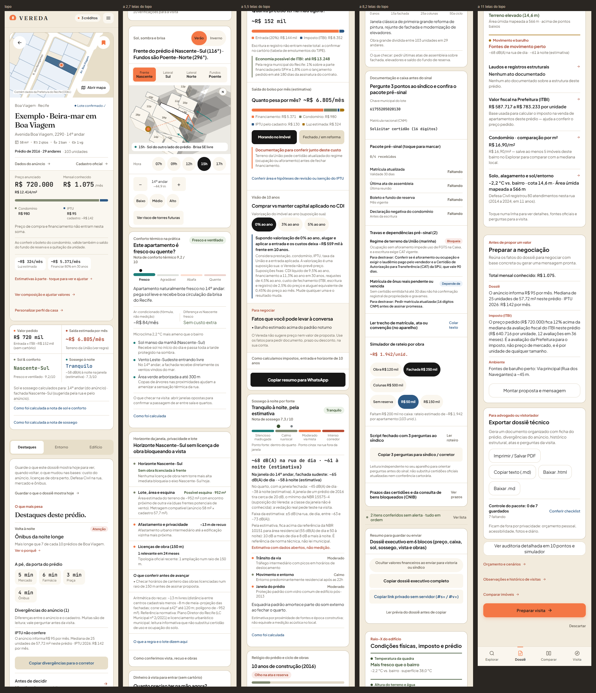

O que isso pede do redesenho: a pessoa precisa chegar a qualquer parte do dossiê sem rolar pelo topo, e cada parte precisa caber em poucas telas.

### 2. A mesma leitura aparece várias vezes, cada vez com outro desenho

O barulho aparece em 8 blocos com leitura própria: placar; "Sossego à noite por fonte"; "Raio-X" › "Movimento e barulho"; "10 pontos" › "Ruído no quarto"; Entorno › "Andar × fachada"; "O que esperar" › Acústica urbana; "Pulso" › Sossego noturno; Edifício › "De que lado vem o barulho". Há ainda menções em "Comparado com o bairro", "Para negociar" e "Preparar a negociação". Os minutos a pé aparecem 4 vezes. O custo aparece no topo, no placar, em "Quanto pesa por mês?", em "Preparar a negociação" e de novo no Comparar.

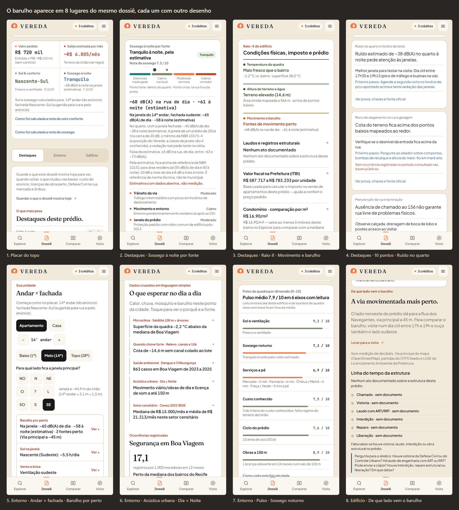

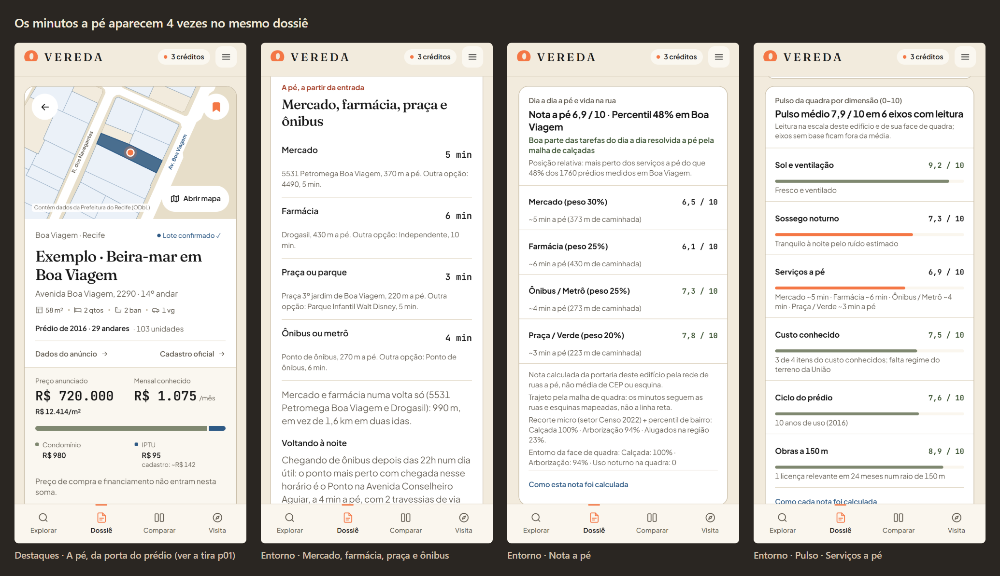

O que isso pede do redesenho: cada leitura tem um lugar só, com um desenho só; os outros lugares apontam para ele.

### 3. Números diferentes para a mesma coisa

- 10 anos: "~R$ 559 mil à frente" ("Visão de 10 anos", financiamento a 11,3% ao ano em 30 anos) e "R$ 420.264 a mais" ("Simulador 10 anos" dentro dos "10 pontos", 10,5% ao ano em 15 anos), na mesma aba.
- Saída mensal: ~R$ 6.805/mês no dossiê e "Bolso ~R$ 6.675/mês" em Salvos.
- IPTU: R$ 95 (anúncio), R$ 130 (cadastro do prédio, na soma), R$ 142 (mesma área, no achado) e "R$ 106–R$ 142/mês" no Edifício.
- Sol na fachada: "~5,5 h/dia" ("Andar × fachada") e "5.8 h", com ponto decimal ("10 pontos").
- Alagamento: Entorno diz "Sem registro na rua" e "10 pontos" diz "Sem ocorrência registrada", enquanto "A rua" e o "Raio-X" (na linha "Solo, alagamento e sol/entorno") mostram 80 atendimentos da Defesa Civil na rua. As duas leituras podem estar certas, porque a primeira conta só alagamento e a segunda conta todo atendimento, mas a tela não explica a diferença.
- Trajeto no Comparar: "cerca de 13h", "~13,3 h/mês" e "13h20 por mês" na mesma tela.

No código, a "Visão de 10 anos" recebe `entradaTco10Anos`, montada com `prazoFinanciamentoAnos` da simulação de compra (`src/app/(abas)/dossie.tsx`, linha 398); o `<SimuladorTco10Anos>` dos "10 pontos" (linha 899) recebe outra entrada, sem prazo nem juros, e cai nos valores padrão. Não corrigimos.

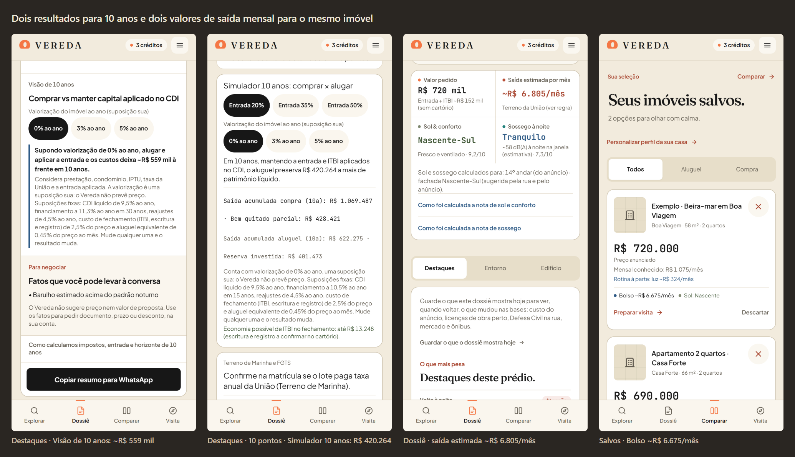

O que isso pede do redesenho: um número tem uma conta só no app inteiro, com a mesma grafia; quando duas bases dizem coisas diferentes, a tela explica a diferença.

### 4. Pilha de caixas iguais, tudo com o mesmo peso

A aba Destaques tem 12 caixas com borda (24 com os "10 pontos"). Quase todas seguem o mesmo molde: rótulo cinza, título em negrito, parágrafo e botão. Nada indica o que pesa mais. Só 4 elementos da aba são marcados como título, o que também deixa a página sem estrutura para o leitor de tela.

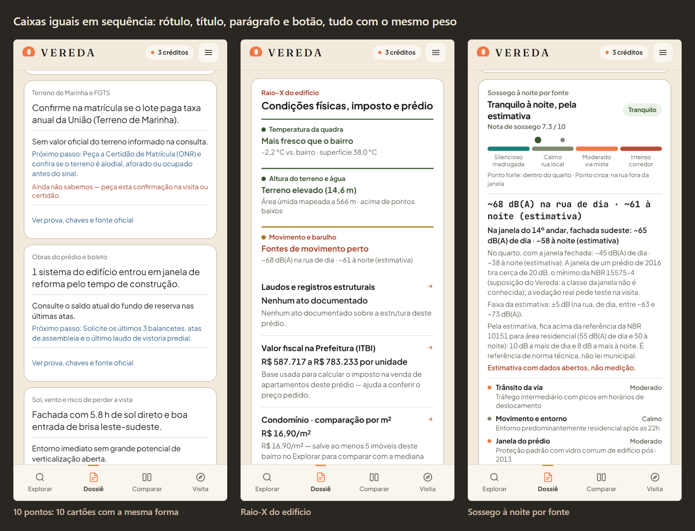

O que isso pede do redesenho: hierarquia visível entre o que decide e o que é detalhe.

### 5. Muitas ações por tela e rótulos longos

97 controles na aba Destaques, 39 rótulos com mais de 3 palavras. No fim da aba há 9 ações antes de "Preparar visita". Há 6 botões que começam com "Copiar", três deles em sequência no "Resumo para guardar ou enviar" e em volta. No Explorar, "Gerar Dossiê" e "Simular" disputam. Exemplos: "Ver auditoria detalhada em 10 pontos e simulador", "Copiar divergências para o corretor", "Copiar 3 perguntas para síndico / corretor", "Usar minha localização agora", "Como calculamos impostos, entrada e horizonte de 10 anos".

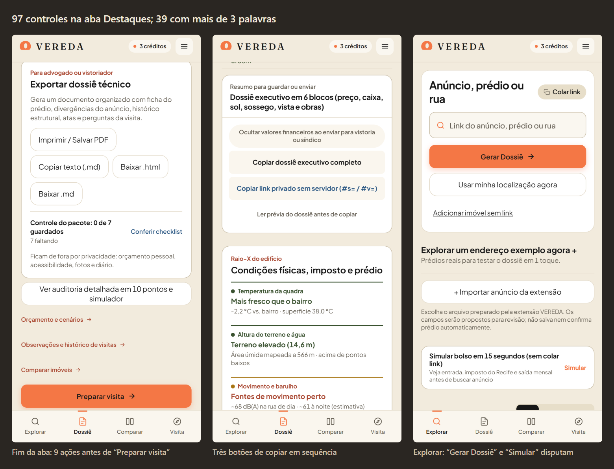

O que isso pede do redesenho: uma ação principal por tela, rótulos curtos, ações parecidas juntas.

### 6. Parágrafo explicando cada seção e termo interno na tela

Muitos blocos abrem com um parágrafo de instrução: "Guarde o que este dossiê mostra hoje para ver, quando voltar, o que mudou nas bases…", "Escolha o arquivo preparado pela extensão VEREDA. Os campos serão propostos para revisão…", "Reúna os fatos do dossiê para negociar com base concreta…". Termos internos aparecem para a pessoa: "Copiar link privado sem servidor (#s= / #v=)", "nao_sabemos" (Comparar › "Duelo direto" › Situação documental), "Reserva estimada para ? dias". Siglas sem tradução nas abas do dossiê: CNM, CAT, SPU, SFH, LUSE, CNIB.

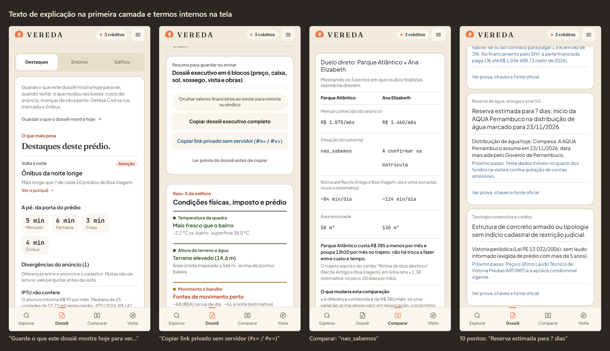

O que isso pede do redesenho: o bloco se explica pelo título e pelo dado; nenhuma chave de código, valor vazio ou sigla sem tradução chega à tela.

### 7. No Explorar, o caderno da pessoa fica abaixo da dobra

O primeiro cartão de "Análises Recentes" começa a cerca de 0,9 tela do topo, depois da busca, dos exemplos, da importação da extensão e do simulador. Cada cartão ocupa quase uma tela e tem 7 pílulas (3 de triagem e 4 de etapa). A lista de imóveis existe em dois lugares, Explorar e Salvos, com desenhos e números diferentes (o bolso só aparece em Salvos).

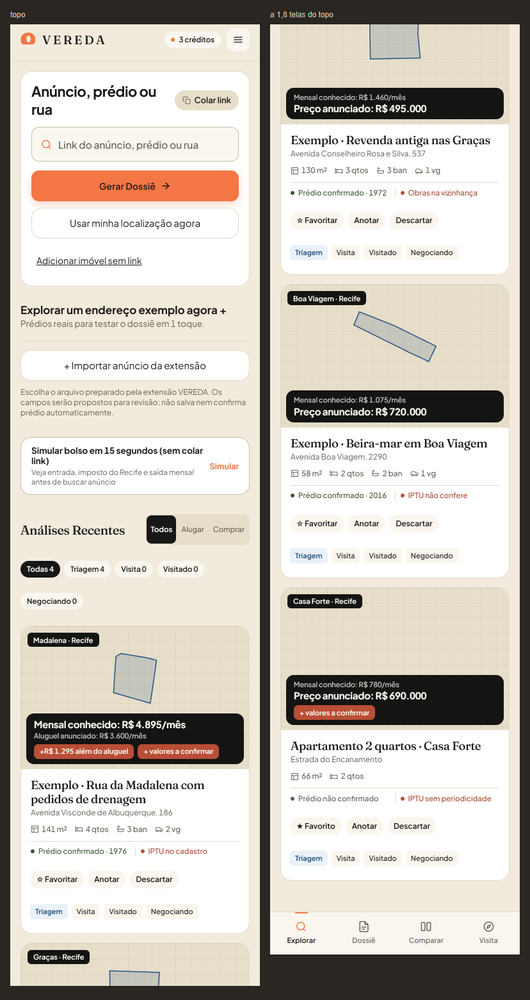

O que isso pede do redesenho: quem volta ao app vê o próprio caderno sem rolar; uma lista só.

### 8. Três das quatro abas dependem de um imóvel aberto

Sem imóvel, Dossiê, Comparar e Visita mostram tela vazia. A lista de salvos só abre pelo menu ("Minhas análises") e, quando abre, a barra acende "Comparar". O cabeçalho gasta 56 px em toda tela com marca, créditos e menu.

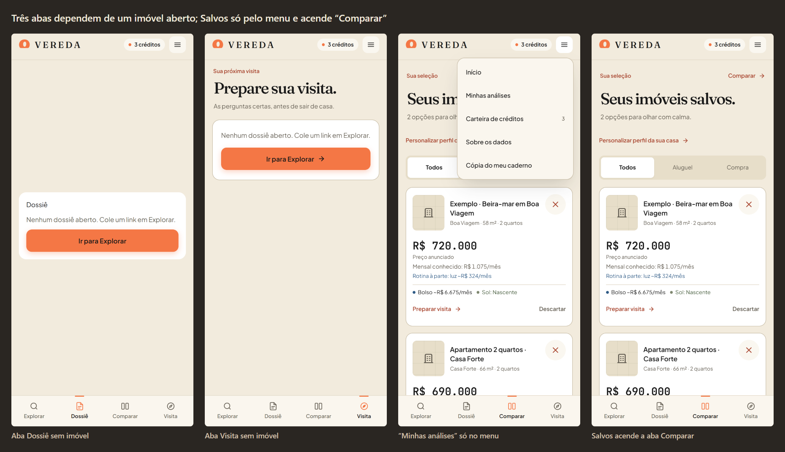

O que isso pede do redesenho: cada aba da barra tem conteúdo útil sem imóvel aberto, e a aba acesa corresponde à tela.

### 9. A ficha de método abre no meio da tela como bloco de texto, e a origem do número tem muitos nomes

Aberta, a ficha de 6 campos da nota de sossego acrescenta cerca de 500 palavras ao texto da aba (2.511 contra 2.010 pela contagem `wc -w`). Nomes vistos para a mesma ideia: "Como foi calculada", "Como foi calculada a nota de sossego", "Como cada nota foi calculada", "Como esta nota foi calculada", "Como cada ponto é comparado", "Como conferimos vista, recuo e obras", "Como calculamos impostos, entrada e horizonte de 10 anos", "O que a regra e o lote dizem aqui", "Ver prova, chaves e fonte oficial", "Ver fonte e data", "Toque em uma linha para ver a fonte". A gaveta "Ver a fonte" em si está bem resolvida e deve ser mantida.

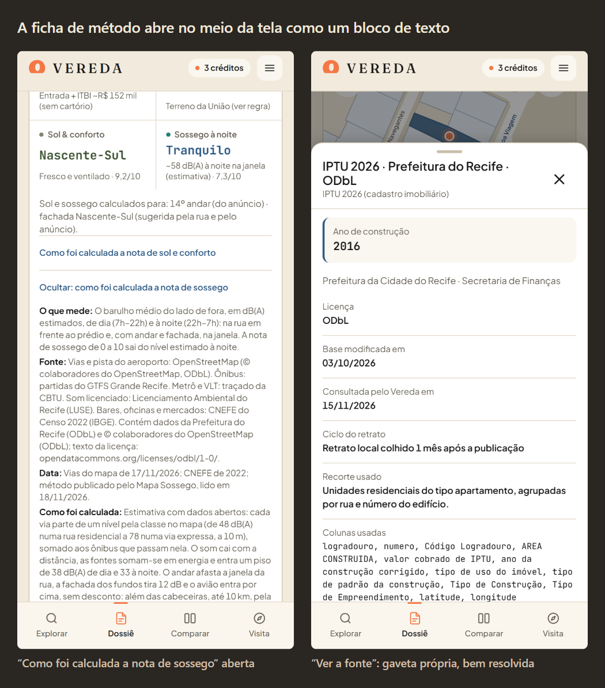

O que isso pede do redesenho: um nome e um gesto só para "de onde vem este número", sem empurrar o resto da tela.

### 10. O Comparar conclui três coisas diferentes na mesma tela

"Ana Elizabeth leva vantagem em 3 de 6 pontos objetivos lado a lado"; "Visite primeiro Ana Elizabeth: custa menos e tem mais área"; "Parque Atlântico custa R$ 385 a menos por mês e poupa 13h20 por mês no trajeto: não há troca a fazer entre custo e tempo". O custo é repetido em 5 blocos. No "Lado a lado", os dois imóveis têm ~58 dB(A) à noite e notas de sossego diferentes (7,3 e 7,5): a nota sai do valor sem arredondar (cerca de 58,3 e 57,5), e a tela mostra os dois como 58. Frase difícil: "Em 585 meses (cerca de 48,8 anos) elas somam a diferença de preço".

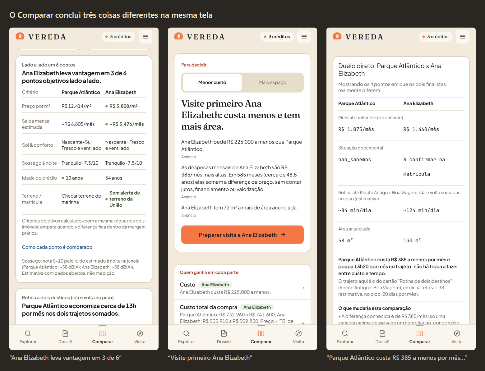

O que isso pede do redesenho: uma conclusão só, que diga o critério; o detalhe vem depois e não a contradiz.

## 8. Também vimos e o que manter

**Também vimos**
- Estrela e sinais de texto no lugar de ícone: "☆ Favoritar", "★ Favorito", "+" e "−" para abrir e fechar.
- Preço e "A confirmar" em fonte mono grande, com cara de código.
- O dossiê diz "10 verificações para a visita" e a aba Visita abre com "12 pontos para conferir": são as mesmas 10, mais 2 checagens de risco que só entram na Visita (garagem e comporta; internet no cômodo). Em Ana Elizabeth são 9 e 12; no Viena, 11 e 14 (`textos/outros-exemplos/*-visita.txt`). Os protótipos usam um número só, o do roteiro.
- Na tela "Ler", "Gerar o dossiê usa 1 crédito" aparece junto de "Só lemos campos do imóvel. Nada sobre quem anuncia." e de um parágrafo sobre o navegador; o aviso de crédito se perde.

**O que manter**
- A gaveta "Ver a fonte".
- A tela "Sem rede" do dossiê: "Não foi possível carregar os dados de Boa Viagem." e "Tentar de novo".
- Visita › "No imóvel": lista de conferência curta, cada ponto com o porquê, uma ação principal ("Salvar e encerrar visita").
- A confirmação do prédio ("É este o prédio?"), com os motivos ("Mesma rua do anúncio") e a saída "Não encontrei o prédio".
- A regra de dizer "estimativa" em todo dB(A), que foi seguida em todas as telas lidas.

## 9. Exemplo escolhido

Dossiê principal: Parque Atlântico (Boa Viagem, compra), o exemplo com mais leituras. Ana Elizabeth (Graças) e Viena (Madalena, aluguel) entram no caderno e no Comparar por contraste. Os valores de anúncio foram digitados como entrada de exemplo; o resto foi lido da tela.

Detalhes e números: [`exemplo-escolhido.md`](exemplo-escolhido.md).

## 10. Divergências entre fontes

Vistas durante a auditoria. Nenhuma foi corrigida; a decisão é do usuário.

- **Referência de marca.** O `AGENTS.md` cita `index.html` na raiz como fonte da identidade visual. O arquivo está em `ignorar/prototipo-demonstrativo-legado/index.html`. Os protótipos da fase 1 usam `src/tema/tokens.ts` e `motion/lib/marca.css`.
- **Hub.** A feature "index.html como única referência de design e experiência" `F-dc967401` está `incluida` e fixa "dock de quatro abas" e "cartões brancos". A refatoração propõe mudar a navegação: se uma opção for escolhida, essa feature precisa de nova redação ou novo veredito.
- **Mapas.** O pedido da sessão fala em MapLibre; o app usa mapas em SVG próprios (`src/componentes/mapa/FundoDoMapa.tsx`), como diz `docs/metodo/contexto-projeto.md`. Os mapas ficam fora do escopo de qualquer forma.
- **Frente visual.** Os blocos listados na nota da seção 6 estão no app e no `FEATURE-REGISTER.md` (seção "Visual front"), mas no hub são uma feature só, `em_aberto`.
