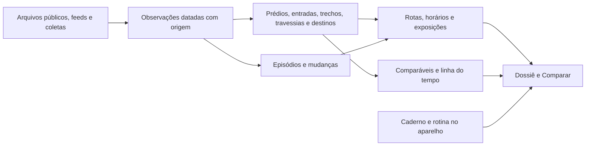

# Parecer técnico integrado da Vereda

14 de novembro de 2026 · Boa Viagem, Casa Forte, Graças, Espinheiro e Madalena

**Fazer da comparação a experiência central da Vereda.** A pessoa cola os anúncios que já considera e descobre o que muda na vida dela ao escolher cada endereço. Quanto sobra por mês, quais tarefas cabem a pé, por onde ela entra e sai, e como o entorno muda com o horário e a chuva. O resultado ideal dá direção para decidir qual imóvel visitar primeiro, qual informação negociar e em que situação a preferência mudaria. A visita e os documentos aprofundam a análise quando a pessoa quiser.

Construiria **uma base histórica que liga prédio, frente de lote, trecho de rua, travessia, destino e evento**. É a mesma infraestrutura para mostrar as duas alternativas de acesso a um mercado, o túnel que já foi bloqueado, a sombra na volta para casa e uma obra no lado da rua para o qual o apartamento está voltado. A busca revelou um ponto de partida concreto. O código de logradouro de **todos os 2.688 prédios** dos cinco bairros aparece na malha oficial de vias do Recife. Para **2.622 deles, ou 97,5%**, o centro cadastral fica a até 50 m da geometria da própria rua. Já há escala para começar a conectar imóveis a percursos. A validação de porta, pista e calçada entra à medida que essas distinções mudam o resultado. [Malha oficial do Recife](https://dados.recife.pe.gov.br/dataset/area-urbana/resource/6be90377-7b6d-483c-9b58-f7f34401ee6a)

Guias de bairros e índices de preços já aparecem em portais, medidas de acesso a transporte existem em produtos como Walk Score e a First Street modela risco de inundação por imóvel. A oportunidade da Vereda está na combinação local e pessoal. Ela consegue explicar como **dois imóveis do mesmo bairro** podem exigir rotinas diferentes, ligar a explicação a registros que mudam ao longo do tempo e fazer surgir uma ação na visita ou na negociação. [Guia do QuintoAndar](https://www.quintoandar.com.br/guias/wp-content/uploads/2023/05/Guia-de-Compra-do-Primeiro-Imovel-2.pdf) · [Transit Score](https://www.walkscore.com/transit-score-methodology.shtml) · [First Street](https://help.firststreet.org/hc/en-us/articles/360047585694-How-is-my-Flood-Factor-calculated)

## O que já temos e o que cada dado pode fazer

O app já importa anúncio por WebView, liga endereço ao índice cadastral, deriva custos, salva destinos, simula a rotina e compara imóveis da mesma modalidade. O ganho imediato é alimentar essas telas com **a mesma evidência estruturada** e usar a comparação como lugar para explicar diferenças. A estimativa atual de deslocamento usa linha reta × 1,32 com referência de bairro. Esse valor pode dar ordem de grandeza. Para descobrir uma ponte, uma travessia, o sentido do ônibus ou um desvio real, a unidade de trabalho passa a ser o caminho. [Comparação](../../../src/app/%28abas%29/comparar.tsx) · [Rotina](../../../src/dados/rotina.ts) · [Custo por partes](../../../src/dados/custoPorPartes.ts) · [Painel de entorno](../../../src/componentes/dossie-v1/Entorno.tsx)

Há três conjuntos operando com finalidades diferentes. Os arquivos `docs/dados/raw` guardam as coletas exploratórias. `docs/dados/processado` resume aquelas coletas, em geral por bairro. As telas consultam as bases efetivamente distribuídas em `src/dados/recife` e `src/dados/sol`, produzidas por outro fluxo em `scripts/dados`. A auditoria encontrou diferenças suficientes para impedir que um arquivo marcado `ok` no catálogo seja tratado como evidência de publicação. A próxima implementação deve manter um único fluxo de promoção de fatos para o app. [Pipeline exploratório](../infra/scripts/09-processar.mjs) · [Construtor do índice](../../../scripts/dados/construir-indice-recife.mjs) · [Índice em uso](../../../src/dados/recife/publicacaoGerada.ts)

| Base | Evidência concreta no checkout | Transformação que vale fazer |
|---|---|---|
| IPTU, lotes, logradouros e CNEFE | A publicação local leu 413.651 registros de IPTU e 114.079 lotes. Dos prédios dos cinco bairros, 2.687 têm DSQFL. As cinco exportações exploratórias `lotes-*.geojson` estão vazias. O recorte oficial de logradouros baixado nesta revisão tem 10.226 feições em CRS84. | Usar ID do prédio, DSQFL e código da rua como espinha dorsal. Projetar por código, localizar a frente do lote, conservar candidatos para esquina e dois acessos. |
| Defesa Civil | O índice usa 2014–2024 e guarda agregados por rua. A cópia exploratória de 2025 tem uma linha. No cache de 2020–2024 há 20 linhas classificadas como alagamento nos cinco bairros, com data recuperável. A junção conservadora por nome completo normalizado e código único no bairro recuperou seis ruas, em Boa Viagem e Espinheiro. Quatorze linhas de Boa Viagem em 2022 são da mesma data administrativa. | Construir histórico por episódio com Defesa Civil, CTTU, boletins, chuva e drenagem. Separar data do atendimento de data da água. Vale mais recuperar um acesso bloqueado de boa qualidade que contar dezenas de vistorias correlatas. |
| Central 156 | No índice, 2.515 dos 2.688 prédios têm pelo menos um chamado de drenagem em 150 m, entre 31/01/2025 e 30/01/2026. No cache 2025–2026, a seleção de drenagem retornou 1.266 linhas nos cinco bairros. 664 têm coordenada dentro de um raio de triagem de 30 km do centro de Recife. | Tratar a proximidade de um chamado isolado como contexto. Explorar reabertura, intervalo de atendimento, sequência após chuva e concentração no mesmo trecho. Fazer geocodificação validada antes de usar as linhas sem ponto. |
| CTTU, luz e LUSE | O índice tem 2.588 prédios com chamado de sinistro com vítima a até 150 m e 772 com atropelamento no mesmo raio, em 2022–2024. As contagens incluem vizinhança sobreposta. No extrato bruto, 89 linhas de atropelamento nos cinco bairros passaram pelo leitor atual. 49 têm número e 27 têm detalhe que o leitor reconhece como possível cruzamento, podendo haver sobreposição. Há 7 pontos LUSE vigentes nos arquivos dos cinco bairros, somados por partição, contra 42 entradas totais. | Ligar sinistros a travessias que realmente são usadas numa rota. Combinar data e estado das licenças com horário observado ou publicado. Essa camada informa por que uma caminhada merece atenção e quando há fontes de atividade. |
| GTFS | O arquivo exploratório `v2026.10.26` contém 7.238 paradas, 400 rotas e 87.678 viagens. Ponto em polígono com a coordenada original encontra 2.839 paradas no Recife. Com −0,75° encontra zero. O gerador da camada de corredores usa outro ZIP, `v2026.10.16`, com 7.217 paradas. Conta linhas de `stop_times` sem aplicar `service_id` por data, embora a interface diga “paradas diárias”. | Usar coordenadas originais e auditar paradas de referência, calendário e exceções. Publicar partidas programadas por sentido e janela, usando distribuição entre horários de saída. O contraste dia útil × sábado é mais útil que a quantidade de paradas em raio. |
| POIs e espaços públicos | As 100 consultas arquivadas de Google Maps registram zero entidades extraídas. O JSON de Overpass disponível traz falha em todas as 18 categorias para Boa Viagem. `servicos-cnefe.json` tem 5.661 pontos de Recife, das categorias ensino (1.676), saúde (1.427) e religião (2.558). O app tem também 499 praças/parques e 49 árvores tombadas. | Recomeçar o catálogo de serviços com extrato OSM datado, cadastro de empresas por atividade, CNEFE, praças e revisão dirigida. Um destino deve ter entrada pública e categoria. Horário e funcionamento entram quando comprovados. Árvores tombadas são marcos, enquanto copas das rotas exigem camada própria. |
| Relevo, calor e sol | A camada de relevo distribui uma amostra de um **modelo de superfície** GLO-30 em uma grade de 0,0014°, aproximadamente 155 m. A leitura térmica usa quatro cenas Landsat numa grade de cerca de 100 m. A série histórica ERA5 exploratória é compartilhada pelos cinco bairros. Há 47.781 volumes nas quatro partições solares, contando sobreposição entre recortes. Madalena não tem partição solar distribuída. | Usar a malha solar para diferenciar fachada e rota por horário. Usar Landsat para contexto de superfície do entorno. Para pequenas depressões da rua, buscar modelo municipal de terreno com resolução e datum verificados. A grade atual orienta triagem da área. |
| Anúncios, ITBI e custo | Oleo guarda dez erros, sem anúncios. A amostra manual do ZAP contém resumos de 139 cartões nos cinco bairros, primeiras duas páginas, venda, com possibilidade de repetição e lançamentos “a partir de”. O FipeZAP local tem 68 linhas no agregado Recife e zero por bairro. O índice tem 1.319 prédios com quartis fiscais por unidade, dos quais 630 também atendem ao filtro de tipologia homogênea da régua atual. O app já guarda alterações de anúncios reimportados pela pessoa. | Começar por comparáveis do caderno e snapshots auditáveis de preços pedidos e encargos. Construir uma distribuição externa só com amostras por anúncio, deduplicação e cobertura. Usar `valor_avaliacao` da transmissão como referência fiscal por unidade, com a identidade correta do valor. |
| Segurança agregada, aeroporto e leilões | O resumo Crime Brasil é por bairro e o derivador inclui furto na categoria criada como “crimes violentos”. O cone experimental do aeroporto usa uma geometria teórica, `total_considerado = 0` nos cinco bairros e pista diferente da planta oficial SBRF. Em `raw/leiloes` há duas páginas de busca e um 404 do TJPE. | Usar indicadores distintos de travessia e iluminação por rota. Substituir a geometria do aeroporto pela planta PEZR registrada e georreferenciada, com erro de ajuste medido. Tratar leilões como universo separado de vendas comuns caso apareça uma fonte de arrematações. |

[Dados locais de exploração](../README.md) · [Auditoria anterior de Defesa Civil e GTFS](../validacao-defesa-civil-gtfs.md) · [Dados ambientais distribuídos](../../../src/dados/recife/camadas-ambientais.json) · [Tratamento de ITBI](../../../scripts/dados/construir-indice-recife.mjs#L1142) · [Folha de ruído SBRF](https://www.anac.gov.br/assuntos/setor-regulado/aerodromos/planejamento-aeroportuario/plantas/sbrf-pezr-divulgacao.pdf) · [Modelo de superfície Copernicus](https://dataspace.copernicus.eu/explore-data/data-collections/copernicus-contributing-missions/collections-description/COP-DEM)

### Cobertura medida por bairro

| Bairro | Prédios | Centro ≤ 50 m da via do mesmo código | Prédios com chamado de drenagem no raio | Vias no índice com categoria alagamento, 2014–2024 | Prédios com volume solar do lote, altura e vínculo validados pelo gerador |
|---|---:|---:|---:|---:|---:|
| Boa Viagem | 1.879 | 1.850 | 1.745 | 5 | 1.159 |
| Casa Forte | 82 | 70 | 64 | 1 | 76 |
| Graças | 291 | 281 | 282 | 0 | 252 |
| Espinheiro | 156 | 150 | 156 | 1 | 67 |
| Madalena | 280 | 271 | 268 | 0 | 0 |
| **Total** | **2.688** | **2.622** | **2.515** | **7** | **1.554** |

A coluna solar conta candidatos com DSQFL associado e altura disponível no arquivo, antes de margem do recorte, orientação de janela e outros requisitos do cálculo. Os 66 centros acima de 50 m são amostra para confirmar esquinas, lotes grandes e lados de rua. O corte é para triagem do piloto. O teste com a malha trabalha com distância ponto–segmento projetada em metros e somente com geometrias do código correspondente. Os números da Defesa Civil por via referem-se à versão publicada. O teste extra com o cache foi restrito a 2020–2024 e a correspondência exata. [Metadados do índice](../../../src/dados/recife/indice-municipal/91b71d239c1847cf/meta.json) · [Publicação solar](../../../src/dados/sol/fontesGeradas.ts)

## Funcionalidades que eu colocaria no produto

Os exemplos de interface desta seção usam números fictícios. Na experiência, a frase principal carrega o resultado e a escala. O toque em **Ver evidência** abre recorte, período, fonte e método. Um conjunto pequeno de estados do dado viaja com a comparação. A explicação é parte do desenho do produto, sem aviso em cada linha.

### 1. Melhor para a sua rotina

Em **Comparar**, abrir com um parágrafo curto e duas ou três diferenças que realmente mudam a escolha. A pessoa pode tocar em “Economizar”, “Fazer a pé” ou “Chegar depois das 21h”. Esses controles reutilizam perfil e destinos existentes quando disponíveis e funcionam com uma rotina padrão para o primeiro acesso. Em seguida, a Vereda mostra um caminho, uma conta ou uma pergunta que muda a recomendação.

> **O A poupa cerca de 5 horas por mês no seu trajeto.** O B custa R$ 180 a menos e tem mercado e praça mais perto de casa.

O motor calcula `diferença mensal = mensalidades comparáveis + diferença de deslocamento parametrizada` e `horas poupadas = diferença em minutos por ida e volta × frequência / 60`. Exemplo, 20 min/dia em 16 dias dão 5h20 por mês. Um diferencial de R$ 180 equivale a cerca de R$ 34 por hora poupada. Esse ponto de troca funciona como argumento de escolha. A pessoa decide quanto o próprio tempo vale. O app usa restrições explícitas, como teto mensal ou trajeto sem escada verificado. Se duas opções atenderem, encontra as diferenças de Pareto e mostra os fatos que explicam a preferência. Se faltar uma despesa material, calcula o **ponto de empate** em vez de estimar a despesa como zero. Para compra, o equivalente é comparar entrada, parcelas e despesas mensais usando o mesmo horizonte e as premissas disponíveis.

**O que construir.** Extrair uma projeção comparável única para Dossiê e Comparar. Reusar `derivarCustoPorPartes`, `custoMensal`, preferências e destinos. Calcular diferenças usando a mesma janela, regra e precisão. Manter o perfil privado e dar valor antes de a pessoa preencher qualquer campo adicional. O critério de sucesso é ela explicar por que um dos imóveis serve melhor e qual fato poderia inverter sua escolha.

**O que vale conferir primeiro.** Gerar uma única pergunta a partir da variável que mais pode mudar a escolha. Se a diferença de preço mensal é de R$ 60 e há rateio pendente, perguntar pelo valor e pelo fim do rateio. Se o diferencial é conforto, sugerir o horário em que as duas fachadas mais divergem no cenário solar. Se o caminho é o fator decisivo, sugerir a entrada e a travessia que valem observar. Reusar a preparação de visita e a mensagem editável para a pergunta. Essa escolha de informação prioritária transforma a visita em uma etapa de decisão, sem pedir que a pessoa percorra um checklist inteiro.

**Onde mais procurar.** Se nenhum dos imóveis atender, inverter a consulta sobre a base de trechos. A pessoa escolhe o que preservar de cada opção, por exemplo, o acesso a pé ao trabalho do A e o teto do B. O sistema mostra trechos cujos caminhos atendem ao limite de tempo e monta uma busca a partir dali. A cobertura de preço pode vir primeiro dos imóveis já salvos, com preço de mercado como dimensão adicional quando houver uma amostra útil. Isso permite recomendar onde ampliar a procura sem depender de um catálogo próprio de anúncios.

### 2. O essencial a pé, com plano B

> **Dois mercados e uma farmácia a até 12 minutos a pé.** Um mercado fica do mesmo lado da avenida. O outro tem acesso por uma travessia sinalizada.

Medir distância e tempo pela rede incluindo pontes, acessos, portões, travessias e ruas que terminam em canais. No piloto, dois mercados independentes são mais informativos que 12 POIs. Expor **opção alternativa e gargalo em comum**. Para cada categoria, calcular a melhor opção em caminhada e a melhor que não depende da mesma ponte/passagem, se houver. Para famílias, testar com escola, farmácia e lazer. Para quem volta tarde, calcular serviço programado depois do horário que escolheu. Quando só existe endereço de referência, o produto já pode mostrar serviço com distância em linha reta de forma legível.

Com o mesmo grafo, comparar “a pé de dia”, “com menos travessias” e, quando houver dados, “sem degraus nos trechos verificados”. O grafo parte de OSM recortado, com `crossing`, `foot`, `sidewalk`, `bridge`, `tunnel`, `layer` e `access`, reconciliado com o código de ruas municipal. Começar com Dijkstra/A* em lote, com dois destinos por categoria e dois caminhos de custos distintos quando existirem. R5/r5py é candidato para integração multimodal em lote. O app recebe matrizes e trechos resumidos. Agregar partidas do GTFS por janelas como dias úteis 7h–9h e 18h–20h e sábado, aplicando calendário, exceções e sentido. Reaproveitar o desenho de tempos por janela do Ipea e a separação de calçada e travessia do OpenSidewalks. [Software Acesso a Oportunidades](https://www.ipea.gov.br/acessooportunidades/software/) · [OpenSidewalks](https://github.com/OpenSidewalks/OpenSidewalks-Schema) · [Calçadas de Barcelona](urbanismo-nova-leva/modeling-barcelona-sidewalks-a-high-resolution-urban-scale-assessment-of-th-83e860.pdf) · [GTFS planejado e observado](urbanismo-nova-leva/on-the-accuracy-of-schedule-based-gtfs-for-measuring-accessibility-e9dba0.pdf)

### 3. Quando chove, por onde eu saio?

> **Um dos acessos passa por um ponto que já foi interditado por água.** O outro caminho até a avenida evita esse ponto e acrescenta quatro minutos.

Esse é o diferencial mais interessante do Recife. Construir um inventário de **pontos observados de água e interdição**, com nome de via/trecho, tipo, período e evidências. O ponto serve tanto para história do endereço quanto para medir um efeito sobre a rotina. A Prefeitura documentou em 14/06/2019 o bloqueio do Túnel Augusto Lucena, em Boa Viagem, por acúmulo de água. Outro balanço lista vias, túneis e cruzamentos em fevereiro de 2023. Essas fontes já dão sementes com localização mais útil que um total por bairro. [Balanço de 14/06/2019](https://www2.recife.pe.gov.br/node/289242) · [Pontos de alagamento em fevereiro de 2023](https://www2.recife.pe.gov.br/noticias/06/02/2023/nas-ultimas-6-horas-recife-registra-7793mm-de-chuvas)

**Primeiro cálculo.** Consolidar boletins da CTTU, Prefeitura e Ação Inverno, Defesa Civil e eventuais fontes jornalísticas independentes. Em texto, extrair `local`, `tipo de impacto`, `modal afetado`, `hora`, `data do boletim`, `data do evento` e `status` com trecho curto de evidência. Para o mesmo temporal, ligar interdição, reabertura e vistoria como registros distintos. Agrupar por episódio meteorológico, começando com janela de 24 h como hipótese a ajustar com dados de chuva e documentação. Datas conhecidas apenas como vistoria permanecem no eixo de atendimento. A chuva da estação e a maré contextualizam a janela. Chamados de drenagem ajudam a priorizar locais para pesquisa. O mapa de suscetibilidade evolui com topografia de terreno, drenagem e controles de eventos independentes. O GLO-30 atual pode ser um atributo grosseiro nesse teste.

**Segundo cálculo.** Reexecutar a rota removendo a ligação impactada no episódio passado. Isso produz três tipos de informação imediatamente úteis. Caminhos passam pelo ponto observado, há um desvio quantificável, ou o mapa precisa de acesso melhor localizado. Um bloqueio a carros não vira interdição a pedestres automaticamente. O cenário histórico é apresentado com data, com texto como “Se este trecho estiver fechado”. A garagem entra na análise quando houver observação do lote ou da entrada. Antes disso, a aplicação pode transformar uma dúvida geral em uma pergunta concreta sobre qual acesso é usado nos dias de chuva. Em bairros onde ainda há poucos pontos conhecidos, a Vereda mostra a rota e os registros disponíveis, sem gerar um placar de risco.

**Aproximação com os dados de hoje.** Para ordenar os casos que entram no protótipo, usar um índice interno de prioridade de revisão por trecho. Começar com um ponto identificado em boletim como sinal principal, chamado de drenagem recorrente com coordenada ou endereço confiável como evidência de apoio, e terreno baixo relativamente ao entorno como contexto. Comparar com três referências simples: contagem bruta de registros, distância até canal e terreno baixo isolado. Testar se o cruzamento encontra mais trechos efetivamente mencionados em temporais retidos. Se sim, a interface pode oferecer “este acesso concentra sinais de drenagem” e explicar o sinal dominante em uma linha. Uma vez confirmado um bloqueio, o desvio em minutos é o número que vale mostrar.

A literatura de China, Porto Alegre, Jacarta e São Carlos dá o mecanismo da perda de conectividade. Os trabalhos de observação cidadã orientam a combinação de dados. Radar, óptico e visão de rua podem ajudar a encontrar eventos que valem revisão. Essa etapa tem retorno quando há imagens datadas, resolução útil e uma amostra por temporal. [Relatos e satélites na China](urbanismo-nova-leva/china-flood-social-satellite.pdf) · [Rede e acesso em Porto Alegre](urbanismo-nova-leva/porto-alegre-redundancia.pdf) · [Vulnerabilidade viária em São Carlos](urbanismo-nova-leva/vulnerabilidade-viaria.pdf) · [GEOID-Flood](urbanismo-nova-leva/flood-benchmark.pdf) · [APAC](https://geoportal.apac.pe.gov.br/server/rest/services/met_monitoramento_chuvas_pe/MapServer) · [Históricos do INMET](https://portal.inmet.gov.br/dadoshistoricos)

### 4. Sombra no caminho e conforto por fachada

> **Às 15h, a rota pela praça troca cinco minutos de sol por um minuto de caminhada extra.** Para o apartamento, a fachada lateral recebe menos sol direto no fim da tarde.

Já existe motor local de sol e geometria construída em quatro bairros. A primeira entrega pode dar uma **comparação por fachadas do prédio** antes de conhecer a janela da unidade. Com face ou cômodo informado, o cálculo se torna específico. Para a caminhada, a grandeza comunicável é **minutos ao sol direto**. Produzir para algumas horas representativas, incluindo 12h e 15h, e duas épocas do ano. Calcular visibilidade solar por trecho e lado da rua, acumular ao longo de um caminho e comparar com a rota curta sob limite de 10–15% de desvio. Modelar copa e marquise em pontos onde elas mudam a decisão. Reusar projeções com intervalos de altura do motor solar. O recorte de Madalena entra com a mesma metodologia de publicação aplicada aos outros bairros.

Valem dois testes. Predição de sombra em trecho, com foto/observação datada ou levantamento dirigido da equipe, e se a versão menos exposta continua mais sombreada quando variamos altura, copa e alinhamento. A física também permite detectar **faces opostas com exposições diferentes a uma avenida ou obra**. Como triagem de visita, mostrar orientação, distância e geometria de barreiras. Atribuir níveis acústicos exigiria campanha de medição. CoolWalks e Hong Kong dão o algoritmo de rotas. Barranquilla e Changchun orientam o teste de campo. Hong Kong e outros contextos densos oferecem hipóteses sobre abrigo e direção, com transferência condicionada aos dados locais. [CoolWalks e código](https://github.com/henrik-wolf/CoolWalks) · [Hong Kong](urbanismo-nova-leva/hong-kong-sombra.pdf) · [Barranquilla](urbanismo-nova-leva/addressing-increased-temperatures-in-cities-determination-of-pedestrian-rou-5a5f20.pdf) · [Protocolo de ruído de Santa Maria](urbanismo-nova-leva/assessment-of-road-traffic-noise-measurement-strategies-for-urban-noise-map-81f680.pdf)

### 5. O caminho da volta e a vizinhança que muda

> **A volta das 21h cruza uma avenida e tem ônibus com intervalos maiores.** Dá para fazer um trecho pela via paralela com uma travessia sinalizada.

Para segurança do pedestre, combinar a travessia efetivamente usada, tipo de via, registros de atropelamento, iluminação conhecida e manutenção de lâmpadas. A tela mostra a exposição observável. Com amostra suficientemente geocodificada, mostrar acontecimentos por cruzamento e por período. Um item “Iluminação” pode trazer presença de ponto e registro de manutenção. A verificação de condição atual vem de observação com data ou publicação operacional. Ocorrências criminais no bairro podem aparecer por tipo e período em contexto, quando a série e a classificação forem confirmadas. Elas ficam fora da ponderação de um endereço ou caminho. Foto da rua é útil para anotar um semáforo, rampa ou obstáculo. Modelos podem encaminhar candidatos para revisão, e a equipe verifica o que afeta a rota. [Protocolo de sinistros por cruzamento](urbanismo-nova-leva/intersections-and-non-intersections-a-protocol-for-identifying-pedestrian-c-2f0cc2.pdf) · [SideSeeing](urbanismo-nova-leva/sideseeing.pdf) · [Avaliação de VLMs](urbanismo-nova-leva/sidewalk-vlm.pdf) · [Chamados da CTTU](https://dados.recife.pe.gov.br/dataset/acidentes-de-transito-com-e-sem-vitimas)

> **Mudou desde que você salvou.** Entrou um processo de obra na rua lateral. O prédio anunciado reduziu o aluguel em R$ 150 na última leitura.

A linha do tempo registra alterações de pedido, publicação, retirada, licenças e mudanças de serviço. Há espaço para uma funcionalidade “desde a última visita ao dossiê”, mesmo com atualização local sob demanda. Para obra, usar estado do licenciamento, posição em relação ao prédio e possíveis cômodos expostos. Usar atualização do processo para mudança de estado, com evidência independente para obra ativa/concluída. Para som noturno, combinar LUSE vigente com atividade e horários de funcionamento verificados. Para aeroporto, cruzar o polígono oficial com o prédio depois de verificar versão e ajuste espacial. Isso cria recortes próprios de noite, fim de semana e mudança da vizinhança, sem depender de um único número de qualidade de vida. [Licenciamento urbanístico](https://dados.recife.pe.gov.br/dataset/licenciamento-urbanistico) · [Cadastro de empresas do Recife](https://dados.recife.pe.gov.br/pt_PT/dataset/empresas-da-cidade-do-recife) · [Histórico local do anúncio](../../../src/dados/historicoDoAnuncio.ts)

### 6. Preço que orienta uma ação

> **O aluguel é R$ 200 menor. Com condomínio e o IPTU informado, a diferença cai para R$ 60.** Se o rateio passar de R$ 60/mês, o outro imóvel fica mais barato.

A primeira régua responde “por que este parece mais caro?” com custo total comparável e diferenças de área, vaga, condomínio, deslocamento e contexto. Para aluguel, usar o caderno e evoluir para **faixa de ofertas verificadas**. Para compra, mostrar o custo de entrada do cenário e os comparáveis condizentes com unidade, área privativa e tempo. Os quartis do ITBI continuam como referência fiscal por unidade do prédio onde o tipo é homogêneo. Quando houver dados parceiros de fechamento, incorporar como outra natureza de preço, sem usar a área construída como denominador da oferta.

O coletor útil registra `portal + id do anúncio + momento + modalidade + atributos + natureza dos valores + evidência do campo`. Guarda cada mudança e detecta republicações por endereço/unidade confirmados, área, atributos e, quando permitido, fingerprint visual. Diferenciar mesma oferta do mesmo apartamento anunciado por outro corretor. Separar condomínio, IPTU e periodicidade, taxas e abatimentos. A consulta de comparação começa por prédio ou microárea, encadeia bairro e outros recortes, sempre com `n` efetivo, período e regra. Usar mediana/intervalos robustos antes de ponderar por distância e semelhança. Estudo de Berlim mostra exatamente por que deduplicar e por que anúncios e estoque podem divergir. O benchmark do ZAP fortalece a necessidade de validação temporal no catálogo inteiro. Xangai mostra o valor de confrontar amostra raspada com evidência de campo. [Aluguel em Berlim](berlin-flat-rent.pdf) · [Benchmark ZAP](ojs-sbbd-zap-17m.pdf) · [Mercado informal em Xangai](urban-studies-shanghai.pdf) · [Manual de índices residenciais](rppi-handbook-imf.pdf)

## Onde fica a vantagem difícil de copiar

1. **Ligações persistentes.** Manter um histórico de aliases de ruas, lotes, torres, frentes de lote, acessos, travessias e serviços. Uma correção melhora todos os dossiês que passam por ali. Toda ligação guarda versão, método, evidências e candidatos rejeitados quando a decisão é ambígua. A base fica mais valiosa a cada junção auditada.
2. **Eventos com memória.** Normalizar o que ocorreu, onde, em que horário e em quais fontes. Relacionar temporais, serviços de drenagem, interdições, reaberturas e obras posteriores. Isso permite explicar a diferença entre episódio isolado, acesso que volta a aparecer e mudança de condição após obras. Importar dados recentes é fácil. Reconstruir um histórico coerente e mantê-lo atualizado custa trabalho local.
3. **Rotina e contrafactual sobre a mesma rede.** Uma rua fechada, uma travessia evitada ou um destino indisponível devem produzir um caminho alternativo e um delta de tempo. Uma mudança de aluguel ou frequência de ida ao trabalho produz um ponto de empate. O motivo da escolha fica verificável e pode ser reutilizado ao trocar um imóvel da lista.
4. **Validação que dá retorno.** Inspecionar primeiro as interseções de muitas rotas, acessos incertos com grande efeito na comparação e ruas com evidências contraditórias. Guardar correções e desfechos voluntários, com dados pessoais no aparelho por padrão. Em cada atualização, procurar mudanças no mundo e erros do pipeline antes de publicar nova versão. Essa fila de revisão vale mais que coletar indiscriminadamente fotos de todas as ruas.
5. **Distribuição e negociação.** O cartão “Por que eu visitaria este primeiro?” pode virar comparação compartilhável e perguntas específicas. Em pesquisa de produto, testar se a pessoa volta ao dossiê quando um anúncio muda, se identifica melhor o que tem de perguntar e se melhora a própria lista. O ativo comercial vem do uso recorrente na decisão. Bases públicas e combinações derivadas continuam sob as condições das respectivas licenças.

## Arquitetura sugerida

No processamento, usar tabelas versionadas `fonte`, `observacao`, `logradouro`, `trecho`, `acesso`, `destino`, `evento` e `snapshot_oferta`. A feição municipal pode cobrir vários quarteirões. Dividir a geometria nas conexões verificadas do grafo e manter a ligação ao código oficial e à versão da malha. A relação entre prédio e trecho usa esse código, projeção geométrica e validação pontual das entradas. A observação guarda `id_fonte`, `id_registro`, `observado_em`, `publicado_em`, `obtido_em`, `geometria`, `escala`, `metodo` e `estado`. O evento referencia observações que o sustentam. O mesmo registro municipal redistribuído por duas páginas é uma origem. Um trecho tem versão de geometria, lado quando conhecido, conexões e atributos. Um destino tem categoria, entrada e evidência da atividade. O perfil pessoal permanece no aparelho até haver necessidade de outra arquitetura.

Executar ingestão e junções fora do app com Node e Python, GeoParquet ou GeoJSON nas etapas espaciais e JSON compacto nas partições. É suficiente usar processamento espacial em lote para a primeira versão de cinco bairros. Candidatar PostGIS quando houver edição concorrente ou consultas remotas de rotas que justifiquem serviço dedicado. Publicar um manifesto com checksum, versões, datas e cobertura por camada. Ativar a versão por partição de forma atômica, preservar a última saída válida e registrar exceções espaciais. Reusar contratos Zod e capacidades do caderno. Popular os mesmos fatos em Destaques, Entorno e Comparar, para que uma correção ocorra na origem e apareça no app inteiro. [Arquitetura vigente](../../plano-recife/03-ARQUITETURA-E-DADOS.md) · [Validação municipal](../../../src/dados/recife/validarMunicipal.ts)

### Onde usar coleta e aprendizado de máquina

| Campo | Método inicial | Próximo método se passar no teste |
|---|---|---|
| Boletins e licenças | CKAN/CSV/GeoJSON para tabelas. HTML de boletins públicos com parser, consulta por tema ou período e registro do parágrafo de origem. Extrair tipos de via, expressões de data e marcadores de interdição. | LLM ou NER para candidatos em linguagem ambígua. Aceitar somente extrações com trecho, data e vínculo verificáveis. Comparar precisão por classe e custo por evento aproveitável. |
| Anúncios | WebView deliberada, APIs ou feeds autorizados. JSON-LD, estado estruturado e DOM com leitores por portal. Cada parse tem fixtures de preço, área e periodicidade. | Extração de atributos pouco estruturados com modelo de texto. Guardar literal e fonte. VLM quando documento ou imagem autorizada contém evidência que o DOM não traz. |
| Rede de caminhada | Extrato datado, reconciliação por código oficial, regras geométricas e auditoria de pontes/travessias. | Segmentação em imagens de rua autorizadas para propor calçadas, rampas, sombra ou barreiras e orientar revisores. Medir ganho em ligações verificadas, não acurácia de imagem isolada. |
| Chuva e acesso | Eventos datados e comparação de conectividade. Classes de observação distintas, com amostra em temporais retidos. | Árvores calibradas ou modelo hidrológico se a equipe conseguir geometria de terreno/drenagem e amostra de rótulos. Validar por temporal e região. Testar radar/óptico como sensor complementar. |
| Preço | Mediana, quantis, comparáveis e regressão hedônica de referência. | CatBoost/LightGBM ou regressão quantílica se reduzirem erro em imóveis, bairros e períodos retidos com calibração. GNN após ablação e ganho operacional. |

O navegador funciona para leitura deliberada e adaptação a páginas que dependem de JavaScript quando houver acesso permitido. Para coleta recorrente, usar armazenamento versionado, limites por fonte, retomada, atualização só quando houver mudança, teste de resposta bloqueada e a última coleta consistente em caso de falha. Para Google Maps, a extração atual já não produz entidades e a política da API impõe condições de armazenamento e derivados. OSM permite construir uma base auditável com extrato licenciado. Para imagem de rua, testar amostras com autoria, data, atribuição e condições de reutilização. [Políticas da API Places](https://developers.google.com/maps/documentation/places/web-service/policies) · [Extrato OSM Nordeste](https://download.geofabrik.de/south-america/brazil/nordeste.html) · [Licença de imagens Mapillary](https://help.mapillary.com/hc/en-us/articles/115001770409-CC-BY-SA-license-for-open-data) · [Extração de atributos em Buenos Aires](attr-extract-unlp-jaiio.pdf) · [Benchmark de GNNs de preço](gnn-do-or-dont.pdf)

## Como a literatura entrou na decisão

Foram avaliados **217 PDFs**, 101 da primeira leva e 116 da leva urbana. Cada trabalho recebeu uma decisão individual de uso, com 68 aplicações metodológicas nesta rodada, 106 hipóteses de experimento e 43 referências de contexto. Também examinei as 180 entradas da busca automática anterior, correspondentes a 172 URLs distintas, e os erros de coleta. Os totais do catálogo descrevem a avaliação do acervo, com níveis de leitura diferentes. A comparação abaixo explica por que os resultados mudam, ou deixam de mudar, a prioridade da Vereda. [Avaliação individual do acervo](avaliacao-do-acervo.md) · [Catálogo inicial](manifesto.md) · [Catálogo urbano](urbanismo-nova-leva/CATALOGO.md)

| Família de evidência | O que aproveitaria | Condição que muda a decisão |
|---|---|---|
| Observações de enchente e redes | China, São Carlos, Porto Alegre e Jacarta convergem na utilidade de ligar os registros à perda de acesso. Relatos e satélite cobrem eventos diferentes. Usar a forma de juntar observações do primeiro grupo e medir desvios do segundo. | Um cenário hidrológico com drenagem detalhada pode ser forte em seu recorte. O cache da Defesa Civil alcança poucas ruas classificadas no piloto. O primeiro produto depende de boletins com trechos identificáveis. |
| Caminhabilidade e acessibilidade | Estudos de Barcelona e de grafo pedonal mostram o ganho de representar lados, cruzamentos e entradas. Avaliar benefício com destinos reais e mudança de escolha. | Medir quilômetros de calçada, largura e inclinação demanda geometrias e observação. Em Seul, o estudo de VLMs testou 514 imagens com medição de campo e ainda encontrou intervalos largos para atributos quantitativos. Útil para priorizar inspeções. |
| Sol, calor e vegetação | Hong Kong testou 500 trajetos simulados com limites de desvio. O estudo encontrou 13,5% menos sol direto modelado ao meio-dia com limite de distância adicional de 10%. CoolWalks ajuda a testar o mesmo mecanismo, e Changchun e Barranquilla orientam o desenho do levantamento. | Resultado depende de horário, alturas, copas e conexões. O que se transfere é a comparação de minutos adicionais versus minutos ao sol. |
| Trânsito, som e condição noturna | Cruzar colisão, configuração da via e caminho usado ajuda a distinguir exposição. O trabalho de Santa Maria mediu 54 locais e oferece critérios para amostragem acústica. Chongqing e Bogotá são referências para uma fase com medições. | A contagem de um tipo de acidente depende de tráfego e exposição. Sem medidas locais, a primeira tela mostra características observáveis e atividades com horário conhecido. |
| Preços, renda e cadastro | Estudos de Recife e Fortaleza indicam dependência espacial e valor de modelos tabulares. Berlim, Tóquio e o manual RPPI orientam comparação de universos e estabilidade da amostra. Deduplicação, recorte temporal e comparáveis são mais prioritários que a escolha de um modelo. | Anúncio e fechamento exigem séries próprias. O ganho incremental de texto ou imagem precisa aparecer em teste por prédio e período, como complemento a um baseline robusto. |
| Extração, geocodificação e agentes | Buenos Aires compara extração por campo. Oslo acrescenta atributos de texto usando oferta ligada à venda. O Census Bureau, Messy Streets e abordagens de cadastro favorecem medir falsos vínculos e revisar casos ambíguos. | A entrada atual cobre a leitura deliberada. Investir em melhorar a associação somente quando a precisão disponível limitar um cenário. Usar trabalhos de agentes para testar mudanças de esquema e respostas problemáticas. |

[Hong Kong](urbanismo-nova-leva/hong-kong-sombra.pdf) · [Medição acústica em Santa Maria](urbanismo-nova-leva/assessment-of-road-traffic-noise-measurement-strategies-for-urban-noise-map-81f680.pdf) · [Fortaleza](ojs-fortaleza-aestimum.pdf) · [Amenidades no Recife](ojs-recife-amenidades.pdf) · [VLMs e calçadas](urbanismo-nova-leva/sidewalk-vlm.pdf) · [Oslo](oslo-llm-avm.pdf) · [Census Bureau](census-linkage-bigmatch.pdf)

A pesquisa interna já traz um bom controle contra dados que só enfeitam. Em 96,5% dos prédios dos cinco bairros havia pelo menos um registro de ensino, saúde ou religião no CNEFE a até 300 m em linha reta. Esse resultado e os 2.515 prédios perto de um chamado de drenagem mostram que um indicador binário de proximidade diferenciaria pouco as opções. A pergunta mais forte é quais serviços você usa, como chega, e o que acontece se o caminho preferido perder uma ligação. Da pesquisa de produto anterior, conservar a métrica de decisão acionável e o caderno privado. Da implementação solar, aproveitar a análise de sensibilidade e os volumes construídos. [Pesquisa de produto e análise CNEFE](../../produto/pesquisa-extensiva-kpis-indicadores-insights-vereda.md) · [Implementação solar](../../produto/sol-nas-janelas-2026-10-27/IMPLEMENTACAO-E-REVISAO.md)

## Ordem de desenvolvimento

Minha escolha é **entregar primeiro uma comparação útil dos dois endereços em todos os cinco bairros**, com teste paralelo do histórico de pontos críticos. O parecer anterior priorizava a cronologia da chuva como a primeira entrega inteira. A evidência do checkout favorece uma primeira versão mais abrangente. A malha municipal alcança os 2.688 prédios e o histórico direto de alagamento do índice abrange sete vias. Cruzar caminhos e decisões agora cria um lugar onde cada novo ponto de chuva pode mudar a experiência.

| Prioridade | Entrega | Trabalho e critério de avanço |
|---|---|---|
| **P0 · Semana 1** | Duas comparações completas de ponta a ponta | Tomar os fatos atuais de custo, endereço, obras e rua das mesmas projeções. Corrigir “paradas diárias” e cota de lote onde a regra atual não mede a grandeza da frase. Criar exemplos com fontes reais no ambiente interno e valores sintéticos explícitos no protótipo. Em um teste moderado, cada pessoa deve identificar qual visitaria primeiro e citar pelo menos uma evidência que mudou a escolha. |
| **P0 · Semanas 1–2** | Prédio ligado à rua e inventário inicial de eventos | Arquivar versão oficial de trechos. Ligar pelo código do logradouro, com segunda revisão dos casos longe da geometria e das esquinas. Extrair manualmente, com prova de origem, 20 a 40 pontos de comunicados em ao menos três episódios, com interdições e reaberturas quando houver. Começar por Boa Viagem e um eixo que atravesse mais de um bairro. Guardar casos degradados e consultar dois episódios retidos para medir falso vínculo. |
| **P1 · Semanas 2–4** | O essencial a pé e comparação de cotidiano | Extrato OSM, quatro categorias de destinos e duas alternativas úteis. Validar inicialmente 30 percursos, seis por bairro, com um lote de travessias e entradas revisado pela equipe. Revisar pelo menos uma ligação difícil em cada bairro. Publicar trajetos com tempo, condição relevante e origem. Fazer cobertura por prédio e categoria antes de ativar em cada partição. |
| **P1 · Semanas 3–5** | Teste de chuva no acesso e oferta por horário | Dado um trecho associado a episódio, calcular rota base e alternativa sob interrupção. Distinguir modo de deslocamento. Auditar o GTFS seguindo a versão bruta e verificar dia útil, sábado, exceções e saída no sentido certo. Associar sinistros e iluminação somente aos trechos ou entorno que dão suporte ao relato. |
| **P2 · Semanas 4–7** | Fachadas, sombra e mudanças desde que salvou | Preencher geometria de Madalena, validar pares de rotas em dois horários e comparar frentes opostas. Reaproveitar eventos do índice e histórico do anúncio para produzir diferenças legíveis entre versões. Testar clareza de processo, licença, obra observada e encerrada na mesma linha do tempo. |
| **P2 · A partir da semana 5** | Faixa de ofertas e negociação | Usar snapshots provenientes de WebView deliberada, fonte aberta ou parceiro. Medir deduplicação, distribuição entre portais, tamanho por estrato e comparabilidade. Antes de mostrar quantis, começar com mínimo experimental de 20 unidades distintas no recorte e validar estabilidade ao deixar cada portal de fora. Onde faltar amostra, mostrar comparação pessoal, valores conhecidos e cenários. |

As semanas são uma hipótese de sequência para uma equipe pequena, com atividades que podem se sobrepor. O prazo depende da atualização das fontes, do recorte OSM, das revisões de campo e da definição de quais plataformas entram no piloto. Com custo, entorno e comparação já existentes, **o primeiro incremento útil é uma tela e uma base de ligações**, sem dependência de contas, visitas, dados de fechamento ou sensores.

### Como medir valor e evitar uma coleção de cartões

- **Métrica de produto.** Proporção de pessoas que terminam a comparação com uma decisão acionável e conseguem dizer o que mudou sua escolha. Medir também tempo até esse ponto, retorno ao dossiê após mudança de anúncio, alternância entre perfis e quais perguntas são usadas. Um evento de clique vale pouco sem a tarefa observada. Comparar o fluxo novo com a experiência atual e definir a meta após obter a linha de base.
- **Métrica de dados.** Cobertura por tema e por bairro, taxa de falsos vínculos de rua e travessia, tamanho efetivo da amostra de anúncios após deduplicação, erro de caminho e diferença entre recomendação com dados completos ou parciais. Em chuva, avaliar por evento e por trecho. Em sombra, comparar minutos ao sol ou ordenação de dois caminhos. Em custo, conferir total conhecido, cenários, diferença e ponto de empate.
- **Primeira campanha.** Selecionar comparação de preços/custos, rotina sem carro e evitar um ponto de alagamento como tarefas distintas. Fazer uma rodada moderada com 8 a 12 pessoas em busca ativa, misturando compra e aluguel. Usar roteiro de decisão, sem introduzir o nome da funcionalidade antes da tarefa. Reter exemplos de ruas, comparações e evidências que geram confusão para alimentar testes de regressão.
- **Carga do app.** Medir primeira abertura de Destaques e Comparar, tempo de troca de cenário e tamanho das partições. Para o piloto, enviar resultados pré-calculados e uma geometria simplificada dos percursos selecionados. Se o custo de atualização manual ficar alto, priorizar o lote de locais com maior número de rotas ou com maior efeito sobre a recomendação.

### Dois imóveis no mesmo bairro, um resultado verificável

No índice de Boa Viagem, encontrei dois prédios de quatro pavimentos com sinais diferentes. O primeiro tem um registro classificado como alagamento na rua, seis pedidos de drenagem no entorno e três licenças de obra no recorte recente do índice. O segundo tem um pedido de drenagem no mesmo raio, duas licenças e nenhuma ocorrência dessa categoria ligada à rua na versão analisada. Esses números permitem uma comparação honesta já no protótipo. O próximo ganho é explicar se a diferença aparece **no caminho que a pessoa realmente usa**. Quando a navegação conhece as rotas, pode mostrar que a saída mais útil de um prédio evita a via com registro e que a outra depende da travessia principal. A mesma evidência é capaz de mudar a ordem de visita da pessoa. Os valores e trajetos da interface só são combinados após validar que se referem ao mesmo lugar e cenário.

A base de ligações é o primeiro ativo a financiar. A experiência de comparação é o primeiro lugar para testar seu valor. O histórico de chuva por acesso e a sombra por rota são as duas experiências que eu usaria para demonstrar um diferencial local após a validação dos caminhos.

## Evidências e escopo desta revisão

A auditoria espacial usou o recurso CKAN `6be90377-7b6d-483c-9b58-f7f34401ee6a`, com 14.527.751 bytes e SHA-256 `154ebe0adc920bd12ec013e1fe110df94f6d2717764dfec9b7ccfc639e426ace`. Converteu `CLOGRACODI` em chave inteira, agrupou linhas pelo código e mediu a distância do centro cadastral a segmentos do mesmo código em projeção local em metros, sem alterar o app. O teste de GTFS usou `stops.txt` do `v2026.10.26` e polígonos CRS84 do Recife, com tratamento de anéis internos e geometrias multipolígono. O teste de Defesa Civil usou cache de 2020–2024, tratou planilhas deslocadas e contou candidatos por nome normalizado e código único no bairro. A correspondência de data é de registro administrativo. A auditoria do 156 aplicou a classificação de drenagem do código atual e usou o raio de 30 km para reconhecer coordenadas plausíveis na amostra bruta. O índice publicado aplica regras próprias e a janela que consta em seus metadados.

A avaliação individual usa o texto disponível de todos os PDFs e leitura dirigida das seções decisivas. Três buscas externas antigas ficaram em HTTP 429 e alguns itens só constam como metadados de descoberta ou no registro de falhas. Custos de operação, precisão das rotas, desempenho do produto com usuários e cobertura de eventos por trecho ainda são hipóteses de execução. [Resultados da auditoria](evidencias-do-parecer.json) · [Lista de avaliações](avaliacao-do-acervo.md) · [Plano da etapa anterior](urbanismo-nova-leva/plano-desenvolvimento.md)
