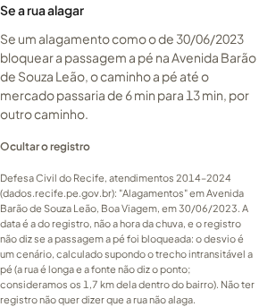

# VEREDA · Patch notes da madrugada 🎮

**15/11/2026 · Recife · Status para a equipe**

> **Tu tem dois apês salvos e tempo para visitar um. Qual vai primeiro? Qual informação faria tu mudar de ideia?**

O VEREDA hoje é um **piloto web para escolher qual imóvel visitar primeiro no Recife**. A pessoa traz os anúncios que já encontrou, monta um dossiê de cada imóvel e compara custo, espaço e rotina. O app mostra o que pesa na escolha e transforma o que falta em pergunta para a visita ou para o corretor. Encontrou a resposta? Dá para voltar e ver se a ordem muda.

```text
🔗 Anúncio A + anúncio B
          ↓
🏢 Confirmar os prédios e abrir os dossiês
          ↓
⚖️ Comparar custo, espaço e rotina
          ↓
❓ Responder o que pode virar o jogo
          ↓
📍 Escolher qual visitar primeiro e por quê
```

| 🌍 Mapa | 🏢 Cadastro | 🧪 Evidência |
|---|---|---|
| **6 bairros** com camadas do piloto. Boa Viagem, Casa Forte, Graças, Espinheiro, Madalena e agora Torre. | **2.825 prédios** nos seis bairros do piloto. O índice cadastral mais amplo tem **7.206 em 72 bairros**, com cobertura variável por recurso. | **1.593 testes automatizados passaram** na conferência local. A entrega registrou **50/50 passos no teste do fluxo web**. **0 sessões com pessoas em busca ativa no fluxo novo**, no registro pós-pivô. |

[Auditoria do piloto](../aplicacao/execucoes/VE17/summary.md) · [Entrega de 15/11](../aplicacao/execucoes/moradia-2026-11-15/README.md)

## 🎒 O que já dá para jogar

| No app | O que a pessoa consegue fazer |
|---|---|
| **Trazer um imóvel** | Colar o link, importar quando a leitura funciona ou preencher manualmente. Confirmar o prédio quando houver correspondência no cadastro. |
| **Abrir o dossiê** | Conferir área e cadastro, separar gastos mensais conhecidos dos que faltam e abrir fontes. Ver lote, obras no entorno, sol por fachada, lado de onde pode vir o barulho e histórico de alagamento onde há dados. |
| **Entender a rotina** | Ver caminhada a partir da entrada para lugares mapeados, opções de transporte por horário **programado**, volta à noite e caminhos alternativos onde o mapa permite. |
| **Comparar dois imóveis** | Ver diferenças de custo, espaço e rotina, trocar prioridades, estimar quanto custa economizar tempo no caminho e responder à pergunta que pode mudar a ordem das visitas. “Onde mais procurar” sugere áreas pela rotina e pelo tempo de viagem. |
| **Visitar, guardar e negociar** | Levar roteiro, guardar observações e medições por cômodo, recuperar comparáveis do próprio caderno e copiar uma mensagem editável para o corretor. “Desde que você guardou” compara o que foi salvo com o que o app consegue verificar de novo. Caderno, perfil e destinos ficam no aparelho por padrão, com backup e restauração. |

**NPC do anúncio:** “Condomínio a confirmar.” **Tu:** “Mas quanto precisa ser para eu trocar de apê?” Na comparação, a resposta pode inverter a ordem de visita. No bloco de chuva, **6 → 13 min** é o cenário calculado se a passagem ficar bloqueada. [Comparação no teste web](../aplicacao/execucoes/VE15/logs/depois-1200-360.png) · [Internet no caderno](../aplicacao/execucoes/moradia-2026-11-15/verificacao/telas/internet-360.png) · [Inventário completo de funcionalidades](../aplicacao/FEATURE-REGISTER.md)



## 🧩 O patch das últimas 24 h

| Frente | O que apareceu ou mudou |
|---|---|
| **App e dados** | **Torre entrou** nas camadas do piloto. A atualização de dados ganhou conferência, retomada e possibilidade de voltar à versão anterior. A carga inicial web caiu de **30,08 MB para 3,45 MB de JavaScript** no teste de exportação. Os dados de cada área passaram a carregar sob demanda. É medição de computador. |
| **Madrugada de 15/11** | **Chuva** ganhou histórico da rua mesmo quando o desvio é pequeno, e separa registro oficial, ponto mapeado e cenário de passagem bloqueada. **Internet** ganhou registro de consulta de fibra por endereço/bloco/unidade e de teste Wi‑Fi ou rede móvel por cômodo. **Preço** ganhou rótulos por tipo. O que alimenta o app hoje continua sendo anúncio e avaliação fiscal do ITBI. |
| **Experimentos** | **CoolWalk** rodou 204 comparações em Graças e Espinheiro, sem alternativa robusta. Há **15 trechos** para conferir em campo. **Estrutura** ganhou um modelo de linha do tempo testado, ainda sem caso completo ligado a um prédio do piloto e sem tela nova. **Criminalidade** chegou ao recorte municipal na SDS. A série por bairro é a próxima busca. |
| **Negócio** | A pasta `vereda-negocio` ganhou pesquisa de público, mercado e concorrência. A aposta em discussão é usar a comparação como porta de entrada e testar um **serviço assistido antes de assinar**, com documentos e apoio de parceiros do lado de quem compra ou aluga. Passe, preço e canal de venda são hipóteses. A carteira que existe no app usa créditos de teste. |
| **Acesso a dados** | **17 pedidos LAI já têm texto pronto.** O arquivo de acompanhamento segue sem envios registrados. |

[Torre e atualização](../aplicacao/execucoes/VE16/summary.md) · [Desempenho web](../aplicacao/execucoes/VE12/payload-split.md) · [Seis frentes de moradia](../aplicacao/execucoes/moradia-2026-11-15/README.md) · [Pesquisa de negócio](../../../vereda-negocio/vereda/01-discovery/market-analysis.md) · [Pedidos LAI](../aplicacao/pedidos-lai-recife.md)

## 👾 Os bosses da fase

1. **Provar que alguém toma uma decisão melhor.** Na pesquisa exploratória de outubro, **71 de 83 pessoas** relataram taxas, condomínio ou IPTU omitidos ou maiores que o anunciado. A avaliação era do conceito antigo. Agora precisamos observar quem está escolhendo imóvel de verdade e medir se encontra a pergunta decisiva e justifica a primeira visita mais rápido. O bot dos testes ainda não precisou pagar condomínio.
2. **Conferir os dados que sustentam muita coisa.** Quatro registros sustentam todos os cenários de desvio por chuva. Um sustenta 147 dossiês. A fila geral tinha 259 linhas aguardando revisão na auditoria. Antes de ampliar o mapa, precisamos saber quanto tempo leva confirmar uma linha e quais erros se repetem.
3. **Fazer o fluxo sobreviver ao celular e ao mundo real.** Faltam testes do piloto em aparelhos físicos. Conferir abertura do dossiê, carregamento, tela pequena, offline após a primeira abertura, permissões e internet por cômodo. A leitura de links varia por portal, então o preenchimento manual também precisa ser rápido.
4. **Alinhar a promessa ao que aparece na tela.** “Valor real das escrituras” depende de fonte registral. “Como está a segurança no bairro” pede evidência na escala do bairro. Hoje dá para demonstrar **avaliação fiscal** e **fatos da volta à noite**. Estrutura depende de documento ligado ao prédio e sombra a pé depende de observação.

[Próximo programa de testes](../aplicacao/NEXT-PROGRAMME.md) · [Pesquisa com clientes e monetização](../../../vereda-negocio/04-CLIENTES-METRICAS-E-MONETIZACAO.md) · [Promessas e evidências](../aplicacao/execucoes/moradia-2026-11-15/README.md)

## 🕹️ Tela de seleção de missão

**Agora, a missão principal é tornar o piloto testável com pessoas.** Em paralelo, dá para mandar pedidos de dados e abrir uma chamada de recrutamento. Cada missão abaixo termina com algo que outra pessoa consegue conferir.

| | Missão | Quando está pronta |
|---|---|---|
| 🔥 | **Revisar os quatro vínculos de chuva** | Quatro casos anotados com fonte, rua, trecho e decisão. O plano pede **pelo menos três confirmados** para manter a exibição dos desvios sem reavaliar o bloco. Cronometrar uma folha de revisão para estimar o custo de manter os seis bairros. |
| 🔥 | **Recrutar e rodar cinco testes de uso** | Cinco pessoas em busca ativa escolhem uma primeira visita só com os anúncios e em uma tarefa equivalente com o VEREDA. Registrar tempo, fato que pesou e pergunta que ficou. |
| 🔥 | **Revisar design e experiência** | Passar por `Início → Confirmar prédio → Dossiê → Comparar → Roteiro` no celular. Escolher os três atritos mais graves, corrigir e comparar antes/depois. Testar também leitura de anúncio que falha, dado faltante e volta sem internet. |
| 🔥 | **Enviar a primeira leva de LAIs** | Começar por **P01 CTTU**, **P03 Defesa Civil**, **P12 SDS**, **P07 Finanças** e **P02 COP**. Uma pessoa assume os envios e anota os protocolos. |
| 🎤 | **Preparar entrevista com um corretor** | Roteiro de 20 minutos com um caso recente. Perguntar o que costuma faltar no anúncio, quais documentos chegam antes do sinal e que pergunta do cliente evita uma visita perdida. Sair com três achados e uma hipótese para testar. |
| 🎬 | **Gravar um Reel de curiosidade no Instagram do VEREDA** | Abrir o vídeo de 20–30 s com **“Sol nascente é do apê ou do anúncio?”** Mostrar o sol por fachada no app e ensinar a checar de que lado ficam as janelas. Fechar com “Tá comparando apês no Recife? Vem testar.” Contar interessados locais e sessões marcadas. View é XP, sessão é missão concluída. |
| 🧪 | **Testar CoolWalk e internet em campo** | Duplas conferem os 15 trechos do roteiro de sombra por lado, horário e marquise. Em duas visitas, testar se alguém consegue consultar fibra e guardar um teste no cômodo certo, em aparelhos reais. |
| 💼 | **Testar a hipótese pré-contrato** | Acompanhar manualmente um caso com documentos cedidos pelo participante, por exemplo uma ata com cota extra, e medir tempo, utilidade e disposição a pagar pelo serviço. Usar o que se aprendeu para decidir se vale automatizar. |

**Fila de desbloqueios.** Laudo ou certidão para o primeiro histórico predial completo. Contagens de roubo a pedestres por bairro. Amostra autorizada de preços registrados. Calçadas, feiras, escolas, saúde, água e energia para aprofundar a rotina. Parnamirim ou Aflitos entram na conversa quando a revisão dos dados couber no tempo da equipe. [Dados prioritários](fontes-prioritarias-recife-2026-11-14.md) · [Parcerias e dados](../../../vereda-negocio/03-DADOS-PARCERIAS-E-MOAT.md) · [Roteiro do CoolWalk](../aplicacao/execucoes/moradia-2026-11-15/2-sombra/roteiro-observacao.csv)

> **Entrou no lobby?** Manda no grupo `pego [missão] / entrego [resultado] / até [dia]`. Se tu tem dois anúncios reais, um celular para testar ou conhece um corretor que topa conversar, já trouxe loot raro.

Para abrir o app localmente com as dependências instaladas, use `npm run web` no repositório principal.

---

*Recorte aproximado de 14/11 às 02h15 a 15/11 às 02h15, horário de Recife. O patch foi conferido pelos relatórios datados, arquivos locais e estado do Git. A branch `main` não registrava commit novo nessa janela. O trabalho recente estava no diretório local. A pasta irmã `vereda-negocio` é a fonte das hipóteses comerciais deste resumo.*
