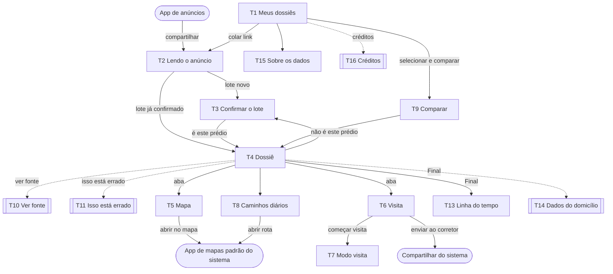

# Vereda: UI/UX e Key Visual

Iniciado em 15/10/2026. Base: [PRD 2.1](PRD-Vereda-2.1.md), de 14/10/2026, revisado em 15/10/2026 (crime por bairro e regra de marcas), e a [pesquisa de viabilidade](pesquisa-viabilidade/SINTESE.md). Este documento alimenta o mock em HTML (claro e escuro) e, depois, o porte para React Native + Expo.

## Decisões posteriores ao PRD

Crime por bairro ("registros da SDS-PE compilados pelo Crime Brasil", registro oficial) e a regra de marcas (veda propaganda, não citação) já estão no PRD revisado. As decisões abaixo ainda não estão.

| Data | Decisão |
| --- | --- |
| 15/10/2026 | Direção visual: aplicativo de imóveis. Cabeçalho de app, mapa no topo, preço em cartão, seções que se expandem, contagens por tipo em anel. Substitui a "prancha de cadastro" do briefing inicial. |
| 15/10/2026 | A cor identifica a categoria e nunca julga (seção 1.2). Substitui "fato não tem cor, só a origem tem". |
| 15/10/2026 | O exemplo principal do mock é um anúncio de aluguel em Boa Viagem, com dados mock tão completos quanto os de compra (régua com quartis, N e controles). |
| 15/10/2026 | No mock, o crime do bairro é comparado com os bairros que fazem divisa com ele (malha oficial de bairros), em ocorrências por mil moradores (Censo 2022). |
| 15/10/2026 | Rotas e "abrir no mapa" vão para o app de mapas padrão do sistema, sem seletor próprio (seção 3.5). |
| 15/10/2026 | T1 vira a tela de entrada: logotipo no cabeçalho, cartão para colar o link com a frase da imagem-chave, aviso de leitura e bairros cobertos, a lista de dossiês, os quatro passos e o acesso a "Sobre os dados" (seção 5.1). |
| 15/10/2026 | T1 com cara de aplicativo: miniatura da imagem-chave (seção 7.7) no cartão de entrada, campo com o botão "Colar" dentro, cartão de créditos com saldo, trilho, formas de ganhar e extrato numa folha nova (T16), lista com chip de tipo e seta. A etiqueta "Protótipo" sai de todas as telas; só "Final" continua (seção 4.14). Os quatro dossiês fictícios ganham endereço e campos de anúncio inventados, marcados como ilustrativos nos dados (seção 8.3). Substitui "sem ilustração no topo". |
| 15/10/2026 | Créditos são Protótipo, sem etiqueta "Final": o cartão em T1, a pílula do cabeçalho e a folha T16 aparecem sempre. "Comprar créditos" fica na tela para mostrar o modelo de negócio na apresentação (PRD 1.1, seção 10), sem preço e sem destino no mock. |

As divergências que essas decisões criam com o PRD estão em [Pendências de PRD](#pendências-de-prd), no fim do documento. Quando o PRD atualizado chegar, `docs/PRD-Vereda-2.1.md` é substituído pela versão nova sem edição, e as duas tabelas são revistas.

## 1. Princípios de interface

O Vereda se parece com um aplicativo de imóveis: cabeçalho de app, mapa no topo, preço em destaque, seções que se abrem com um toque. A diferença está no que cada número carrega. Todo número tem origem, data e escala, e nenhum vem com julgamento (PRD, regra 1).

A primeira leitura é curta. A tela mostra o resumo de cada seção, e o detalhe aparece quando a pessoa abre a seção. Quem quer conferir encontra a fonte a um toque.

### 1.1 Princípios

| # | Princípio | O que acontece na tela | Motivo |
| --- | --- | --- | --- |
| P1 | Toda afirmação tem fonte, data e escala | Seção fechada: o resumo traz a escala no próprio texto ("em 12 meses", "no bairro") e a fonte curta. Seção aberta: rodapé com fonte, datas, texto fixo do PRD e "Ver fonte". | PRD, regra 1 |
| P2 | Posição é fato; adjetivo é veredito | Comparação só como régua, com uma frase de posição ("entre os 25% mais altos"). Nenhuma nota, score, estrela, selo, "ótimo preço" ou recomendação. | PRD, regra 1 |
| P3 | Régua só onde a fonte compara divisões | Régua em aluguel ou preço, IPTU, condomínio, idade e área. Renda do setor sem régua. Crime: contagem bruta do bairro e, ao lado, a taxa por mil moradores do bairro e dos vizinhos de divisa, na ordem do mapa e não do valor. Defesa Civil: contagem por tipo, sem régua. | PRD, regra 2; textos fixos de Renda e Crime; decisão de 15/10/2026 |
| P4 | Resultado antes de qualquer pergunta | A entrada leva direto ao dossiê. Dados do domicílio só dentro do dossiê, opcionais, guardados no aparelho. | PRD, regra 3 |
| P5 | Quem lê o anúncio é o aparelho | A leitura na WebView aparece como etapa. Só campos da lista branca. Nome, telefone e CRECI do anunciante nunca aparecem. | PRD, regra 4 |
| P6 | Nenhum tempo de deslocamento no Protótipo | O mapa mostra raios de 500 m, 1 km e 1,5 km, rotulados "em linha reta". "Abrir mapa" e "Abrir rota" entregam o local ao app de mapas padrão do sistema (seção 3.5). | PRD, regra 6; item 8; decisão de 15/10/2026 |
| P7 | Confiança visível em 4 rótulos | Com a seção aberta, cada valor leva o traço do seu rótulo, e o rodapé diz o rótulo por extenso (seção 1.3). | PRD, regra 7 |
| P8 | "Não sabemos" é um estado | Ocupa o lugar do valor, com o mesmo peso e o traço pontilhado. Nunca some nem vira mensagem de erro. | PRD, regra 7 |
| P9 | Contestar nunca esconde | "Isso está errado" abre motivos fechados e mantém o valor visível. "Não é este prédio" reabre a confirmação do lote. | PRD, item 12; Final |
| P10 | Fonte citada, marca não promovida | Fontes nomeadas no rodapé, em texto. Nenhum app de mapas é nomeado nem mostrado: quem escolhe é o sistema. Nenhum logo ou captura de terceiros. | PRD, regra 8; decisão de 15/10/2026 |
| P11 | O lote é a identidade do prédio | No mapa do topo, o pino do prédio e o polígono do lote confirmado. Na lista de dossiês, o polígono. Nenhuma foto de anúncio. | PRD, "O que o produto é"; regra 4 |
| P12 | Pouco texto na primeira leitura | Seções fechadas por padrão. Só "Para perguntar na visita" fica sempre aberta, porque é a ação que o dossiê prepara. | Decisão de 15/10/2026 |
| P13 | Movimento só responde ao toque | Abrir seção, abrir fonte, confirmar lote. Nenhuma animação de entrada. | Decisão do briefing |

Como os 4 blocos do PRD (item 4) aparecem na tela:

| Bloco do PRD | Na tela |
| --- | --- |
| Cadastro | Seção "O prédio" e seção "Obras próximas"; polígono do lote no mapa |
| Fiscal e custo | Cartão de preço com a régua; "Custos por partes" no Final |
| Defesa Civil | Seção "Defesa Civil no bairro" |
| Consistência | Cartão "Para perguntar na visita", com o que não bate e o que não sabemos (inclui suscetibilidade) |

"O bairro" (crime por área) é um cartão extra do mock, conforme o PRD.

### 1.2 Cor: identifica a categoria, nunca julga

Cada categoria tem uma cor fixa: um tipo de ocorrência, um tipo de atendimento, um tipo de ponto no mapa, uma parte do custo. A cor diz "isto é roubo", nunca "isto é muito" ou "isto é ruim". Uma cor que marca valor alto ou baixo seria um veredito sem palavras (regra 1).

| Cor | Papel |
| --- | --- |
| Barro | A marca, a ação principal (um botão por tela) e o próprio anúncio: pino do prédio no mapa, marcador na régua |
| Azul cadastral | Contorno do lote confirmado e traço de "registro oficial" |
| Paleta de categorias (6 cores, seção 2) | Fatias dos anéis e quadrados da lista. A cor fica presa ao tipo, igual em qualquer bairro. Não muda com a ordem nem com o tamanho. |
| Neutros | Texto, superfícies, base do mapa |

Regras:

- Verde, vermelho e amarelo de alerta não aparecem em nenhum fato.
- Nenhuma escala de cor por gravidade ou intensidade. Camadas contínuas no mapa (calor, no Final) usam uma escala de claro a escuro num tom neutro, com legenda numérica.
- A cor nunca carrega a informação sozinha. Todo anel vem com a lista de nomes e números ao lado.
- O centro do anel só mostra contagem (ocorrências, atendimentos). Dinheiro nunca vira total no centro de um anel (Custo de vida, Final: "nunca um total").
- Crime é a exceção à paleta de categorias: o anel usa tons de um único cinza, como o texto fixo do PRD pede ("sem cor"). A seção mostra primeiro o número total; a divisão por natureza fica num segundo toque ("Ver por natureza").

### 1.3 Fonte, data, escala e rótulo em cada seção

Seção fechada:

```
[ícone]  Defesa Civil no bairro                [anel pequeno]  ⌄
         206 atendimentos em 2024
```

Seção aberta:

```
         [anel com 206 no centro]
         ■ Atendimento social                  65
         ■ Análise visual estrutural           63
         ...
         Registro oficial. Registro de atendimentos da Defesa Civil 2024,
         Boa Viagem, Prefeitura do Recife, consultado em 15/10/2026.
         [texto fixo do PRD]                              Ver fonte
```

| Elemento | Regra |
| --- | --- |
| Resumo da seção fechada | Número principal e escala na mesma frase. Uma linha. |
| Valor | Algarismos tabulares, unidade junta (m², R$, /mês). Milhar com ponto, decimal com vírgula. |
| Rótulo de confiança | Na seção aberta, um traço curto antes de cada valor; no rodapé, o rótulo por extenso. Em seções de uma fonte só, basta o rodapé. |
| Rodapé | Ordem fixa: rótulo, fonte, recorte, data de referência, data da consulta, texto fixo do PRD, "Ver fonte". Um rodapé nunca cobre duas fontes. |
| Fonte | Órgão e base. Com intermediário, as duas fontes, como no texto fixo de crime: "registros da SDS-PE compilados pelo Crime Brasil". Para o anúncio: "declarado pelo anunciante, lido em 15/10", sem nome de portal. |
| Data | dd/mm/aaaa, ou mês e ano em períodos ("out/2025 a set/2026"). |
| Escala | O texto fixo do PRD entra literal. Sem texto fixo no PRD, a escala mínima é base, recorte territorial e período. |
| Ver fonte | Abre N, período, raio, linhas usadas e o link da base. Mesmo componente em todo o app. |

Traços dos rótulos:

| Rótulo | Traço |
| --- | --- |
| registro oficial | linha cheia, azul cadastral |
| declarado pelo anunciante | linha tracejada |
| inferência ou sinal exploratório | hachura |
| não sabemos | pontilhado |

O traço sempre vem com o texto do rótulo em algum ponto da seção. A forma sozinha não basta para quem não distingue os traços, e o leitor de tela lê o texto.

### 1.4 Tom de voz

Direto, sem desculpa, sem exclamação, frases curtas. O app fala com "você" e se refere a si como "o Vereda" (como no texto fixo de Rotas). Nunca diz "eu". Títulos de seção em linguagem comum: "O prédio", "Defesa Civil no bairro", "O bairro", "Obras próximas", "Para perguntar na visita". Os textos de cartão cobertos pelo PRD entram literalmente; a seção 6 reúne o restante.

| Regra | Assim | Não assim |
| --- | --- | --- |
| Dizer o que aconteceu e o próximo passo | "Este link não é de um anúncio de apartamento. Cole outro link." | "Ops! Algo deu errado" |
| Sem desculpa | "O anúncio não abriu. Tente de novo ou cole outro link." | "Desculpe, não conseguimos..." |
| Posição, não adjetivo | "R$ 36/m², entre os 25% mais altos dos aluguéis anunciados no bairro" | "ótimo preço", "bairro seguro", "região valorizada" |
| "Não sabemos" sem eufemismo | "não sabemos" | "dado indisponível no momento", "em breve" |
| Pergunta concreta para a visita | "O anúncio diz 3 suítes e 1 banheiro." | "Atenção: anúncio inconsistente" |
| Botão com verbo, até 3 palavras | "Preparar visita", "Abrir mapa", "Ver fonte" | "Clique aqui", "OK", "Continuar →" |
| Sem caixa alta e sem travessão | "Defesa Civil no bairro" | "DEFESA CIVIL", "Fiscal — IPTU" |

## 2. Tokens

Os valores saem do layout aprovado em 15/10/2026 (seção 1). Os mesmos nomes valem no mock em HTML (variáveis CSS) e no React Native (objeto de tema). O modo escuro é o mesmo documento com a luz apagada: os papéis não mudam, só os valores.

### 2.1 Cores

Base:

| Token | Claro | Escuro | Papel |
| --- | --- | --- | --- |
| `cor-fundo` | #F3F4F2 | #14181B | Fundo da tela |
| `cor-superficie` | #FFFFFF | #1F2427 | Cartões, seções, barra de abas, pílulas sobre o mapa |
| `cor-texto` | #22292D | #E4E7E5 | Texto, ícones, contorno de foco |
| `cor-texto-apoio` | #636B6F | #8E969A | Resumos, rodapés de fonte, rótulos de aba inativos |
| `cor-linha` | #E2E5E2 | #2C3338 | Divisores e trilho da régua. Decorativa: nunca carrega informação sozinha |
| `cor-traco` | #7C8488 | #8E969A | Traços de confiança e marcas de escala em gráfico. Nunca texto no claro |
| `cor-nota` | #F6EEE8 | #2A2622 | Fundo do cartão "Para perguntar na visita" |

Marca e origem:

| Token | Claro | Escuro | Papel |
| --- | --- | --- | --- |
| `cor-barro` | #8C3D1D | #D9805A | Marca, botão principal (um por tela) e o anúncio: pino no mapa, marcador na régua |
| `cor-sobre-barro` | #FFFFFF | #14181B | Texto e ícone sobre o barro |
| `cor-faixa-regua` | #D1B1A5 | #574036 | Faixa entre P25 e P75 da régua |
| `cor-azul-cadastral` | #2E5A85 | #7FA6CE | Contorno do lote confirmado e traço de "registro oficial". Nada mais |

Categorias (fatias de anel e quadrados da lista). No máximo cinco categorias e "outros" por gráfico. A cor fica presa ao tipo em todo o app; o mapeamento tipo → cor vive nos dados (seção 8).

| Token | Claro | Escuro |
| --- | --- | --- |
| `cat-ipe-roxo` | #6B4DB0 | #A88BE0 |
| `cat-goiaba` | #B4436C | #E58BA8 |
| `cat-ipe-amarelo` | #A87512 | #E8B54A |
| `cat-mare` | #1F7F7A | #4FB3AE |
| `cat-terra` | #8A7A60 | #CDBFA8 |
| `cat-outros` | #B9C0BC | #5C656A |

O barro e o azul cadastral ficam fora da paleta de categorias, para que uma fatia nunca se confunda com o anúncio ou com a origem oficial. Verde e vermelho não existem na paleta.

Crime (seção 1.2: anel em tons de um único cinza):

| Token | Claro | Escuro | Uso |
| --- | --- | --- | --- |
| `crime-1` | #2E3538 | #E4E7E5 | Barra do bairro do dossiê; maior fatia |
| `crime-2` | #7C8488 | #8E969A | Fatias intermediárias |
| `crime-3` | #C3C8C5 | #4A5357 | Barras dos vizinhos; demais fatias |

Mapa:

| Token | Claro | Escuro |
| --- | --- | --- |
| `mapa-terra` | #ECEAE4 | #1D2327 |
| `mapa-via` | #FFFFFF | #2E363B |
| `mapa-mar` | #D3E3E8 | #15252D |
| `mapa-praia` | #F1E8D6 | #2A2A25 |
| `mapa-praca` | #DDE6DA | #1E2A26 |

A base do mapa é neutra. Sobre ela só aparecem o pino em barro, o lote em azul cadastral, o raio em barro tracejado e os pontos de interesse em pílulas de superfície com ícone na cor da categoria.

### 2.2 Contraste (WCAG 2.1 AA)

Texto exige 4,5:1; elemento gráfico que carrega informação exige 3:1. Calculado pela fórmula de luminância relativa do WCAG.

| Par | Claro | Escuro | Mínimo |
| --- | --- | --- | --- |
| `cor-texto` sobre `cor-fundo` | 13,37 | 14,33 | 4,5 |
| `cor-texto` sobre `cor-superficie` | 14,76 | 12,58 | 4,5 |
| `cor-texto` sobre `cor-nota` | 12,87 | 12,05 | 4,5 |
| `cor-texto-apoio` sobre `cor-fundo` | 4,93 | 5,93 | 4,5 |
| `cor-texto-apoio` sobre `cor-superficie` | 5,44 | 5,21 | 4,5 |
| `cor-texto-apoio` sobre `cor-nota` | 4,74 | 4,99 | 4,5 |
| `cor-sobre-barro` sobre `cor-barro` | 7,50 | 6,11 | 4,5 |
| `cor-azul-cadastral` sobre `cor-superficie` | 7,20 | 6,16 | 4,5 |
| `cor-barro` sobre `cor-superficie` | 7,50 | 5,36 | 3 |
| `cor-traco` sobre `cor-superficie` | 3,81 | 5,21 | 3 |
| `cor-barro` (marcador) sobre `cor-faixa-regua` | 3,77 | 3,28 | 3 |
| `cat-ipe-roxo` sobre `cor-superficie` | 6,34 | 5,55 | 3 |
| `cat-goiaba` sobre `cor-superficie` | 5,30 | 6,41 | 3 |
| `cat-ipe-amarelo` sobre `cor-superficie` | 4,02 | 8,31 | 3 |
| `cat-mare` sobre `cor-superficie` | 4,80 | 6,26 | 3 |
| `cat-terra` sobre `cor-superficie` | 4,17 | 8,67 | 3 |
| `crime-1` sobre `cor-superficie` | 12,48 | 12,58 | 3 |
| `crime-2` sobre `cor-superficie` | 3,81 | 5,21 | 3 |
| Ícone em `cor-fundo` sobre categoria, pior caso | 3,65 (ipê-amarelo) | 6,32 (ipê-roxo) | 3 |
| Contorno de foco (`cor-texto`) sobre `cor-fundo` | 13,37 | 14,33 | 3 |

Abaixo de 3:1, por decisão: `cat-outros` (1,85 / 2,63), `crime-3` (1,70 / 1,99), `cor-linha` e a faixa da régua contra o trilho (1,57 / 1,34). Nenhum deles carrega informação sozinho: "outros" e as barras dos vizinhos têm nome e número escritos ao lado, e os quartis da régua têm o valor escrito embaixo. O marcador do anúncio leva um anel de 2 px em `cor-superficie` para se separar da faixa.

### 2.3 Tipografia

Família única: Archivo, em instâncias estáticas, porque o Android do React Native não lê eixos de fonte variável com confiança. As cinco instâncias abaixo existem no repositório oficial da fonte e são as mesmas no mock e no app. Algarismos tabulares sempre (`font-variant-numeric: tabular-nums` no CSS, `fontVariant: ['tabular-nums']` no RN). Sem monoespaçada, sem caixa alta.

| Token | Instância | Tamanho (px = sp) | Linha | Uso |
| --- | --- | --- | --- | --- |
| `tipo-numero` | ArchivoCondensed-ExtraBold | 28 | 32 | Preço, número no centro do anel |
| `tipo-titulo-tela` | ArchivoCondensed-ExtraBold | 24 | 28 | Endereço no topo do dossiê |
| `tipo-barra` | Archivo-Bold | 16 | 20 | Título no cabeçalho |
| `tipo-botao` | Archivo-Bold | 15 | 20 | Botão principal |
| `tipo-secao` | Archivo-SemiBold | 14 | 20 | Título de seção e de cartão |
| `tipo-corpo` | Archivo-Regular | 14 | 20 | Texto e valores em linha |
| `tipo-apoio` | Archivo-Regular | 12 | 16 | Resumo de seção, chips, rodapé de fonte, rótulos de aba |
| `tipo-etiqueta` | Archivo-Medium | 12 | 16 | "ilustrativo", etiqueta de fase, segmento selecionado |

Nenhum texto abaixo de 12. O texto acompanha o tamanho de fonte do sistema; `tipo-numero` para em 1,3 vez o tamanho base para não quebrar a linha do preço.

### 2.4 Espaço, raio, linhas, ícones e toque

| Token | Valor | Uso |
| --- | --- | --- |
| `espaco-1` | 4 | Entre ícone e texto |
| `espaco-2` | 8 | Entre seções; entre chips |
| `espaco-3` | 12 | Margem lateral dos cartões; entre cartões |
| `espaco-4` | 16 | Padding interno de cartão; margem lateral do texto |
| `espaco-5` | 20 | Antes de um título de grupo |
| `espaco-6` | 24 | Respiro acima da barra de abas |
| `raio-quadrado` | 8 | Quadrado de categoria na lista |
| `raio-icone` | 10 | Fundo do ícone de seção |
| `raio-cartao` | 16 | Cartões, seções, mapa, botão principal |
| `raio-pilula` | 999 | Chips, segmentos, pílulas sobre o mapa, etiquetas |
| `linha-divisor` | 0,5 (hairline) | Divisores entre linhas de valor |
| `linha-traco` | 2 | Traço de confiança |
| `linha-lote` | 1,5 | Contorno do lote |
| `linha-raio` | 1,25, tracejado 4/4 | Raio de distância no mapa |
| `regua-trilho` | 6 de altura | Trilho e faixa da régua |
| `regua-marcador` | 14 de diâmetro, anel de 2 | Marcador do anúncio |
| `icone-p` / `icone-m` / `icone-g` | 16 / 20 / 24 | Em linha / em seção / na barra e no cabeçalho |
| `toque-minimo` | 48 × 48 | Toda área tocável, mesmo com ícone menor |

Sem sombra. A hierarquia vem do tom: `cor-superficie` sobre `cor-fundo`. Ícones de uma família só, de contorno, com traço 2, sem ícone preenchido. No mock, Tabler Icons; no porte, a mesma família, a confirmar contra a documentação do Expo do SDK do projeto.

### 2.5 Estados e movimento

| Estado | Regra |
| --- | --- |
| Foco | Contorno de 2 px em `cor-texto`, afastado 2 px, seguindo o raio do elemento |
| Pressionado | Sobreposição de `cor-texto` a 8% sobre o elemento, sem mudar o tamanho |
| Selecionado | Segmento: fundo `cor-superficie` e `tipo-etiqueta`. Aba: pílula `cor-nota` atrás do ícone e rótulo em `cor-texto` |
| Seção aberta | A seta gira 180°; o resumo e o anel pequeno saem, o conteúdo entra |

| Token | Valor | Uso |
| --- | --- | --- |
| `movimento-seta` | 150 ms | Giro da seta da seção |
| `movimento-secao` | 200 ms | Abrir e fechar seção |

Com "reduzir movimento" ligado no sistema, os dois viram 0. Nenhuma animação de entrada.

### 2.6 Variáveis CSS do mock

```css
:root {
  --cor-fundo: #F3F4F2; --cor-superficie: #FFFFFF; --cor-texto: #22292D;
  --cor-texto-apoio: #636B6F; --cor-linha: #E2E5E2; --cor-traco: #7C8488;
  --cor-nota: #F6EEE8; --cor-barro: #8C3D1D; --cor-sobre-barro: #FFFFFF;
  --cor-faixa-regua: #D1B1A5; --cor-azul-cadastral: #2E5A85;
  --cat-ipe-roxo: #6B4DB0; --cat-goiaba: #B4436C; --cat-ipe-amarelo: #A87512;
  --cat-mare: #1F7F7A; --cat-terra: #8A7A60; --cat-outros: #B9C0BC;
  --crime-1: #2E3538; --crime-2: #7C8488; --crime-3: #C3C8C5;
  --mapa-terra: #ECEAE4; --mapa-via: #FFFFFF; --mapa-mar: #D3E3E8;
  --mapa-praia: #F1E8D6; --mapa-praca: #DDE6DA;
}
:root[data-tema="escuro"] {
  --cor-fundo: #14181B; --cor-superficie: #1F2427; --cor-texto: #E4E7E5;
  --cor-texto-apoio: #8E969A; --cor-linha: #2C3338; --cor-traco: #8E969A;
  --cor-nota: #2A2622; --cor-barro: #D9805A; --cor-sobre-barro: #14181B;
  --cor-faixa-regua: #574036; --cor-azul-cadastral: #7FA6CE;
  --cat-ipe-roxo: #A88BE0; --cat-goiaba: #E58BA8; --cat-ipe-amarelo: #E8B54A;
  --cat-mare: #4FB3AE; --cat-terra: #CDBFA8; --cat-outros: #5C656A;
  --crime-1: #E4E7E5; --crime-2: #8E969A; --crime-3: #4A5357;
  --mapa-terra: #1D2327; --mapa-via: #2E363B; --mapa-mar: #15252D;
  --mapa-praia: #2A2A25; --mapa-praca: #1E2A26;
}
```

O mock segue o tema do sistema (`prefers-color-scheme`) e tem um seletor manual que grava `data-tema` no elemento raiz.

## 3. Mapa de navegação

### 3.1 Telas

Lista fechada. T12 (seletor de app de mapas) saiu em 15/10/2026: a saída para mapas passou para o sistema (seção 3.5). Nenhuma tela fora desta lista entra no mock nem no app sem passar por este documento. "Folha" é uma tela que sobe de baixo sobre a anterior e fecha com gesto ou botão.

| # | Tela | Tipo | Fase | Item do PRD | O que faz |
| --- | --- | --- | --- | --- | --- |
| T1 | Meus dossiês | Raiz | Protótipo | 1, 11 | Lista de dossiês, com o polígono do lote como imagem. Campo "Colar link" fixo no topo. Seleção de 2 ou 3 dossiês para comparar |
| T2 | Lendo o anúncio | Tela | Protótipo | 1, 2 | Abre o anúncio na WebView do aparelho e lê os campos da lista branca. Mostra a etapa em curso. Estados: lendo, não abriu, não é anúncio de apartamento, fora dos bairros cobertos |
| T3 | Confirmar o lote | Tela | Protótipo | 3 | Mapa com o lote encontrado. "É este prédio" ou "Não é este", com os lotes vizinhos para escolher |
| T4 | Dossiê | Aba | Protótipo e Final | 4 a 7; Final | A tela aprovada na seção 1. Cartões do Final aparecem com etiqueta de fase |
| T5 | Mapa | Aba | Protótipo e Final | 8; Final | Pontos de interesse e raios de 500 m, 1 km e 1,5 km. No Final, camadas de 3D e sombra, calor e alagamento |
| T6 | Visita | Aba | Protótipo | 9 | Roteiro de visita e mensagem ao corretor, com o resumo de 3 linhas e o formato para WhatsApp |
| T7 | Modo visita | Tela cheia | Protótipo | 10 | Checklist, GPS que confirma o prédio, foto da fachada, cronômetro, ruído e bússola |
| T8 | Caminhos diários | Tela | Protótipo e Final | 12; Final | Destinos que a pessoa guarda no aparelho, com a distância em linha reta a partir do prédio. Cada um abre o app de mapas padrão (seção 3.5). No Final, rotina de 3 pontos, isócronas e trânsito típico |
| T9 | Comparar | Tela | Protótipo | 11 | Fatos lado a lado de 2 ou 3 dossiês, diferença por magnitude, sem recomendação. Comparáveis abertos pela pessoa, como lista e faixa |
| T10 | Ver fonte | Folha | Protótipo | Regra 1 | N, período, raio, linhas usadas, licença e link da base de um fato |
| T11 | Isso está errado | Folha | Protótipo | 12 | Motivos fechados de contestação. O fato continua visível |
| T13 | Linha do tempo do prédio | Tela | Final | Final | IPTU, ITBI, licenciamento e Defesa Civil em ordem de data |
| T14 | Dados do domicílio | Folha | Final | Final | Pessoas, criança em idade escolar, veículos, deslocamento, pet, em faixas. Só no aparelho. Botão "Apagar" |
| T15 | Sobre os dados | Tela | Protótipo | Regra 5; Aberto, jurídico 2 | Fontes, licenças e atribuições exigidas. "Apagar dados do aparelho" |
| T16 | Créditos | Folha | Protótipo (dados inventados no mock) | PRD 1.1, seção 10 | Saldo, extrato de movimentos e as três formas de ganhar crédito. "Comprar créditos" sem preço, para mostrar o modelo de negócio |

A barra de abas aparece só dentro de um dossiê, com quatro destinos: Dossiê (T4), Mapa (T5), Visita (T6) e Meus dossiês (T1). Fora do dossiê não há barra.

### 3.2 Fluxos

| De | Ação | Para |
| --- | --- | --- |
| App de anúncios | Compartilhar com o Vereda | T2 |
| T1 | Colar link | T2 |
| T2 | Lote encontrado, prédio ainda não confirmado neste aparelho | T3 |
| T2 | Lote já confirmado neste aparelho | T4 |
| T2 | Não abriu, não é anúncio, fora dos bairros | Fica em T2, com o estado e "Cole outro link" |
| T3 | É este prédio | T4 |
| T3 | Não é este | T3, com os lotes vizinhos |
| T4 | Ver fonte, em qualquer seção | T10 |
| T4 | Isso está errado | T11 |
| T4 | Não é este prédio | T3 |
| T4 | Abrir mapa, no cartão do mapa | T5 |
| T4 | Caminhos diários | T8 |
| T4 | Preparar visita | T6 |
| T4 | Linha do tempo (Final) | T13 |
| T4 | Informar meu domicílio, no custo por partes (Final) | T14 |
| T5, T8 | Abrir no mapa, abrir rota | App de mapas padrão do sistema (seção 3.5) |
| T6 | Enviar ao corretor | Folha de compartilhamento do sistema |
| T6 | Começar visita | T7 |
| T7 | Encerrar | T6, com o que foi registrado |
| T1 | Selecionar 2 ou 3 e "Comparar" | T9 |
| T9 | Tocar num dossiê | T4 |
| T1 | Sobre os dados | T15 |
| T1 | Pílula de créditos no cabeçalho, "Ver extrato" ou "Comprar créditos" | T16 |

Voltar sempre volta para a tela anterior. Uma folha fecha com gesto para baixo ou com "Fechar". O link compartilhado abre o dossiê certo mesmo com o app fechado.

### 3.3 Diagrama



Retângulo: tela. Retângulo duplo: folha. Elipse: fora do app.

### 3.4 Rotas

Proposta para o porte com Expo Router, com as telas em `src/app/`. O mock em HTML usa os mesmos caminhos como âncoras (`#/dossie/boa-viagem/mapa`). Os nomes de arquivo e o tipo de apresentação das folhas devem ser conferidos na documentação do Expo Router da versão do SDK do projeto antes do porte (AGENTS.md).

| Tela | Caminho |
| --- | --- |
| T1 | `/` |
| T2 | `/ler?url=` |
| T3 | `/dossie/[id]/confirmar-lote` |
| T4 | `/dossie/[id]` |
| T5 | `/dossie/[id]/mapa` |
| T6 | `/dossie/[id]/visita` |
| T7 | `/dossie/[id]/visita/ao-vivo` |
| T8 | `/dossie/[id]/caminhos` |
| T9 | `/comparar?ids=` |
| T10 | `/dossie/[id]/fonte/[fato]` |
| T11 | `/dossie/[id]/contestar/[fato]` |
| T13 | `/dossie/[id]/linha-do-tempo` |
| T14 | `/dossie/[id]/domicilio` |
| T15 | `/sobre-os-dados` |
| T16 | `/creditos` |

### 3.5 Saída para o app de mapas

Decisão de 15/10/2026: o Vereda não monta lista de apps. Entrega o local ao sistema, e o sistema abre o app de mapas padrão ou pergunta qual usar. Base: relatório [inv4](pesquisa-viabilidade/inv4-rotas-externas.md).

| Plataforma | Link | O que leva | Comportamento |
| --- | --- | --- | --- |
| Android | `geo:0,0?q=lat,lng(rótulo)` | Só o destino | Abre o app padrão; sem padrão definido, o sistema mostra a lista de apps que aceitam `geo:` |
| iOS | `https://maps.apple.com/directions?source=lat,lng&destination=lat,lng&mode=` (iOS 18.4+) | Origem, destino e modo | Abre o Apple Maps |

Consequência nos Caminhos diários (T8): no Android a rota parte de onde a pessoa está, não do prédio, porque `geo:` não leva origem. A T8 mostra a distância em linha reta a partir do prédio e o texto fixo de Rotas. A rota completa a partir do prédio só existe no iOS.

O que essa decisão elimina: a lista de apps instalados, as declarações `<queries>` no Android e `LSApplicationQueriesSchemes` no iOS, e duas dúvidas jurídicas do PRD (a 4, Google Maps URLs ao lado de MapLibre, e a 5, marcas no seletor).

Falta testar em aparelho: se o Android mostra a lista quando não há padrão, e o que cada app faz ao receber `geo:` (inv4, seção de testes).

## 4. Componentes

Cada componente usa só os tokens da seção 2. Os nomes abaixo valem no mock e no porte.

### 4.1 Estados comuns

Os seis estados valem para todo componente que mostra um fato. Cada componente diz, na sua tabela, quais deles se aplicam.

| Estado | Quando | Na tela |
| --- | --- | --- |
| Padrão | O fato existe e tem fonte | Valor, traço do rótulo, rodapé de fonte |
| Carregando | A consulta à fonte está em curso | Blocos em `cor-linha` no tamanho final do conteúdo, sem brilho animado (P13), e uma linha em `tipo-apoio` dizendo qual fonte está sendo lida: "Lendo o IPTU 2026" |
| Vazio | A fonte foi consultada e não tem registro | O zero como fato: "Nenhuma obra em 150 m desde 2017", com o texto fixo do PRD quando houver ("ausência não é irregularidade"). Rodapé de fonte normal |
| Não sabemos | Não há fonte, a fonte não cobre o caso, ou o campo não existe | "não sabemos" no lugar do valor, mesmo peso tipográfico, traço pontilhado, e uma linha com o motivo: "o IPTU não informa banheiros" |
| Contestado | Esta pessoa enviou "Isso está errado" sobre o fato | O valor continua. Pílula "Você contestou em 15/10" em `tipo-etiqueta`, sem cor de alerta |
| Em verificação | Duas contestações independentes sobre o mesmo fato (Final) | O valor continua. Pílula "Em verificação" com borda pontilhada e, em "Ver fonte", a data das contestações e o motivo |

Nenhum estado esconde o fato nem usa vermelho, amarelo de alerta ou ícone de perigo.

### 4.2 Seção de fato

A unidade do dossiê (seção 1.3). Fechada mostra ícone, título, resumo com escala, anel pequeno quando há contagem por tipo, e a seta. Aberta mostra as linhas de valor, o gráfico quando houver e o rodapé.

| Parte | Regra |
| --- | --- |
| Área de toque | A linha inteira do cabeçalho, no mínimo 48 de altura |
| Resumo | Uma linha, número e escala juntos. Em "carregando", vira bloco em `cor-linha` |
| Linha de valor | Nome à esquerda, valor à direita em `tipo-corpo` tabular, traço do rótulo antes do valor quando a seção mistura origens |
| Rodapé | Rótulo por extenso, fonte, recorte, data de referência, data da consulta, texto fixo, "Ver fonte" e "Isso está errado" |
| Estados | Todos os seis |
| Acessibilidade | Cabeçalho anuncia título, resumo e "expandido" ou "recolhido" |

### 4.3 Rótulo de confiança

| Variante | Traço (16 × 2) | Texto |
| --- | --- | --- |
| Registro oficial | Linha cheia, `cor-azul-cadastral` | registro oficial |
| Declarado | Tracejado 4/3, `cor-texto` | declarado pelo anunciante |
| Inferência | Hachura a 45°, `cor-texto` | inferência ou sinal exploratório |
| Não sabemos | Pontilhado 1/3, `cor-texto` | não sabemos |

O traço nunca aparece sem o texto em algum ponto da mesma seção. "Desconhecido oficial" (PRD, regra 7) só no cartão "Para perguntar na visita", com a variante "não sabemos".

### 4.4 Régua

Posição do anúncio numa distribuição (PRD, item 6).

| Parte | Regra |
| --- | --- |
| Trilho | `regua-trilho`, `cor-linha`, do menor ao maior valor do recorte |
| Faixa | P25 a P75 em `cor-faixa-regua`; mediana como marca vertical |
| Marcador | `regua-marcador` em `cor-barro`, anel de 2 em `cor-superficie`; valor do anúncio acima |
| Rótulos | P25, mediana e P75 escritos em `tipo-apoio` embaixo |
| Frase | "Acima de 58% dos aluguéis anunciados no bairro". Posição, nunca adjetivo |
| Controles | Segmentado de recorte (Bairro, 500 m, 1 km) e de período (12, 24 meses). Trocar refaz a régua e o rodapé |
| Rodapé | Texto fixo do PRD: "quartis do ITBI, [bairro ou raio de X m], [12 ou 24] meses, N = x" na compra; "anúncios de aluguel, [bairro], 12 meses, N = x" no aluguel (pendência 4) |
| Estados | Carregando; vazio (N abaixo de 10: a régua some e aparece "Poucos registros no recorte: N = 6. Aumente o raio ou o período"); não sabemos (anúncio sem área: o marcador some, a régua fica) |

O mínimo de 10 registros para desenhar quartis é proposta deste documento.

### 4.5 Anel de contagem

Contagem por tipo, no estilo aprovado (Defesa Civil, crime por natureza).

| Parte | Regra |
| --- | --- |
| Anel | Até 5 fatias e "outros", na ordem do maior para o menor; cor da categoria (seção 2.1), ou `crime-1` a `crime-3` no crime |
| Centro | Total em `tipo-numero` e a unidade ("atendimentos"). Nunca dinheiro |
| Lista | Quadrado de categoria com ícone, nome e número. Obrigatória: a cor não informa sozinha |
| Versão pequena | 30 × 30 no cabeçalho da seção fechada, sem texto |
| Estados | Carregando (anel em `cor-linha`); vazio ("Nenhum atendimento em 2024", sem anel); não sabemos |

### 4.6 Comparação com os vizinhos

Barras horizontais da taxa por mil moradores do bairro e dos bairros que fazem divisa (decisão de 15/10/2026).

| Parte | Regra |
| --- | --- |
| Ordem | Ordem do mapa, de norte a sul, nunca do maior para o menor |
| Barra | `crime-1` para o bairro do dossiê, `crime-3` para os vizinhos; escala comum começando em zero |
| Texto | Nome, taxa com uma casa decimal e contagem bruta entre parênteses |
| Rodapé | Texto fixo de crime do PRD e "Moradores: Censo 2022" |
| Estados | Carregando; não sabemos (vizinho sem dado: a barra vira "não sabemos" na mesma linha) |

### 4.7 Polígono do lote

| Uso | Regra |
| --- | --- |
| Mapa do topo do dossiê | Contorno `linha-lote` em `cor-azul-cadastral`, preenchimento do mesmo azul a 18%, pino em `cor-barro` |
| Lista de dossiês | Polígono sozinho em 40 × 32, sem mapa, no lugar da foto |
| Confirmar o lote (T3) | Lote candidato em azul; lotes vizinhos com contorno tracejado em `cor-traco`, tocáveis |
| Estados | Carregando (moldura em `cor-linha`); não sabemos (lote não resolvido: pino sem polígono e "Lote não confirmado" com "Confirmar o lote") |

### 4.8 Ver fonte (folha T10)

| Linha | Exemplo |
| --- | --- |
| Base | ITBI 2025 e 2026, Prefeitura do Recife |
| Licença | ODbL |
| Recorte | Boa Viagem, apartamentos |
| Período | out/2025 a set/2026 |
| N | 3.571 |
| Linhas usadas | valor de avaliação ÷ área construída |
| Consultado em | 15/10/2026 |
| Link | Abrir a base |

Um fato ilustrativo mostra, no topo da folha, "dado ilustrativo, pendente de fonte".

### 4.9 Isso está errado (folha T11)

Motivos fechados, um por envio, sem texto livre (o PRD deixa chat livre fora do produto):

1. O valor está diferente do que vi
2. Não é deste prédio
3. Está desatualizado
4. A fonte não diz isso

Depois do envio, a folha fecha, o fato passa ao estado "contestado" e uma linha confirma: "Recebido. O fato continua visível enquanto conferimos." No Protótipo, o envio vai para a fila manual (PRD, item 12).

### 4.10 Não é este prédio

Link em `tipo-apoio` no rodapé do cartão de endereço e no rodapé de "O prédio". Leva a T3 com o lote atual marcado e os vizinhos tocáveis. Ao escolher outro lote, o dossiê é refeito e o anterior sai de "Meus dossiês". No Final, reabre a confirmação para todos (PRD, Final).

### 4.11 Custo por partes (Final)

| Parte | Regra |
| --- | --- |
| Barra | Uma barra empilhada por parte, sem número total, sem porcentagem |
| Partes | Condomínio (declarado ou mediana do bairro), IPTU cobrado, transporte (tarifa × rota), cesta DIEESE, índice FIPE (cidade) |
| Lista | Cada parte com valor, rótulo e fonte própria |
| Estados | Não sabemos por parte (a parte aparece com "não sabemos" e a barra não inclui o trecho) |

PRD, Final: "Nunca um total."

### 4.12 Raios no mapa

Círculos de 500 m, 1 km e 1,5 km em `linha-raio` e `cor-barro`, centrados no pino. Pílula "500 m em linha reta" em `cor-superficie`. Pontos de interesse em pílulas com ícone na cor da categoria; tocar abre o nome, a distância em linha reta e a fonte. Nenhum tempo (PRD, regra 6).

### 4.13 Abrir no mapa

Botão secundário "Abrir rota" ou "Abrir no mapa". Entrega o destino ao sistema (seção 3.5). Abaixo, o texto fixo de Rotas. Sem nome nem ícone de app.

### 4.14 Etiqueta de fase

Pílula em `tipo-etiqueta`, contorno `cor-linha`, só com o texto "Final", no canto de cada tela, cartão e seção do Final. O que é do Protótipo não leva etiqueta (decisão de 15/10/2026: a tela precisa parecer o app, não o protótipo). O mock tem um seletor "Mostrar o Final" que esconde tudo com etiqueta "Final". Créditos são Protótipo e não têm etiqueta.

### 4.15 Ilustrativo

Pílula "ilustrativo" em `tipo-etiqueta`, contorno `cor-linha`, ao lado do valor ou no cabeçalho da seção. O leitor de tela lê "dado ilustrativo, pendente de fonte", o texto do PRD. "Ver fonte" repete o texto por extenso.

### 4.16 Para perguntar na visita

Cartão em `cor-nota`, sempre aberto. Uma linha por divergência entre anúncio e registro, ou por "não sabemos" que a visita pode resolver. Cada linha vira item do roteiro em T6.

## 5. Telas

Cada tela lista o conteúdo na ordem em que aparece, a etiqueta de fase e o que cada toque faz. Os textos entre aspas são exemplos; os textos fixos e de interface ficam na seção 6. Os dados de exemplo são do dossiê de aluguel em Boa Viagem (seção 8).

### 5.1 T1 Meus dossiês (Protótipo)

| Ordem | Conteúdo | Toque |
| --- | --- | --- |
| 1 | Cabeçalho com o logotipo (seção 7.5) à esquerda e, à direita, a pílula de créditos: símbolo e o número de créditos disponíveis, sem a palavra "créditos" (fica no nome acessível) | A pílula abre T16 |
| 2 | Cartão de entrada: frase da imagem-chave e apoio à esquerda, miniatura da imagem-chave (seção 7.7) à direita, campo do link com o botão principal "Colar" dentro, aviso de leitura e bairros cobertos | O campo aceita colar e abre T2. O botão lê o link da área de transferência; sem link, foca o campo |
| 3 | Cartão "Créditos": número de dossiês disponíveis em `tipo-numero`, trilho com uma célula por crédito (disponíveis em barro, usados em `cor-linha`), linha "Cota gratuita de {n}, {g} ganhos, {u} usados", lista das três formas de ganhar com "+1", "Ver extrato" e "Comprar créditos" | Os dois links abrem T16 |
| 4 | Título "Meus dossiês" com "Selecionar" à direita e a lista: polígono do lote num quadrado de `cor-fundo`, endereço, valor e área declarados numa linha, chip "Aluguel" ou "Compra", bairro, data do dossiê, seta | Tocar abre T4. Tocar e segurar, ou "Selecionar" e tocar, seleciona para comparar |
| 5 | Passos: Colar link, Confirmar o lote, Dossiê, Preparar visita | Sem toque |
| 6 | "Sobre os dados", com as bases citadas numa linha | Abre T15 |
| 7 | Barra "Comparar 2" quando há 2 ou 3 selecionados. O botão "Colar" passa a secundário, para manter um botão principal por tela | Abre T9 |

O crédito segue o PRD 1.1 (seção 10) e o CONTEXT.md: um crédito abre um dossiê; a cota inicial é gratuita; créditos são ganhos por confirmação do lote, feedback pós-visita e motivo do descarte, nunca por envio de documentos. No mock, saldo e extrato vêm de `mock/creditos.json` (seção 8.1). A pílula "ilustrativo" não aparece na lista; ela continua no cartão de endereço do dossiê.

Vazio: "Nenhum dossiê ainda. Compartilhe um anúncio de apartamento com o Vereda ou cole o link acima."

### 5.2 T2 Lendo o anúncio (Protótipo)

| Ordem | Conteúdo | Toque |
| --- | --- | --- |
| 1 | WebView com a página do anúncio, visível | A pessoa pode rolar; nada é guardado |
| 2 | Etapas: "Anúncio aberto", "Preço, área e quartos lidos", "Procurando o lote" | Sem toque |
| 3 | Linha fixa: "Só lemos campos do imóvel. Nada sobre quem anuncia." | Sem toque |

| Estado | Conteúdo | Toque |
| --- | --- | --- |
| Não abriu (bloqueio, erro de rede) | "O anúncio não abriu. Tente de novo ou cole outro link." | "Tentar de novo", "Colar outro link". Nunca contorna bloqueio (PRD, regra 4) |
| Não é anúncio de apartamento | "Este link não é de um anúncio de apartamento. Cole outro link." | "Colar outro link" |
| Fora dos bairros cobertos | "Este anúncio fica em Areias. Por enquanto o Vereda cobre Boa Viagem, Casa Forte, Graças, Espinheiro e Madalena." | "Colar outro link". Pendência 8: o PRD revisado chama Areias de dossiê demonstrativo |

### 5.3 T3 Confirmar o lote (Protótipo)

| Ordem | Conteúdo | Toque |
| --- | --- | --- |
| 1 | Mapa com o lote encontrado (azul) e os lotes vizinhos (tracejado) | Tocar num vizinho o seleciona |
| 2 | Folha: "É este o prédio?", endereço e número de pavimentos do lote | Sem toque |
| 3 | "É este prédio" (botão principal) | Confirma e abre T4 |
| 4 | "Não é este" | Destaca os vizinhos para escolha |

Na compra a confirmação é obrigatória. No aluguel há "Pular por agora" (pendência 5); o dossiê abre com o estado "Lote não confirmado" no mapa.

### 5.4 T4 Dossiê (Protótipo e Final)

Ordem dos cartões. As linhas com etiqueta Final somem quando o seletor "Mostrar o Final" está desligado.

| Ordem | Cartão | Fase | Conteúdo | Toque |
| --- | --- | --- | --- | --- |
| 1 | Cabeçalho | Protótipo | Voltar, "Dossiê", compartilhar, etiqueta de fase | Compartilhar envia o link do dossiê |
| 2 | Mapa do topo | Protótipo | Pino, lote, raio de 500 m, até 3 pontos de interesse mais próximos | "Abrir mapa" abre T5 |
| 3 | Endereço | Protótipo | Tipo e bairro, endereço, chips de área, quartos, banheiros, vagas e andar (declarado) | "Não é este prédio" abre T3 |
| 4 | Preço | Protótipo | Valor, custos declarados, régua com controles (seção 4.4) | Controles refazem a régua; "Ver fonte" abre T10 |
| 5 | Para perguntar na visita | Protótipo | Divergências e "não sabemos" (seção 4.16) | Cada linha leva ao fato de origem |
| 6 | O prédio | Protótipo | Pavimentos, unidades, ano, área do lote, IPTU por unidade (área e valor cobrado) | Abrir e fechar; "Ver fonte"; "Isso está errado" |
| 7 | Transmissões no prédio | Protótipo | Contagem e mediana da avaliação fiscal do ITBI no prédio, 2015-2026, agregada. Nunca uma transmissão isolada | Idem |
| 8 | Obras próximas | Protótipo | Processos de licenciamento no lote e em 150 m | Idem |
| 9 | Defesa Civil no bairro | Protótipo | Anel de atendimentos por tipo (seção 4.5) | Idem |
| 10 | Seus caminhos | Protótipo | Destinos salvos com distância em linha reta, ou "Adicionar destino" | Abre T8 |
| 11 | Linha do tempo do prédio | Final | IPTU, ITBI, licenciamento e Defesa Civil em ordem de data, resumo de 3 eventos | Abre T13 |
| 12 | Sol e sombra | Final | Altura do prédio ("medido em 2013" ou "altura inferida por pavimentos") e horas de sol no andar | "Ver em 3D" abre T5 na camada 3D |
| 13 | Calor e árvores | Final | Temperatura de superfície da célula de 100 m e árvores do censo arbóreo por perto | Abre T5 na camada de calor |
| 14 | Alagamento e barulho | Final | Faixas marginais, arboviroses do bairro (série anual), barulho de metrô, via e bares | Idem |
| 15 | Renda do setor | Final | Mediana e média do rendimento do responsável, com N. Sem régua | "Ver fonte" |
| 16 | Indício de tipologia | Final | Só com os 3 sinais. "O que observar" e "Pergunta ao proprietário" | Cada pergunta vai para o roteiro de T6 |
| 17 | O bairro | Final (no mock com dados reais) | Contagem e comparação com os vizinhos (seção 4.6) | "Ver por natureza" abre o anel cinza |
| 18 | Custo por partes | Final | Barra sem total (seção 4.11) | "Informar meu domicílio" abre T14 |
| 19 | Preparar visita | Protótipo | Botão principal | Abre T6 |
| 20 | Barra de abas | Protótipo | Dossiê, Mapa, Visita, Meus dossiês | Troca de aba |

Na compra, o cartão de preço usa a régua do ITBI; no aluguel, a régua de anúncios (pendência 4). O resto da ordem é igual.

### 5.5 T5 Mapa (Protótipo e Final)

| Ordem | Conteúdo | Fase | Toque |
| --- | --- | --- | --- |
| 1 | Mapa em tela cheia com pino e lote | Protótipo | Arrastar e aproximar |
| 2 | Chips de categoria: Saúde, Escolas, Mercados, Estações | Protótipo | Liga e desliga a categoria |
| 3 | Raios de 500 m, 1 km e 1,5 km, rotulados "em linha reta" | Protótipo | Sem toque |
| 4 | Ponto de interesse | Protótipo | Folha com nome, distância em linha reta, fonte e "Abrir no mapa" |
| 5 | Seletor de camada: Ruas, 3D e sombra, Calor, Alagamento | Final | Troca a camada. Calor usa escala de luminância com legenda numérica |

Rodapé: "Pontos de interesse: Prefeitura do Recife; data de referência pendente de ofício."

### 5.6 T6 Visita (Protótipo)

| Ordem | Conteúdo | Toque |
| --- | --- | --- |
| 1 | Roteiro: itens de "Para perguntar na visita" e do indício de tipologia, mais itens fixos (ruído da rua, sol na sala, estado das áreas comuns) | Marcar e desmarcar; "Adicionar item" |
| 2 | Mensagem ao corretor: resumo de 3 linhas por modelo (seção 6) | "Editar" |
| 3 | "Enviar ao corretor" | Folha de compartilhamento do sistema, com o texto pronto para WhatsApp |
| 4 | "Começar visita" (botão principal) | Abre T7 |

### 5.7 T7 Modo visita (Protótipo)

Tela cheia, sempre no modo escuro, para uso na rua.

| Ordem | Conteúdo | Toque |
| --- | --- | --- |
| 1 | Cronômetro da visita | Pausar |
| 2 | GPS: "Você está no prédio" ou "Você está a 120 m do prédio" | Confirma o prédio; a origem vira "humano em campo" (PRD, item 10) |
| 3 | Grade: Foto da fachada, Ruído, Bússola, Roteiro | Foto abre a câmera; Ruído mede em dB; Bússola mostra a orientação da janela; Roteiro abre a lista |
| 4 | "Encerrar" | Volta a T6 com o que foi registrado |

Ordem de corte se faltar tempo (PRD, R14): Ruído e Bússola saem primeiro.

### 5.8 T8 Caminhos diários (Protótipo e Final)

| Ordem | Conteúdo | Fase | Toque |
| --- | --- | --- | --- |
| 1 | Destinos salvos: nome e distância em linha reta a partir do prédio | Protótipo | "Abrir rota" entrega ao app de mapas padrão (seção 3.5) |
| 2 | "Adicionar destino" | Protótipo | Busca por endereço ou ponto no mapa; fica só no aparelho |
| 3 | Texto fixo de Rotas | Protótipo | Sem toque |
| 4 | Rotina de 3 pontos, isócronas a pé, trânsito típico, verificação da distância declarada | Final | Abre o detalhe de cada destino |

### 5.9 T9 Comparar (Protótipo)

| Ordem | Conteúdo | Toque |
| --- | --- | --- |
| 1 | Colunas de 2 ou 3 dossiês: endereço e polígono | Tocar abre T4 |
| 2 | Linhas de fato lado a lado: preço, área, andar, ano, pavimentos, contagens. Diferença em números ("27 m² a mais"), sem destaque de melhor | Sem toque |
| 3 | "Anúncios que você abriu": lista de outros anúncios lidos na WebView, rotulados "declarado pelo anunciante", e a faixa de preço da lista ("de R$ 3.900 a R$ 5.200") | Tocar abre o anúncio de novo na WebView |

PRD, item 11: diferença por magnitude, sem recomendação; comparáveis só como lista e faixa.

### 5.10 Folhas e telas de apoio

| Tela | Fase | Conteúdo | Toque |
| --- | --- | --- | --- |
| T10 Ver fonte | Protótipo | Seção 4.8 | "Abrir a base" abre o portal no navegador |
| T11 Isso está errado | Protótipo | Seção 4.9 | "Enviar" |
| T13 Linha do tempo | Final | Eventos do prédio em ordem de data, cada um com fonte | Tocar abre T10 do evento |
| T14 Dados do domicílio | Final | Pessoas (1, 2, 3 a 4, 5 ou mais), criança em idade escolar, veículos (0, 1, 2 ou mais), deslocamento, pet; "Fica só neste aparelho" | "Salvar"; "Apagar" |
| T15 Sobre os dados | Protótipo | Fontes, licenças e atribuições; "Apagar dados do aparelho" | Cada fonte abre o portal |
| T16 Créditos | Protótipo | Número de dossiês disponíveis; extrato em ordem de data, com nome do movimento, bairro ou endereço do dossiê, data e "+1" ou "−1"; texto da regra; "Comprar créditos" como botão secundário, sem preço | "Comprar créditos" fica sem destino no mock; existe para mostrar o modelo de negócio na apresentação |

## 6. Microcopy

Voz da seção 1.4: direto, sem desculpa, sem exclamação, frases curtas, "você" para a pessoa, "o Vereda" para o app. Chaves entre chaves (`{bairro}`) são preenchidas pelos dados.

### 6.1 Textos fixos do PRD

Transcritos do PRD revisado em 15/10/2026, sem alteração. Entram literalmente, sem aspas na tela.

| Cartão | Texto | Rótulo | Onde aparece |
| --- | --- | --- | --- |
| IPTU por unidade | área e valor cobrado, IPTU 2026, Prefeitura do Recife | registro oficial | O prédio |
| Transmissões | avaliação fiscal do ITBI, não preço; agregado do edifício, 2015-2026 | registro oficial | Transmissões no prédio |
| Régua de preço | quartis do ITBI, [bairro ou raio de X m], [12 ou 24] meses, N = x | registro oficial + declarado pelo anunciante | Cartão de preço, compra |
| Obras próximas | licenciamento em 150 m, só processos digitais desde 2017; ausência não é irregularidade | registro oficial | Obras próximas |
| Distância a POI | em linha reta | registro oficial (coordenada), data de referência pendente | Mapa, Caminhos, pontos de interesse |
| Altura e 3D | medido em 2013; altura inferida por pavimentos; rodapé do bairro: 2 em cada 3 prédios posteriores a 2013 não constam | registro oficial ou inferência | Sol e sombra; Mapa, camada 3D |
| Calor | por célula de 100 m, temperatura de superfície, não do ar, ~09h30, mediana de 9 cenas 2022-2025 | inferência ou sinal exploratório | Calor e árvores; Mapa, camada de calor |
| Renda do setor | mediana do rendimento mensal do responsável, setor censitário, Censo 2022, N = x responsáveis | registro oficial | Renda do setor |
| Renda per capita | área de ponderação [código], que inclui [bairros], Censo 2022 | registro oficial | Renda do setor, camada adicional |
| Arborização | censo arbóreo da Prefeitura, pontos levantados entre 2018 e 2022, publicado como 2023 | registro oficial | Calor e árvores |
| Defesa Civil | ocorrências geocodificadas, 2025; sem registro não significa sem risco | registro oficial | Defesa Civil no bairro (ver 6.2) |
| Suscetibilidade | SGB 2015, sem setorização no Recife | não sabemos | Para perguntar na visita |
| Prédio-caixão | indício por 3 sinais cadastrais; não é laudo | inferência ou sinal exploratório | Indício de tipologia |
| Rotas | abre no app de mapas que você escolher; o Vereda não calcula tempo | sem rótulo | Caminhos, Abrir no mapa |
| Crime por bairro | contagem bruta de ocorrências registradas, 12 meses ([período]), por bairro informado no registro policial; registros da SDS-PE compilados pelo Crime Brasil; não é o total de crimes, há subnotificação | registro oficial | O bairro |

Na linha "Altura e 3D", o ponto e vírgula separa as três variantes nesta tabela; na tela aparece só a variante que se aplica. Instruções que o PRD põe junto dos textos ("sem posição em distribuição"; "sem cor, sem adjetivo, sem ranking de bairros e sem agrupar ameaça em 'crimes violentos'") não aparecem na tela (pendência 2).

### 6.2 Textos de escala que o PRD ainda não cobre

Usados no mock até o PRD decidir. Cada um aponta a pendência.

| Onde | Texto | Pendência |
| --- | --- | --- |
| Régua, aluguel | anúncios de aluguel, {bairro}, {12 ou 24} meses, N = {n} | 4 |
| Régua, frase de posição | Acima de {p}% dos {aluguéis anunciados / avaliações fiscais de apartamentos} no bairro. | 6 |
| Defesa Civil, dado de 2024 por bairro | atendimentos registrados pela Defesa Civil, 2024, por bairro; sem registro não significa sem risco | 3 |
| Crime, comparação | Por mil moradores, com os bairros que fazem divisa. Moradores: Censo 2022. | 1 |

### 6.3 Interface

Navegação e ações gerais:

| Contexto | Texto |
| --- | --- |
| Abas | Dossiê; Mapa; Visita; Meus dossiês |
| Cabeçalho | Voltar (leitor de tela); Compartilhar (leitor de tela) |
| Seção | Ver fonte; Isso está errado; Expandido / Recolhido (leitor de tela) |
| Etiquetas | Final; ilustrativo (leitor de tela: dado ilustrativo, pendente de fonte) |
| Seletor do mock | Mostrar o Final; Ver escuro; Ver claro |

T1 Meus dossiês:

| Contexto | Texto |
| --- | --- |
| Cabeçalho | logotipo (imagem, nome acessível "Vereda"); pílula {n} (leitor de tela: {n} créditos, ver extrato) |
| Chamada | O link do anúncio vira um dossiê de evidências. |
| Apoio | Recife, a partir de registros públicos. |
| Campo | Colar link (leitor de tela); exemplo no campo: Cole o link do anúncio; botão: Colar |
| Avisos | Só lemos campos do imóvel. Nada sobre quem anuncia.; Boa Viagem, Casa Forte, Graças, Espinheiro e Madalena. |
| Créditos | Créditos; Um crédito abre um dossiê; {n} dossiês disponíveis (ou dossiê disponível); Cota gratuita de {c}, {g} ganhos, {u} usados.; Confirmar o lote +1; Feedback pós-visita +1; Motivo do descarte +1; Ver extrato; Comprar créditos |
| Título da lista | Meus dossiês; Selecionar; Cancelar |
| Item | {endereço}; {valor} · {área}; {Aluguel ou Compra}, {bairro} · {data} |
| Passos | Colar link; Confirmar o lote; Dossiê; Preparar visita |
| Dica | Toque e segure para selecionar e comparar.; Toque para selecionar 2 ou 3 e comparar. |
| Botão | Comparar {2 ou 3} |
| Vazio | Nenhum dossiê ainda. Compartilhe um anúncio de apartamento com o Vereda ou cole o link acima. |
| Link | Sobre os dados |

T2 Lendo o anúncio:

| Contexto | Texto |
| --- | --- |
| Título | Lendo o anúncio |
| Etapas | Anúncio aberto; Preço, área e quartos lidos; Procurando o lote; Lote encontrado |
| Aviso fixo | Só lemos campos do imóvel. Nada sobre quem anuncia. |
| Não abriu | O anúncio não abriu. Tente de novo ou cole outro link. |
| Não é anúncio | Este link não é de um anúncio de apartamento. Cole outro link. |
| Fora dos bairros | Este anúncio fica em {bairro}. Por enquanto o Vereda cobre Boa Viagem, Casa Forte, Graças, Espinheiro e Madalena. |
| Sem conexão | Sem conexão. O dossiê abre quando a internet voltar. |
| Lote não encontrado | Não achamos o lote deste endereço. Marque o prédio no mapa. |
| Botões | Tentar de novo; Colar outro link; Marcar no mapa |

T3 Confirmar o lote:

| Contexto | Texto |
| --- | --- |
| Pergunta | É este o prédio? |
| Apoio | {endereço}, {n} pavimentos no cadastro |
| Botões | É este prédio; Não é este |
| Depois de "Não é este" | Escolha o prédio no mapa. |
| Aluguel | Pular por agora |
| Estado no dossiê | Lote não confirmado; Confirmar o lote |

T4 Dossiê:

| Contexto | Texto |
| --- | --- |
| Cartão de preço | {valor}/mês; Condomínio; IPTU no anúncio; período não informado; Sem total. |
| Endereço | Não é este prédio |
| Mapa | Abrir mapa; {d} em linha reta |
| Títulos de seção | O prédio; Transmissões no prédio; Obras próximas; Defesa Civil no bairro; Seus caminhos; Linha do tempo do prédio; Sol e sombra; Calor e árvores; Alagamento e barulho; Renda do setor; Indício de tipologia; O bairro; Custo por partes |
| Resumo de seção | {número} {unidade} {escala}: "206 atendimentos em 2024", "3 processos em 150 m desde 2017", "2.165 ocorrências em 12 meses, 17,2 por mil moradores" |
| Vazio de seção | Nenhum {registro} {escala}: "Nenhuma obra em 150 m desde 2017" |
| Carregando | Lendo o {fonte}: "Lendo o IPTU 2026" |
| Não sabemos | não sabemos; motivo: "o IPTU não informa banheiros" |
| Régua com poucos dados | Poucos registros no recorte: N = {n}. Aumente o raio ou o período. |
| Contestado | Você contestou em {data} |
| Em verificação | Em verificação |
| Crime | Ver por natureza; Ordem do mapa, de norte a sul. |
| Custo por partes | Informar meu domicílio |
| Indício de tipologia | O que observar; Pergunta ao proprietário |
| Botão principal | Preparar visita |

"Para perguntar na visita" (cartão em `cor-nota`):

| Caso | Texto |
| --- | --- |
| Anúncio contra si mesmo | O anúncio diz {a} e {b}. ("O anúncio diz 3 suítes e 1 banheiro.") |
| Anúncio contra registro | O anúncio diz {x}; o {fonte} diz {y}. |
| Campo ausente no anúncio | O anúncio não diz {campo}. |
| Não sabemos | {campo}: não sabemos. Dá para perguntar na visita. |
| Suscetibilidade | Suscetibilidade: não sabemos. SGB 2015, sem setorização no Recife |

T6 Visita:

| Contexto | Texto |
| --- | --- |
| Títulos | Roteiro; Mensagem ao corretor |
| Itens fixos do roteiro | Ouvir o ruído da rua; Ver o sol na sala; Ver as áreas comuns |
| Itens vindos do dossiê | Perguntar {pergunta} ("Perguntar pelo 2º banheiro") |
| Ações | Adicionar item; Editar; Enviar ao corretor; Começar visita |

Mensagem ao corretor, modelo de 3 linhas (PRD, item 9). Vai pela folha de compartilhamento do sistema, em texto simples, pronta para WhatsApp:

```
Olá, vi o apartamento da {endereço}, em {bairro}.
Gostaria de visitar {quando}.
Pode confirmar {pergunta 1} e {pergunta 2}?
```

T7 Modo visita:

| Contexto | Texto |
| --- | --- |
| Título e ação | Modo visita; Encerrar |
| GPS | Você está no prédio; Você está a {d} m do prédio |
| Permissão | Para confirmar o prédio, o Vereda usa a sua localização só durante a visita.; Permitir; Agora não |
| Grade | Foto da fachada; Ruído; {n} dB agora; Bússola; janela da sala: {direção}; Roteiro; {a} de {b} |

T8 Caminhos diários:

| Contexto | Texto |
| --- | --- |
| Título | Caminhos diários |
| Destino | {nome}; {d} em linha reta a partir do prédio; Abrir rota |
| Vazio | Guarde os lugares aonde você vai toda semana. Ficam só neste aparelho. |
| Ação | Adicionar destino |

T9 Comparar:

| Contexto | Texto |
| --- | --- |
| Título | Comparar |
| Diferença | {dossiê A} tem {x} a mais. ("Boa Viagem tem 27 m² a mais e R$ 600 a mais por mês.") |
| Lista | Anúncios que você abriu; Faixa: de {mínimo} a {máximo} |
| Vazio | Abra outros anúncios pelo Vereda para vê-los aqui. |

Folhas e telas de apoio:

| Contexto | Texto |
| --- | --- |
| T10 Ver fonte | De onde vem; Base; Licença; Recorte; Período; N; Linhas usadas; Consultado em; Abrir a base; dado ilustrativo, pendente de fonte |
| T11 Isso está errado | Isso está errado; O valor está diferente do que vi; Não é deste prédio; Está desatualizado; A fonte não diz isso; Enviar |
| T11, depois do envio | Recebido. O fato continua visível enquanto conferimos. |
| T14 Dados do domicílio | Dados do domicílio; Fica só neste aparelho.; Pessoas; Criança em idade escolar; Veículos; Deslocamento; Pet; Salvar; Apagar; Dados apagados. |
| T15 Sobre os dados | Sobre os dados; Apagar dados do aparelho |
| T16 Créditos | Créditos; {n} dossiês disponíveis; Cota inicial; Dossiê; Confirmação do lote; Feedback pós-visita; Motivo do descarte; Um crédito abre um dossiê. Você ganha créditos ao confirmar o lote, ao enviar o feedback pós-visita e ao informar o motivo do descarte. Nunca por envio de documentos.; Comprar créditos |
| T15, confirmação | Apagar todos os dossiês e destinos deste aparelho? Não dá para desfazer.; Apagar; Cancelar |

### 6.4 Números e datas

| Tipo | Forma |
| --- | --- |
| Dinheiro | R$ 4.500; R$ 36/m²; R$ 1.190/mês |
| Área e distância | 125 m²; 850 m; 3,2 km |
| Contagem e taxa | 2.165; 17,2 por mil moradores; 58% |
| Data | 15/10/2026 |
| Período | out/2025 a set/2026; 2015-2026 (como no PRD) |
| Andar | 1º andar |

### 6.5 Palavras que não entram

Nenhuma destas aparece em texto de interface nem de cartão: barato, caro, seguro, perigoso, violento, valorizado, ótimo, bom, ruim, ideal, recomendado, melhor, pior, nota, score, "crimes violentos", "atenção", "cuidado". Nenhum ponto de exclamação. Nenhuma desculpa ("ops", "desculpe", "infelizmente").

## 7. KV

O KV nasce do símbolo existente e do lote, nunca de foto de imóvel ou de skyline. Os arquivos estão em [`docs/kv/`](kv/). Todo texto dentro dos SVGs foi convertido em contorno, para não depender de fonte instalada.

### 7.1 Símbolo

O ninho do joão-de-barro em silhueta cheia, com a abertura recortada. A geometria é a original; mudaram as cores e a forma de recortar.

| Medida (unidades do desenho) | Valor |
| --- | --- |
| Caixa do contorno | x 2 a 97, y 3 a 80,4 (95 × 77,5) |
| Caixa da abertura | x 38,1 a 65,9, y 23 a 68,4 |
| Parede inferior, topo, esquerda, direita | 12,1; 20,0; 36,1; 31,1 |
| viewBox dos arquivos | `0 0 99 83` (a caixa original `0 0 100 100` deixava o símbolo alto e com sobra embaixo) |

A assimetria (abertura deslocada para a direita, parede direita mais fina) é da forma original e foi mantida.

### 7.2 Ajustes ópticos

Lado a lado em [`ajuste-optico.svg`](kv/ajuste-optico.svg): original, furo real e versão pequena.

| Ajuste | O que mudou | Por quê |
| --- | --- | --- |
| Furo real | Um caminho só, com `fill-rule="evenodd"`. A abertura deixa de ser uma forma pintada com a cor do papel | O símbolo funciona sobre qualquer fundo, inclusive o ícone em barro e o modo escuro |
| Cores | #F47745 e #F2EBDD saem. Entram barro e grafite, nos dois modos (seção 2.1) | A paleta antiga está fora desta direção |
| Versão pequena | Abertura reduzida a 88%, a partir do topo dela. A parede inferior passa de 12,1 para 17,5 unidades | A 16 px a parede inferior tinha 2,0 px e some em tela de baixa densidade; com o ajuste, tem 2,9 px. Usada até 24 px |

### 7.3 Arquivos

| Arquivo | Uso | Fundo |
| --- | --- | --- |
| `simbolo-barro.svg` | Símbolo principal | Claro |
| `simbolo-barro-escuro.svg` | Símbolo principal | Escuro |
| `simbolo-grafite.svg` | Uma cor só, documentos, carimbo | Claro |
| `simbolo-grafite-escuro.svg` | Uma cor só | Escuro |
| `simbolo-pequeno-barro.svg` | Até 24 px: favicon, notificação, barra | Claro |
| `simbolo-traco.svg` / `simbolo-traco-escuro.svg` | Traço cadastral: contorno de 2,5 e linha de base tracejada com marcas de cota, como num levantamento de lote | Claro / escuro |
| `logotipo-claro.svg` / `logotipo-escuro.svg` | Símbolo e "Vereda" | Claro / escuro |
| `icone-app.svg` | Ícone do app, 1024 × 1024 | Barro |
| `icone-app-monocromatico.svg` | Ícone temático do Android | Transparente |
| `splash-claro.svg` / `splash-escuro.svg` | Prévia da tela de abertura, 1080 × 2340 | Claro / escuro |
| `cabecalho-apresentacao-claro.svg` / `-escuro.svg` | Cabeçalho dos slides, 1920 × 160 | Claro / escuro |
| `kv-apresentacao-claro.svg` / `-escuro.svg` | Imagem-chave, 1920 × 1080 | Claro / escuro |
| `ajuste-optico.svg` | Comparação da seção 7.2 | Claro |

### 7.4 Tamanho mínimo e respiro

| Regra | Valor |
| --- | --- |
| Tamanho mínimo em tela | 16 px de largura, com a versão pequena |
| Troca para a versão normal | Acima de 24 px |
| Tamanho mínimo impresso | 8 mm de largura |
| Respiro | Um quarto da largura do símbolo em volta, livre de texto e de outras formas |
| Fundo | Só `cor-fundo`, `cor-superficie` ou barro (no ícone). Nunca sobre foto |

### 7.5 Logotipo

Símbolo à esquerda e "Vereda" em ArchivoCondensed-ExtraBold, em contorno. A altura da maiúscula é 62% da altura do símbolo; a distância entre os dois é 22% da altura do símbolo; a base da palavra alinha com a base do símbolo. Símbolo em barro, palavra em `cor-texto`. Sem slogan junto do logotipo. Na ficha do concurso a marca não entra (PRD, "O que o produto é").

### 7.6 Aplicações

| Aplicação | Regra |
| --- | --- |
| Ícone do app | Fundo barro, símbolo em `cor-fundo` com 55% da largura, centrado. Dentro da zona segura do ícone adaptativo do Android. Versão monocromática para o ícone temático |
| Tela de abertura | Fundo `cor-fundo` do modo do sistema, símbolo em barro com 240 px de largura em 1080, centrado. Sem animação, sem texto, sem barra de progresso. No porte, a configuração da tela de abertura deve ser conferida na documentação do Expo do SDK do projeto |
| Cabeçalho da apresentação | Logotipo à esquerda, régua pequena com marcador à direita, linha de base em `cor-linha` |
| Tela de apresentação do concurso | A imagem-chave (7.7). Sem logos ou capturas de terceiros; benchmarking só em texto, com fonte e data (PRD, regra 8) |

### 7.7 Imagem-chave

Junta as três assinaturas do produto: o lote, o símbolo e a régua.

| Elemento | Construção | Por quê |
| --- | --- | --- |
| Quadra | Lotes vizinhos em contorno tracejado, `crime-3` | O Vereda lê a cidade pelo cadastro de lotes |
| Lote | Contorno de 5 em `cor-azul-cadastral`, preenchimento a 12% | O lote confirmado é a identidade do prédio (P11) |
| Símbolo | Ninho em barro dentro do lote | O prédio que o dossiê descreve |
| Haste | Linha tracejada em barro do lote até a régua | O mesmo traço do "declarado pelo anunciante": o anúncio leva o prédio para a distribuição |
| Régua | Trilho, faixa P25 a P75, mediana e marcador em barro | Posição numa distribuição é fato (regra 1) |
| Texto | "O link do anúncio vira um dossiê de evidências." e "Recife, a partir de registros públicos." | Descreve o produto com as palavras do PRD, sem adjetivo |

## 8. Dados mock

### 8.1 Arquivos

| Arquivo | Conteúdo |
| --- | --- |
| [`mock/dossie.schema.json`](mock/dossie.schema.json) | Esquema JSON (draft 2020-12) do dossiê |
| [`mock/dossies/boa-viagem.json`](mock/dossies/boa-viagem.json) | Aluguel, Rua João Cardoso Aires, 327. Prédio com dados reais |
| [`mock/dossies/casa-forte.json`](mock/dossies/casa-forte.json) | Compra, fictício |
| [`mock/dossies/gracas.json`](mock/dossies/gracas.json) | Compra, fictício, com indício de tipologia |
| [`mock/dossies/espinheiro.json`](mock/dossies/espinheiro.json) | Aluguel, fictício |
| [`mock/dossies/madalena.json`](mock/dossies/madalena.json) | Compra, fictício |
| [`mock/creditos.json`](mock/creditos.json) | Extrato de créditos inventado: cota inicial de 5, dois ganhos em Boa Viagem (confirmação do lote e feedback pós-visita), cinco dossiês usados, saldo 2. O saldo é a soma dos movimentos |

Os dossiês ficam em arquivos `.json` separados, e não dentro deste documento, para que o mock em HTML e depois o app carreguem os mesmos arquivos sem cópia. Os cinco foram validados contra o esquema em 15/10/2026.

### 8.2 Esquema

Um dossiê tem endereço, lote, anúncio, preço com régua, itens de visita, seções e mapa. A unidade é o fato.

| Campo do fato | Regra |
| --- | --- |
| `rotulo` | `registro_oficial`, `declarado`, `inferencia` ou `nao_sabemos` (PRD, regra 7) |
| `valor` e `texto` | O valor bruto para cálculo e o texto pronto para a tela |
| `fonte` | `base`, `orgao`, `licenca`, `url`, `atualizado_em`, `consultado_em` e `via` (intermediário). Sempre presente (PRD, regra 1) |
| `escala` | O texto fixo do PRD, literal, ou o texto provisório da seção 6.2 |
| `ilustrativo` | `true` quando o valor não foi consultado numa fonte. A tela mostra a pílula "ilustrativo" |
| `estado` | Um dos seis estados da seção 4.1 |
| `motivo_nao_sabemos` | Obrigatório quando `estado` é `nao_sabemos` |

Cada seção traz `bloco_prd` (`cadastro`, `fiscal`, `defesa_civil`, `consistencia`, `extra_final` ou `extra_mock`), que liga a seção aos 4 blocos do PRD (seção 1.1), e `fase`, que alimenta a etiqueta e o seletor "Mostrar o Final". O gráfico de uma seção é `anel` (até 6 fatias, cor por token) ou `barras_vizinhos` (ordem norte para sul, com um `anel` de detalhe por natureza).

Exemplo de fato real:

```json
{
  "id": "iptu_cobrado",
  "rotulo": "registro_oficial",
  "valor": [3934, 4457],
  "unidade": "R$/ano",
  "texto": "de R$ 3.934 a R$ 4.457 por ano",
  "fonte": {
    "base": "IPTU 2026", "orgao": "Prefeitura do Recife", "licenca": "ODbL",
    "url": "https://dados.recife.pe.gov.br/dataset/imposto-predial-e-territorial-urbano-iptu",
    "atualizado_em": "2026-10-03", "consultado_em": "2026-10-15", "via": null
  },
  "escala": "área e valor cobrado, IPTU 2026, Prefeitura do Recife",
  "ilustrativo": false,
  "estado": "padrao",
  "motivo_nao_sabemos": null
}
```

### 8.3 Os cinco dossiês

| Dossiê | Tipo | Régua (R$/m²) | O anúncio | Real | Ilustrativo |
| --- | --- | --- | --- | --- | --- |
| Boa Viagem | Aluguel | P25 29, mediana 34, P75 41, N = 186 | R$ 36/m², acima de 58% | Prédio (IPTU, ITBI, licenciamento), Defesa Civil, crime e vizinhos, amplitude de calor; campos do anúncio de venda | Aluguel e régua de aluguel, pavimentos, área do lote, polígono, Final restante |
| Casa Forte | Compra | P25 4.001, mediana 5.124, P75 6.691, N = 137 | R$ 7.375/m², acima de 80% | Régua do ITBI, Defesa Civil, crime e vizinhos, amplitude de calor | Endereço, anúncio, prédio |
| Graças | Compra | P25 2.946, mediana 3.891, P75 4.878, N = 465 | R$ 4.136/m², acima de 55% | Régua do ITBI, Defesa Civil, crime e vizinhos | Endereço, anúncio, prédio, indício de tipologia |
| Espinheiro | Aluguel | P25 28, mediana 33, P75 39, N = 64 | R$ 36/m², acima de 66% | Defesa Civil, crime e vizinhos | Endereço, anúncio, prédio, régua de aluguel |
| Madalena | Compra | P25 3.549, mediana 4.646, P75 5.985, N = 501 | R$ 4.565/m², acima de 47% | Régua do ITBI, Defesa Civil, crime e vizinhos | Endereço, anúncio, prédio |

Os dossiês fictícios usam endereços inventados em ruas reais dos bairros (Rua Jornalista Guerra de Holanda, 232; Rua Amélia, 412; Rua da Hora, 1030; Rua Benfica, 475), com `ilustrativo: true` no endereço e nos campos do anúncio: o prédio não foi consultado, e o número pode não existir. Areias não tem dossiê (pendência 8).

### 8.4 Dados reais, consultados em 15/10/2026

| Dado | Base e método | Resultado (Boa Viagem) |
| --- | --- | --- |
| Prédio | IPTU 2026, registros de Rua João Cardoso Aires, 327. Lidos só logradouro, número, bairro, área construída, ano da construção corrigido, uso, padrão, valor cobrado e coordenadas | 44 unidades residenciais; 124,81 m² cada; 2010; padrão Superior; IPTU de R$ 3.934 a R$ 4.457 por ano |
| Transmissões | ITBI 2015 a 2026 no mesmo endereço, agregado; avaliação ÷ área construída, valores acima de R$ 100/m² | 56 transmissões; mediana de R$ 4.339/m²; 2017 não está no datastore |
| Obras próximas | Licenciamento Urbanístico de Boa Viagem a até 150 m da coordenada mediana do IPTU do prédio; só processos de projeto, construção, reforma, legalização e demolição | 49 registros desde 2018; 4 alvarás de demolição deferidos em 2026, entre 118 m e 140 m |
| Régua de compra | ITBI de apartamentos, out/2025 a set/2026, avaliação ÷ área construída, por bairro | Tabela 8.3 |
| Defesa Civil | Registro de atendimentos 2024, por bairro e tipo de ação (o arquivo de 2025 tem 1 linha) | Boa Viagem 206; Casa Forte 26; Graças 20; Espinheiro 117; Madalena 88 |
| Crime | Páginas de bairro do Crime Brasil, registros da SDS-PE, out/2025 a set/2026; naturezas do CSV do PRD | Bairros-alvo e 22 vizinhos |
| Moradores | Censo 2022, tabela da apresentação do ICPS/Prefeitura que cita o IBGE; cada linha conferida pela soma das variações e pelo total da zona | 20 bairros conferidos |
| Vizinhos | Malha oficial de bairros (ODbL): bairros que tocam o polígono do bairro-alvo, ordenados pelo centro de norte a sul | Tabela 8.3 |
| Calor | Amplitude P90 − P10 da pesquisa de viabilidade (inv5) | Boa Viagem 6,6 °C; Casa Forte 1,7 °C |

Lista branca respeitada (PRD, regras 4 e 5): do IPTU não foram lidos contribuinte, CPF/CNPJ, complemento, regime de tributação nem pavimentos; do ITBI, o complemento; do Licenciamento, CNPJ e razão social; da Defesa Civil, o endereço. Nenhum dado de quem anuncia.

### 8.5 Limites conhecidos

- A "área construída" do ITBI pode ser privativa ou total; o dicionário de dados precisa ser conferido, porque muda o R$/m².
- A coordenada do prédio é a mediana das coordenadas do IPTU, não o polígono do lote. O polígono e o DSQFL não foram consultados.
- A classificação de "processo de obra" no licenciamento é deste documento, por palavras do campo de assunto.
- A população de 7 vizinhos (Boa Vista, Santo Amaro, Torreão, Ilha do Retiro, Paissandu, Prado, Zumbi) não foi conferida; esses itens entram como "não sabemos".
- A grafia dos bairros varia entre as bases ("Gracas" e "Graças"); a ingestão real precisa normalizar.
- Os números mudam quando as bases são atualizadas. O script que gerou os arquivos ficou fora do repositório.

## Para começar o mock em HTML

O que o mock recebe deste documento:

| Item | Onde |
| --- | --- |
| Tokens em variáveis CSS, claro e escuro | Seção 2.6 |
| Fontes: 5 instâncias estáticas da Archivo | Seção 2.3 |
| Ícones: uma família de contorno (Tabler no mock) | Seção 2.4 |
| Lista de telas, fluxos e caminhos das âncoras | Seções 3.1, 3.2 e 3.4 |
| Componentes e os seis estados | Seção 4 |
| Ordem e conteúdo de cada tela, etiqueta de fase | Seção 5 |
| Textos fixos e de interface | Seção 6 |
| Símbolo, logotipo, ícone e abertura | `docs/kv/` (seção 7) |
| Esquema, os cinco dossiês e o extrato de créditos | `docs/mock/` (seção 8) |
| Seletores do mock | Tema (sistema, claro, escuro) e "Mostrar o Final" |
| Pendências que o mock mostra como estão hoje | Pendências de PRD, abaixo |

## Pendências de PRD

Divergências entre este documento e o PRD 2.1 revisado em 15/10/2026. O PRD não foi alterado por este documento.

Resolvidas na revisão de 15/10/2026: fonte e rótulo do crime (registros da SDS-PE compilados pelo Crime Brasil, registro oficial, números reais no mock), licença do compilado (exceção à regra 5 só no mock) e regra de marcas.

| # | Tema | O PRD diz | Este documento faz | Origem |
| --- | --- | --- | --- | --- |
| 1 | Comparação do crime com os arredores | Texto fixo de crime: contagem bruta, "sem ranking de bairros" | No mock: taxa por mil moradores do bairro e dos vizinhos de divisa (Boa Viagem 17,2; Imbiribeira 17,4; Ibura 18,0; Pina 22,4; Jordão 12,8). Contagens do Crime Brasil (out/2025 a set/2026); população do Censo 2022 conforme apresentação do ICPS/Prefeitura que cita o IBGE, a confirmar na tabela do IBGE. Risco: a taxa por morador infla bairros de passagem e de comércio. Precisa de texto fixo novo. | Decisão de 15/10/2026 |
| 2 | Texto fixo do crime | O trecho "sem cor, sem adjetivo, sem ranking..." vem dentro da coluna de texto de escala | Exibe só o texto entre aspas; o trecho seguinte é lido como instrução de design | Revisão da seção 1 |
| 3 | Defesa Civil | Texto fixo "ocorrências geocodificadas, 2025" | O arquivo "Atendimentos 2025" do portal tem 1 linha (consultado em 15/10/2026). O mock usa "Atendimentos 2024" (80.173 registros no Recife; 206 em Boa Viagem), por bairro e tipo de ação. Falta texto fixo para a escala de bairro. | Consulta ao portal em 15/10/2026 |
| 4 | Régua para aluguel | Régua de preço com quartis do ITBI, que registra compra e venda | Para aluguel, régua só com anúncios de aluguel do ledger, rótulo "declarado pelo anunciante", escala "anúncios de aluguel, [bairro], 12 meses, N = x". Frase nova. | Aluguel como exemplo principal |
| 5 | Confirmação do lote | Obrigatória em compra | Opcional em aluguel | Aluguel como exemplo principal |
| 6 | Frase de posição | Régua com texto fixo de escala, "sem adjetivo" | Além do texto fixo, uma frase de posição em linguagem comum ("entre os 25% mais altos"). Frase nova num cartão coberto pelo PRD. | Revisão da seção 1 |
| 7 | ITBI e lista branca | A lista branca exclui o complemento só no IPTU | O ITBI publicado também traz "complemento" ao lado de logradouro e número; o mesmo risco de reidentificação vale. Proposta: excluir na ingestão. | Consulta ao portal em 15/10/2026 |
| 8 | Areias | Briefing: só exemplo de "fora dos bairros cobertos", sem dossiê. PRD revisado: "Areias (dossiê demonstrativo)" na tabela de crime | A definir nas seções 5 e 8 | PRD revisado em 15/10/2026 |
| 9 | Rotas | Item 12: seletor com uma linha por app de mapas instalado, cada um com origem, destino e modo, e "Outro app" via `geo:`; texto fixo de Rotas "abre no app de mapas que você escolher" | Entrega ao app padrão do sistema (`geo:` no Android, Apple Maps no iOS). No Android perde origem e modo. O texto fixo continua literal; no iOS a pessoa não escolhe o app | Decisão de 15/10/2026 |
| 10 | Créditos | PRD 2.1 põe créditos no Final ("crédito só por confirmação corroborada") e não descreve saldo, cota nem compra; o PRD 1.1 (seção 10) diz que o uso é gratuito durante o programa | T1 mostra cartão de créditos e a folha T16 como Protótipo, com dados inventados; "Comprar créditos" aparece sem preço e sem destino, para mostrar o modelo de negócio na apresentação. As três formas de ganhar vêm do PRD 1.1. Falta ao PRD definir cota inicial, compra e o que "corroborada" muda na tela | Decisão de 15/10/2026 |
